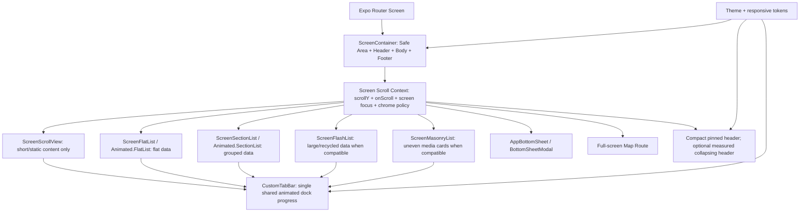

# NEEV — Screen Container, Scroll System, Dock, Lists, Layout and Performance Master Implementation Prompt

**Purpose:** This is an execution contract for Antigravity, Gemini, and all coding agents working in the existing Neev React Native / Expo repository. It is not a proposal for a new app. Agents must inspect the live repository, implement the architecture, migrate every affected screen, run checks, profile a release build, fix regressions, and report only verified results.

**Product quality bar:** production-ready, restrained, polished, accessible, low-latency, reliable on real Android devices, consistent across every screen. No generated-looking emoji or sparkle decoration. Use Neev's real vector emblem and the established product icon set only where icons communicate a meaningful action.

---

## 1. Mission and non-negotiable rules

You are responsible for implementing and verifying a unified screen layout and scrolling system for Neev. Fix the actual code, not just documentation or examples. Do not stop when the dashboard looks better. Audit and migrate every route, modal, tab, settings page, form, directory, detail page, map screen, knowledge screen, schedule screen, and long-content view.

### Non-negotiable rules

1. **Inspect before editing.** Read the repository's `AGENTS.md`, package scripts, Expo config, route tree, installed dependency versions, existing shared UI components, theme tokens, and current changes. Confirm that each code finding in this prompt still exists before changing it.
2. **Preserve the existing product.** Reuse and improve Neev's current `ScreenContainer`, `AppHeader`, `AppText`, `Card`, `SquircleSurface`, `PressableScale`, `CustomTabBar`, `useScrollAwareDock`, theme and route structures. Do not create a parallel design system or duplicate components for the same purpose.
3. **Do not blindly copy BlinkQuest code.** Use BlinkQuest as a visual and interaction-quality reference only. Neev has its own family, map, location, privacy, schedule and household requirements. Do not import BlinkQuest-specific product restrictions that do not belong to Neev.
4. **One vertical scroll owner per screen.** A large list must not be placed inside a parent vertical `ScrollView`. The screen shell must support an external virtualized root without wrapping it in another scroll container.
5. **One canonical scroll-to-chrome hook.** Do not attach both a Reanimated `onScroll` handler and a second JavaScript scroll listener to the same root list to control the header or dock. Horizontal carousels must not hide the bottom dock.
6. **Use the right list for the data shape.** Use `FlatList`, `SectionList`, FlashList, an animated FlatList/SectionList, or FlashList masonry when that specific component fits the screen and is compatible with the installed stack. These are alternatives, not components to nest together for decoration.
7. **No blanket performance props.** Do not blindly set `windowSize`, `initialNumToRender`, `maxToRenderPerBatch`, `removeClippedSubviews`, arbitrary item heights or aggressive clipping. Measure and choose values based on real layouts and release-device results.
8. **No silent dependency upgrades.** Inspect the installed Expo SDK, React Native, Reanimated, Worklets, Gesture Handler, FlashList and bottom-sheet versions first. Use the compatible APIs for those exact versions. Do not upgrade the Expo/RN stack casually to gain one feature.
9. **No dummy implementation.** Never replace a real map, real data, real location state, persistence or interaction with a fake screen, SVG map pretending to be live, placeholder response or success toast. Unavailable integrations must show a truthful, actionable state.
10. **No regression by visual shortcut.** The app must handle Android safe areas, gesture navigation, three-button navigation, keyboard resize, rotation, compact screens, large text, loading, empty, error and offline states.
11. **Profile the real cause.** Capture a baseline before the refactor, then complete a second end-to-end profiling pass after screens are migrated. Do not assume that FlashList alone will solve lag. Measure UI-thread frames, JS work, renders, native layout/measure, memory, SVG surfaces, blur, timers, maps and network/storage churn.
12. **Finish the task.** Do not return another plan as the deliverable. Make code changes, update the repo's existing task tracker/docs, run available checks, fix their failures, and provide a factual evidence report. If generation/context stops, leave a durable checkpoint with completed files, current failures and the exact next action. Do not claim unverified work passed.

### Product visual direction

- Pista/sage foundation: `#7D8C7D`; use the project's canonical theme tokens for surfaces, ink, borders, states and dark/light behavior.
- Keep headers compact and predictable. A screen title should establish hierarchy, not consume a quarter of the viewport.
- Use consistent spacing, responsive typography and the existing squircle language across surfaces.
- Avoid gratuitous glow, blur, shadows, bouncing animations, gradient decoration, arbitrary colored icon tiles, emoji and repeated cards inside cards.
- Animate only interactions that benefit from movement. Respect reduced motion. No forever-running decorative loop when the app is backgrounded or the component is not visible.
- Every control must have one obvious purpose, a working action, a clear disabled/loading/error state and appropriate accessibility labels.

---

## 2. Repository discovery and initial evidence

Before editing, record the real paths and versions for:

- `src/components/ui/ScreenContainer.tsx`
- `src/components/ui/AppHeader.tsx`
- `src/components/ui/CollapsingHeader.tsx`
- `src/components/ui/AppText.tsx`
- `src/components/ui/Card.tsx`
- `src/components/ui/SquircleSurface.tsx` and any `Squircle` equivalent
- `src/components/navigation/CustomTabBar.tsx`
- `src/components/navigation/useScrollAwareDock.ts`
- route layouts and every screen using `ScreenContainer`
- all list components and any existing list hooks
- all bottom sheets, modals and form screens
- `src/components/location/FamilySanctuaryMap.tsx` and map route(s)
- theme/layout/typography tokens
- installed performance/crash-reporting tools and current scripts.

Use the repo's own instructions for package manager and commands. The source excerpts supplied in chat are evidence to investigate, not a guarantee that every live file is identical.

### Findings already visible in supplied excerpts — verify each one

1. `ScreenContainer` wraps every `scrollable` screen in `Animated.ScrollView`. This makes any long `.map()`-rendered list mount all entries and encourages nested vertical scroll containers when a screen is switched to FlatList/FlashList.
2. Knowledge and Schedule pages render arrays of entries/events with `.map()` inside that page-wide scroll area. Family page renders member cards and family bridges with `.map()` inside a page-wide scroll area. For large datasets, these should become the appropriate virtualized root or an honestly bounded static view.
3. The Family screen combines realm selection, map, cluster filters, member directory, bridge cards and multiple complex native `Modal` forms in one screen component. This increases render coupling and makes long modal content and keyboard handling fragile.
4. `CollapsingHeader.tsx` calculates `headerContentTop` with a 46-point control offset while the toolbar constant is 52. Verify overlap and top spacing; derive dimensions from a single geometry source instead of competing literals.
5. `AppText` appears to normalize a resolved font size even though `SetuTypography` already calls `normalize()` when defining tokens. That can apply scaling twice. Verify the actual active code and eliminate double normalization.
6. `SquircleSurface` and `Squircle` use layout state to learn dimensions and draw SVG paths. If many cards/badges/buttons fall back to one SVG path each, mounting and layout can become expensive. Profile this on-device before choosing a replacement.
7. `AnimatedNeevLogoIcon` includes a repeating nine-second animation loop. Ensure it pauses while the app is inactive, off-screen or the containing tab is not visible, and that its animation is not needlessly active during map/list scrolling.
8. The dock exposes both a Reanimated worklet path and a JS `useScrollAwareTabBar` path. Audit all callers for duplicate scroll handling and multiple sources of truth.
9. The map component excerpt uses module-time `Dimensions.get()` and a fixed compact map height. Make dimensions respond to orientation/window changes and provide a real full-screen map route where intended.
10. Several Family page dialogs use a native `Modal` with unconstrained `View` content. Verify keyboard, long form and compact device clipping. Complex sheets need a reusable, scrollable sheet implementation or full-screen route.
11. The existing Family screen has code paths that display status/success language around invitation sync, realm creation and bridge management. Verify persistence and backend acknowledgement before presenting an operation as complete. Do not represent a local optimistic mutation as server confirmation.

Add further concrete findings after inspecting the repository. Do not stop at this list.

---

## 3. Target layout architecture

Create one shared screen shell, one scroll event system, one dock geometry source, a small set of root-scroll adapters, one reusable sheet abstraction, and one responsive layout/typography system.



### The shell must not force a scrolling strategy

`ScreenContainer` should own layout and chrome, not every screen's vertical scrolling. Add an explicit scroll ownership API or equivalent architecture. Backward-compatible screens may initially use the old `scrollable` prop, but migrate them deliberately and remove ambiguity after the migration.

Use an explicit intent such as:

- `scrollMode="shell-scroll-view"`: shell owns an `Animated.ScrollView`; only short/static content, policy/legal screens, compact forms and settings pages that genuinely contain limited content.
- `scrollMode="external"`: shell provides a bounded flex body and scroll context; its direct content is the one root `FlatList`, `SectionList`, FlashList or masonry list. No parent vertical ScrollView.
- `scrollMode="none"`: fixed layouts, map overlays or other views whose children do not scroll vertically.

Adapt the exact naming to the existing codebase. Do not leave two equally authoritative APIs that permit accidental nesting. Make the external body `flex: 1` and bounded. Audit every parent for a missing `flex: 1` / `minHeight: 0`-equivalent layout constraint.

### Recommended default header behavior

- Default all standard routes to a compact pinned header.
- Support a measured collapsing large title only as an explicit opt-in when it improves a specific screen.
- Do not render the large title twice: one copy in the pinned header and another in the list header.
- Keep back and right-side actions reachable throughout scrolling.
- Keep title alignment stable when optional actions appear/disappear. Measure the available side widths correctly and handle a narrow device, long localized title, subtitle, back button and two action buttons.
- The content must start below the actual toolbar height + safe area exactly once.
- The sticky bar can use a subtle surface/hairline change after scrolling. A real-time blur on every Android header is not required for the design and must not be used if it hurts performance.

### Header mode rules

- `compact`: small pinned title, optional concise subtitle, no oversized expanded title.
- `collapsing`: only for a screen intentionally designed for it; use the same root scroll shared value and a list header if virtualization is used.
- `none`: full-screen map/camera/media routes where a custom accessible overlay owns the controls.
- `custom`: special layout, but it still gets shared safe-area and footer/inset helpers.

Do not make “hide all headers while scrolling” the default. A compact pinned toolbar is the stable default; dock auto-hide is a separate option.

---

## 4. Canonical scroll hook and dock behavior

Implement one hook (for example `useScreenScrollController`) and one context API. The shell creates the shared `scrollY` value and the handler, and root scroll adapters consume it. Do not create a second independent `lastY`/dock controller in every list component.

### Hook contract

The hook must expose, in a typed way:

- the Reanimated shared `scrollY` value for header effects;
- one root scroll handler usable by the currently supported animated scroll root;
- screen focus/active state, updated through navigation focus/blur lifecycle;
- a declared dock behavior: `always`, `auto-hide`, or `hidden`;
- a way to reset scroll-direction state on focus/route changes;
- reduced-motion-aware handling;
- optionally `scrollToTop` via the underlying list ref, without creating a second scroll owner.

The exact TypeScript handler type must match the installed Reanimated release. Compile it; do not paper over incompatibility with `any`.

### Worklet-level scroll rules

1. Update `scrollY` only inside the Reanimated scroll worklet for animations; never call React `setState` on every scroll frame.
2. Clamp negative bounce/overscroll to zero for chrome decisions, while allowing native physics to work naturally.
3. Record previous Y within the worklet context or one shared value.
4. Return to visible when at the top (approximately 0–24 dp) or after a meaningful upward scroll.
5. Hide the dock only after a meaningful downward delta and after a minimum scroll depth. Use hysteresis so tiny finger movements do not alternate visibility every few pixels.
6. Always reset/show the dock on route focus. Reset the previous offset to the current offset so a stale screen's last Y does not produce a surprise hide on the first event.
7. Ignore scroll events from unfocused routes. Use focus-aware state so retained tabs cannot affect shared chrome while not active.
8. Do not hide the dock for horizontal rails, maps, bottom sheets, short settings/forms, text inputs while the keyboard is open, active selection/drag modes, reduced-motion users, or screens that declare `always`.
9. For short content that does not actually scroll, dock visibility must not change.
10. Make the root scroll component responsible for firing exactly one chrome event stream. Do not combine `useAnimatedScrollHandler` with the old JS `useScrollAwareTabBar` on the same list.

### Tab dock implementation constraints

- Keep one authoritative shared progress value for the dock. Keep `dockTarget` only if it is needed to avoid replaying duplicate transitions; otherwise consolidate it.
- Put common dock dimensions and bottom inset math in a small geometry module that both `CustomTabBar` and the screen shell use. Do not import the entire `CustomTabBar` component just to obtain an inset helper; avoid UI component dependency cycles.
- Tab-bar height, safe-area bottom padding, floating tablet behavior and content clearance must derive from that shared geometry. Do not add the inset in the screen shell, its list, a footer and an individual page simultaneously.
- `always` is the safe default; `auto-hide` must be selected explicitly for discovery/feed/list experiences where it improves focus.
- On tab change/focus: cancel stale transitions if necessary, show the dock, reset scroll-direction tracking and keep touch targets reachable.
- Do not animate path geometry on every frame. Precompute/memoize dock paths on meaningful width changes; animate transform/opacity/scale only.
- Audit the centre orb's 60 dp geometry, tab slots, wave path, labels, safe-area bottom, tablets, landscape and the compact 320–360 dp phone range. Do not accept a pretty dock if it overlaps list content.
- Use real Neev branding; preserve the existing vector logo. Its playful emotion should be subtle, finite/visibility-aware and reduced-motion-safe, not an always-running GPU tax.

---

## 5. Choosing root scroll components

Use one root vertical scrolling component per screen. The following are reusable options and selection rules, not a mandate to stack every list library in every route.

| Data/content | Root component | Rules |
|---|---|---|
| Short settings/legal/about/form with limited children | `Animated.ScrollView` wrapper | Fine for modest finite content. Bound it with `flex: 1`; forms must work with the keyboard and dynamic text. |
| Flat list of members, recipes, events or search results | `FlatList` or `Animated.FlatList` | Use stable keys, memoized row component, list header/footer/empty states, and functional `extraData` only when required. |
| Rows grouped by month, event day, category or relation type | `SectionList` or compatible animated SectionList | Prefer sections over hand-built `.map()` groups inside a parent ScrollView. Use stable section keys and compact section headers. |
| Large frequently updated/recycled directory, timeline or media list | FlashList if the installed version and New Architecture are compatible; otherwise use the best supported list | Measure release performance. Follow the installed version's recycling/state rules. Do not switch for branding alone. |
| Unequal-height photos/media tiles | Compatible FlashList masonry or the existing maintained masonry list | Verify the API against the installed major version. Keep aspect ratios and row state stable. Do not use masonry for equal-height event/task rows. |
| One small horizontal filter rail inside a vertical root | Horizontal `ScrollView` or horizontal list | Allowed. It must not control vertical dock visibility. Keep chips reachable and avoid clipping. |
| A short nested task checklist inside one event card | A small mapped group can be fine if its size is bounded | For unbounded tasks, flatten into a dedicated task route or an appropriate root list instead of nesting vertical lists. |

### Do not do the following

- Do not wrap `FlatList`, `SectionList`, FlashList or a masonry root inside `ScreenContainer`'s `Animated.ScrollView`.
- Do not set `scrollEnabled={false}` on a huge virtualized list nested inside an outer ScrollView and claim virtualization is solved.
- Do not place two independently scrollable vertical lists in one screen unless one is a deliberately bounded inner pane with a real product need, an explicit height, tested gesture handoff and clear affordance.
- Do not use `ScrollView` plus hundreds of `.map()` calls because the screen “looks short” on one device.
- Do not use a masonry list for content whose order is meaningful (family tree order, chronological schedule or task sequence) unless product behavior explicitly supports rearrangement.
- Do not wrap every screen in `Animated.createAnimatedComponent` blindly. Use the component supported by the installed Reanimated/list version and test real scroll callbacks, refs, pull-to-refresh, pagination and gesture behavior.

### Animated list policy

- For standard lists requiring UI-thread scroll animations, use the matching animated component from the installed Reanimated version (e.g. `Animated.FlatList` / `Animated.SectionList`) and the canonical hook handler.
- For FlashList, verify its current official Reanimated integration and installed version. If an animated wrapper is required, build and test the wrapper once in the shared list adapter; do not wrap it differently screen by screen.
- If only a simple compact header needs a shadow or hairline, a JS scroll event is not automatically required; prefer a UI-thread handler only when motion is actually driven by scroll.
- For list content that has no animated behavior at all, do not pay animation/measurement complexity just because Reanimated is installed.

### Virtualization and recycled row state

- `keyExtractor` must return stable record identity, not array index for mutable lists.
- `renderItem`, `ListHeaderComponent`, `ListFooterComponent`, `viewabilityConfig`, `contentContainerStyle` and callbacks should be referentially stable when beneficial; do not make a new large data array for every render.
- Each row must subscribe only to the store fields it needs. Avoid a whole-store subscription inside a row.
- Keep `renderItem` cheap. Filter/sort/group data with `useMemo` only when based on stable dependencies and the transformation is non-trivial.
- For fixed-height rows, use `getItemLayout` only when the actual row height is truly invariant under font scaling, accessibility text and wrapping. Do not fake heights.
- FlashList recycles views. Reset per-item local state when the record identity changes or use the installed version's recycling-aware state helper. Never leak an expanded state, swipe offset or draft from item A into item B.
- For mixed row kinds, use the supported item type API where it materially improves recycling.
- Use `ListHeaderComponent` for filters/summary/map teaser and `ListFooterComponent` for pagination/end content. Avoid manually building all rows in the header.
- Provide genuine loading, empty, retry/error and end-of-list states. Do not use an empty array temporarily to fake loading if that destroys scroll position.
- Keep accessibility focus and VoiceOver/TalkBack order correct when recycled cells are reused.
- Measure before tuning `drawDistance` or other FlashList-specific properties. Do not pass `FlatList` props that the installed FlashList version ignores.

---

## 6. Screen migration requirements

### Knowledge Vault

- Keep the category rail horizontal.
- Move the entry collection to the correct root virtualized list.
- Preserve search/filter/pin/expand behavior using stable entry IDs.
- Use a memoized row component; avoid rerendering every entry when one pin changes.
- A recipe/story row may show a concise excerpt with a dedicated detail or expansion state. Ensure expansion changes height naturally and is correctly reset for recycled rows.
- Keep the Add Knowledge action reachable, preferably in a restrained header action or appropriate footer, without duplicating an always-visible CTA after a long list.

### Family Functions / Schedule

- Use a grouped `SectionList` when date/category grouping serves the user; otherwise use a flat or FlashList root. Do not create a list implementation simply to check off a component name.
- Keep category filters horizontal, not a nested vertical list.
- Event task previews should be bounded. Long task collections belong in a dedicated task list/details screen.
- Replace arbitrary default dates and fixed assignee IDs with valid form defaults and actual member selection. Validate dates/time in the user's local timezone.
- The weekly real-life game feature should be a reusable section, not a fake virtual game score or hardcoded success state.

### Family directory/network

- Use a root list or `SectionList` for members, clusters and bridges. Consider distinct sections in one SectionList with a `ListHeaderComponent` for active family summary, privacy scope and cluster filter; avoid a massive parent ScrollView around all member cards.
- Extract family member card, cluster chip, bridge card, invitation flow and kinship editor into memoized, reusable components. Keep mutations and form state close to the flow that owns them.
- Use a real member/profile ID. Do not infer identity by substring matching a name or set placeholder phone strings such as “Claimed (Verified)”.
- Never announce an invite, bridge or realm is synced until the operation actually succeeds. Handle offline/pending/retry distinctly from success.
- Maintain the independent family-tree/realm privacy boundaries. A virtualized list is not a privacy boundary: the authorized dataset itself must be scoped before render.

### Dashboard

- Small finite summary modules can stay in a ScrollView if there is a real measured benefit; frequently growing task/event collections must be virtualized.
- Do not convert a dashboard with 6 meaningful cards into an unnecessarily complex multi-section data model just to use SectionList.
- Prefer `ListHeaderComponent` and section models over nesting several vertical scrolling subcomponents.
- Subscribe to narrow store slices. A clock, location pulse, sync status or live member location must not trigger a full dashboard rerender at high frequency.
- Keep the first viewport useful. No massive hero title, stack of ten cards, or long all-purpose prose block above the first actionable content.

### Settings, About and Privacy Policy

- Settings should be compact, grouped and scannable, using the existing section/list row components.
- Static policy/legal content can be a ScrollView with readable line height, but it must respond to dynamic type and narrow width.
- Settings operations must reflect actual operation results; no fake “cache cleared”, “Google connected” or “sync succeeded” states.
- The About/Privacy wording must accurately reflect current product behavior. Do not claim local-only, encryption, zero tracking, P2P sync or cloud backup unless the implementation proves the claim.

### Forms and detail screens

- Use a scrollable form only when necessary; ensure inputs can scroll into view above the keyboard.
- Use `keyboardShouldPersistTaps="handled"` where forms have buttons inside scroll content.
- Keep primary submit actions pinned when the form is long; only one component may own the bottom inset.
- Validate and display per-field errors. Prevent duplicate submission while pending; keep the button dimensions stable during loading.
- Multi-step family creation, account linking or complex privacy configuration is usually better as a full-screen route than a small sheet.

---

## 7. Bottom sheets, modals and gesture ownership

Create one shared `AppBottomSheet` abstraction based on the bottom-sheet library already installed and compatible with the current Expo/RN stack. If the dependency is absent, compare supported options and choose one deliberately; do not add or upgrade a large dependency before the package/config compatibility check.

### Sheet contracts

- One provider at the correct app root if required by the chosen library; one consistent backdrop, handle, corner radius, surface tone, safe-area behavior, status/navigation-bar behavior and dismiss interaction.
- Use the library's integrated sheet scrollables (`BottomSheetScrollView`, `BottomSheetFlatList` or equivalents) for content inside a gesture-driven sheet. Do not put an ordinary vertical ScrollView inside a sheet and expect gestures/keyboard to work automatically.
- Provide keyboard integration (`BottomSheetTextInput` or the library-required focus/blur integration), explicit Android input mode, and tested resize/scroll behavior.
- Short action picker: compact sheet. A few edit fields: medium/expandable sheet if it fits. Long form, deep workflow, family tree editor, permission explanation or full-screen map: use a full-screen route when a sheet would clip or confuse hierarchy.
- Content may be taller than the device. It must become scrollable, not overflow below the top/bottom edge.
- Support Android back, swipe-to-dismiss where appropriate, backdrop tap, nested horizontal gestures, TalkBack focus, keyboard open/close, orientation, and no-scroll-while-submitting.
- Ensure only the sheet or its inner scrollable owns the active gesture at any moment. Do not add another pan gesture that blocks the list/map by default.
- Close a sheet before navigating to a full screen if that's the clear user flow; prevent multiple sheets from opening on top of each other.
- Use shared design tokens and squircle surface treatment. Avoid a different bespoke native Modal for each screen.

### Native Modal exceptions

A simple blocking confirmation, system picker, or platform-specific permission explanation can use React Native `Modal` when appropriate. It still needs safe-area sizing, bounded content, accessibility labels, back handling and keyboard behavior. Don't leave raw `View` content unbounded just because a Modal animates from the bottom.

---

## 8. Full-screen map and map gesture handling

The compact family map teaser and the full-screen map are different experiences. Build/repair a dedicated full-screen route for map interactions; do not stretch a 220 dp card or SVG mock into a pretend map.

### Full-screen map requirements

- Map surface fills the available window edge-to-edge (respecting system UI and chosen edge-to-edge contract). Controls/labels are overlay siblings with safe-area placement, not part of the measured map viewport.
- Read map implementation and installed native provider before altering it. If there is a genuine map SDK, use its official viewport, camera and gesture APIs. If not, explicitly report what dependency/service is missing; don't simulate roads, location accuracy or Google suggestions using SVG paths.
- Use `useWindowDimensions()` and actual layout callbacks for orientation/split-screen responsiveness. Do not rely on module-time `Dimensions.get()` constants for route sizing.
- Let the real map handle pan, pinch-to-zoom and map scrolling. Overlay buttons should not intercept map gestures except where directly touched. Don't attach a whole-screen Pan gesture above the map.
- Add recenter-to-my-location, zoom controls if the map SDK does not provide adequate native ones, layer/filter toggle if supported, search/nearby results, selected marker details, location permission state, loading/retry/offline state, and accuracy/staleness disclosure.
- Use Expo Router/native-stack's supported full-screen presentation for the installed version when appropriate. Keep a predictable Back action and don't cause unnecessary redirect loops.
- Location sharing must be consent-based, scoped to a specific person/cluster/family realm, time-limited where appropriate, revocable, and honest about background permission or device-offline limits. Do not broadcast a precise location to everyone connected with a family by default.
- “Find my phone” may ring/locate a paired device only through a working, authorized device capability and permission. GPS cannot identify which cushion/sofa holds a phone. Do not invent indoor pinpoint accuracy, radar distances, exact placement, ratings, routes or places.
- Separate the map's high-frequency location updates from the rest of the screen's React state. Quantize updates only for display, preserve source accuracy/timestamps, and avoid one state update per location sample across all markers.
- If map tiles/network are unavailable, show a truthful map/network error, last-known location age or offline mode; do not render fake live data.

---

## 9. Responsive typography and zero overflow

Audit the type system once, then migrate all screens to it. Do not patch every screen with arbitrary smaller hardcoded font sizes.

### Typography requirements

1. Pick one normalization strategy. Do not normalize in both theme token construction and `AppText`.
2. Use `useWindowDimensions()` for runtime layout, rotation and foldable/split-screen changes. Do not calculate all font/layout scaling from `Dimensions.get()` once at module import.
3. Keep typography tokens semantic (`display`, `h1`, `h2`, `h3`, body, body medium, caption, label, button). A `display` title is reserved for intentional hero moments; standard screens use compact title tokens.
4. Include device `fontScale` / platform font-size accessibility behavior. Do not block larger text with an arbitrary restrictive multiplier to preserve the screenshot.
5. Do not use `adjustsFontSizeToFit` as a universal overflow fix. Prefer wrapping, `flexShrink: 1`, `minWidth: 0` where applicable, and a deliberate two-line title policy.
6. Long titles/subtitles, family names, relation labels, translations, event locations and chips must wrap or truncate in a predictable way. No text should stretch a row beyond the viewport.
7. Standardize line-height ratios, label weights, letter spacing and spacing tokens. Avoid tiny 9–10 sp content for essential actions. Captions must remain readable.
8. Test the smallest supported Android width and at least 1.0×, 1.3× and 1.5× system font scaling. On a small screen, the design may become taller; it must not become clipped.
9. Avoid fixed heights on text-bearing cards/rows unless the content is truly fixed and font accessibility is accounted for.
10. Use the theme for all text/surface colors. Avoid one-off literal grey, green or red values except where required by a documented status token.

### Overflow audit for every route

Check:

- horizontal clipping at 320–360 dp widths;
- right actions colliding with the title;
- chip/filter rails clipping the active pill;
- two-column forms crushing text inputs;
- tags wrapping outside cards;
- long relation and cluster names;
- cards with zero `minWidth: 0` / `flexShrink` on a child row;
- header text under the status bar or behind the pinned header;
- footer/buttons behind dock/navigation insets;
- modal content clipped by keyboard, compact screen or large text;
- drawer content extending beneath system bars;
- full-screen map controls under cutouts;
- rotation/orientation changes;
- dynamic text layout invalidating assumptions in `getItemLayout` or masonry cells.

Use a repeatable route checklist and fix shared causes in common components first.

---

## 10. Squircle consistency without a performance regression

“Squircle everywhere” means one coherent corner language and silhouette, not adding multiple custom SVG painters around every piece of text.

- Use the existing `SquircleSurface` / `Squircle` / `Card` and radius/smoothing tokens as the canonical component set.
- Use squircle surfaces for important cards, buttons, sheets, badges and interactive surfaces where the effect is meaningful. Use the matching canonical radius shape for list rows and high-volume cells without creating multiple nested squircle painters.
- Ensure `Card` does not wrap another `SquircleSurface` needlessly. Avoid Card-inside-Card unless it communicates hierarchy.
- Determine whether the native Android squircle view is actually registered in release builds. If the SVG fallback is used, profile its impact when hundreds of cells mount.
- Prefer one native/surface draw per visible card. Don't render several full-size `Svg` trees or use SVG paths merely to paint simple high-frequency list row backgrounds.
- If simplifying the fallback, preserve the established silhouette as closely as the platform allows. Document the tradeoff and do not introduce inconsistent square cards as a shortcut.
- Cache/memoize pure squircle path math where possible. Avoid repeated layout state changes when width/height are unchanged (existing code attempts this; verify it works under real item recycling).
- Avoid unnecessary shadow + clipping + blur combinations; Android shadow clipping and blur layers can force expensive compositing.
- Squircle components must preserve ordinary View layout semantics: `flex`, width, min-height, margin, gap, `alignItems`, `justifyContent`, accessibility and pointer events must work on the same outer view.
- Verify measurement and touch bounds after orientation and width changes; never let vector artwork intercept touches.

---

## 11. Animation, gestures and app lifecycle

Use Reanimated for interaction-driven movement that benefits from the UI thread, not to animate every property on every screen without a design reason.

### Reanimated requirements

- Verify the installed Reanimated/Worklets configuration and Expo plugin/Babel requirements for the current SDK. Do not mix incompatible Worklets copies or upgrade one package independently.
- Use shared values and worklets for root scroll, dock motion, collapsing header, press feedback and map/gesture feedback where appropriate.
- Do not bridge per-frame updates to JavaScript through `runOnJS` for ordinary scrolling. Bridge only meaningful discrete events.
- Memoize gesture objects only when required by the installed Gesture Handler patterns; avoid recreating gestures/handlers every React render when it causes cancellation or jumpiness.
- Keep one gesture owner for a touch sequence. Compose simultaneous/exclusive/failure relationships deliberately for sheets, horizontal rails, maps and swipe rows.
- Respect `useReducedMotion`, user preferences and app lifecycle. Cancel/restore animation values on unmount, route change and app background.
- Avoid layout animations on every list row when a list data set changes in bulk. Animate insert/remove only where stable, performant and accessible.
- Avoid expensive blur and multiple animated SVG paths inside every visible cell.
- Test rapid direction changes, fling, pull-to-refresh, scroll momentum, screen transition during scroll, open/close sheet mid-gesture, Android back and interruption of animations.

### Continuous animation rule

Neev's animated logo can feel warm and expressive, but it must not run a permanent 9-second loop when the app is backgrounded, a screen is not visible, reduced motion is enabled, or the user is actively scrolling a dense view where the animation is distracting. Pause it through app state / focus and resume safely; never create a new interval or animation loop per list row.

---

## 12. Diagnose and fix actual lag, heat and jank

Do not claim “optimized” based on source appearance, dev-mode scrolling or one successful build. Use baseline and post-fix measurements on a real Android device, in release mode, with a representative family dataset.

### Profile before and after

Capture the same user journeys before and after changes:

1. cold launch → onboarding/auth routing → dashboard ready;
2. switch all bottom tabs repeatedly;
3. scroll dashboard to bottom and back quickly;
4. filter, expand, pin and refresh Knowledge rows;
5. scroll a large Family directory and bridge list;
6. change Schedule filters and toggle event tasks;
7. open/edit/save/close every complex sheet and keyboard form;
8. open full-screen map, move/zoom, select markers and close;
9. background/foreground the app with animations/location enabled;
10. navigate away mid-request and return.

Record: device/build/version, cold start time, screen transition time, JS FPS/CPU where available, UI frame/jank statistics, React render counts for high-impact screens, memory/heap trend, native allocations, network/persistence request counts, battery/thermal behavior over a repeatable session, crash and JS error output. Compare same route/data/device/build type. Never compare debug performance with release performance as if they were equivalent.

### Likely cost centres to test (not assume)

- Parent `Animated.ScrollView` rendering all row components.
- Broad Zustand selectors causing dashboard/page-wide rerenders.
- Filtering/sorting entire arrays on every keystroke or live update.
- SVG-based `SquircleSurface` mounted throughout lists, causing layout-state + SVG path work.
- Multiple BlurViews, clipping and shadows composited inside scrolling lists.
- Continuous animated logo, gesture subscriptions, intervals and location timers while offscreen/backgrounded.
- Multiple root/inner vertical scroll views and gesture responders fighting.
- Map/location streams triggering React renders for every family marker on every GPS sample.
- Multiple React Query/local-store sources of truth that update the same screen independently.
- Sync loops, retries, notifications or location tasks that never stop after route/app state changes.
- Expensive work during mount/route transition instead of after interactions.
- Fonts loading twice, startup redirects that mount screens only to redirect again, and repeated bootstrap/network setup.
- Layout thrash due to a `onLayout` state loop or unstable `contentContainerStyle`/props.
- Giant icon/image/SVG assets or unbounded image decode caches.

### Optimize in this order

1. Fix root scroll ownership / virtualization and first-render work.
2. Remove accidental state subscriptions and duplicate scroll handlers.
3. Eliminate expensive per-row surfaces/layers only when profile confirms cost.
4. Pause non-visible animation, timers and location subscriptions.
5. Correct navigation/bootstrap, cache/network and render ownership.
6. Tune list batch/window/recycling parameters only from measurements.
7. Tune map marker/render strategy and high-frequency state separately.
8. Re-profile each identical journey and document before/after evidence.

Do not hide a profiler warning or suppress a crash to improve a metric. Fix the root cause.

---

## 13. Crash, navigation and state correctness

- Check every ErrorBoundary path and ensure error recovery does not loop back into the same broken screen indefinitely.
- Check auth/onboarding guards and route restoration so they do not redirect repeatedly or remount the dashboard unnecessarily.
- Ensure `ScreenContainer` doesn't change tree shape on every tiny state change.
- Keep bootstrap idempotent. Register listeners, focus observers, timers and subscriptions once per intended lifecycle and clean them up.
- No screen-level catch block may silently route away while dropping the useful error. Report safe user-facing errors and capture details in crash reporting without secrets.
- Check `useEffect` dependencies and stale closures. Use `useFocusEffect` only for focus-bound work and memoize its callback. Cancel or ignore async results when the screen blurs/unmounts.
- Check state updates after unmount, duplicate submit actions, duplicate navigation, lost form draft, stale list selection and recycled component state leaks.
- Keep tokens/secrets out of route parameters, console logs and analytics. Do not reveal family/private information in crash metadata.
- Use error boundaries as recovery paths, not a substitute for fixing errors.
- Run app startup, route transitions and Android back tests after the layout refactor.

---

## 14. Required implementation files and ownership

Adapt paths to the real repository. Prefer editing the existing canonical files over creating another component with nearly the same name.

| Responsibility | Desired owner |
|---|---|
| Screen shell / safe-area / pinned header / footer | Existing `ScreenContainer.tsx` |
| Header modes / dimensions / title alignment | Existing `AppHeader.tsx` + `CollapsingHeader.tsx` |
| Root scroll context and canonical scroll controller | One small module under `components/ui` or `hooks` |
| Static scroll root | Existing screen wrapper or `ScreenScrollView` |
| Flat/section/FlashList root adapters | One shared list module directory |
| Shared dock visibility state and hook | Existing `useScrollAwareDock.ts`, with only one event path |
| Dock dimensions + inset calculations | One geometry helper shared by shell and dock |
| Reusable bottom sheet provider/shell | One shared `AppBottomSheet` abstraction |
| Font tokens / normalization | One canonical typography module and `AppText.tsx` |
| Squircle shape/render strategy | Existing `SquircleSurface.tsx` / `Card.tsx` |
| Responsive breakpoints / gutter | Existing `theme/layout.ts` or its canonical successor |
| Screen inventory and acceptance evidence | Existing repo task tracker, not a parallel tracker |

Do not mechanically create every proposed path if the repository already has a canonical equivalent. Record the ownership decision in the existing docs/tracker.

---

## 15. Required hook/component contracts

The final implementation should provide equivalent behavior to the following conceptual API, adapted to installed versions and existing conventions:

```tsx
<ScreenContainer
  header={<AppHeader title="Knowledge Vault" rightAction={...} />}
  scrollMode="external"
  headerMode="compact"
  dockBehavior="auto-hide"
>
  <ScreenFlashList
    data={entries}
    keyExtractor={(entry) => entry.id}
    renderItem={renderEntry}
    ListHeaderComponent={<KnowledgeFilters />}
    ListEmptyComponent={<KnowledgeEmptyState />}
  />
</ScreenContainer>
```

For a static form:

```tsx
<ScreenContainer
  header={<AppHeader title="Record Knowledge" showBack />}
  scrollMode="shell-scroll-view"
  dockBehavior="always"
  footer={<AppButton title="Save" onPress={save} loading={saving} />}
>
  <KnowledgeForm />
</ScreenContainer>
```

For a full-screen map, don't place a list/ScrollView around the map. The shell should provide safe-area-aware overlays while the map owns the viewport and map gestures.

### Required guarantees

- `ScreenContainer` external mode renders no ScrollView or list around its direct root list.
- Exactly one root vertical list receives the screen's chrome scroll handler.
- The compact header stays visible unless the screen explicitly declares another behavior.
- Bottom clearance is calculated and applied once.
- A sheet uses its integrated list/scroll component instead of accidentally inheriting the screen's root scroll handler.
- Horizontal rails do not affect root scroll tracking.
- The root list has bounded height and can actually scroll.
- Screen blur/focus restores and resets the dock state.
- Header/dock update animations run on the UI thread and don't cause per-frame React state changes.

---

## 16. Responsive geometry and safe areas

- Use `SafeAreaProvider`/`useSafeAreaInsets` consistently; do not mix two independent top-inset implementations.
- A header either owns the top safe area or the container does—never both.
- Each route declares its body/content padding responsibility. A parent must not add a gutter if the virtualized list already adds the same gutter.
- Put all dock dimensions and computed lower clearance in one helper. The footer and list body must know whether the dock is present.
- Pinned footers on screens with no dock must include bottom safe-area padding. Pinned footers on a tab page must not overlap the dock; choose one coherent dock/footer rule.
- Ensure `flex: 1` continues through every parent to a scroll root. A ScrollView/list needs a bounded viewport.
- Prefer `useWindowDimensions` for orientation/width changes. Re-measure custom SVG/native surfaces when width changes without setting state on every redundant `onLayout`.
- Avoid using raw window height to calculate arbitrary fixed sheet/map height when safe-area, keyboard and split-screen change the usable content area.

---

## 17. Quality gates and test plan

### Static/runtime checks

Run the repository's actual scripts, likely including (only if present in its package scripts):

- typecheck / TypeScript compilation;
- lint;
- existing unit/component tests;
- Expo config/doctor check;
- Android release build with the repository-approved Gradle command;
- installation and launch on a real Android device;
- JavaScript/native crash log review.

Do not invent scripts. Do not run two Gradle builds simultaneously. Respect repo instructions about generated Android directories and lockfile/dependencies.

### Layout matrix

Test every migrated screen at minimum across:

- compact Android phone (about 320–360 dp width);
- typical phone (about 390 dp width);
- larger phone and/or tablet layout;
- portrait plus orientation change if the app supports landscape;
- normal and larger system font sizes;
- gesture navigation and three-button navigation where available;
- keyboard open and closed;
- offline/error/loading/empty/data-rich states.

### Gesture matrix

- normal swipe and fast fling;
- reverse direction near top/middle/bottom;
- pull to refresh;
- horizontal filter rail nested in a vertical root;
- sheet drag vs inner list scroll;
- keyboard open while scrolling fields;
- map pan/pinch with overlay controls;
- dock hide/show while tabs are retained;
- Android back with modal/sheet/map open;
- navigation during scroll momentum;
- reduced-motion enabled.

### Production acceptance tests

1. No clipped or unreachable control on any route.
2. No unintended same-axis nested vertical scroll root.
3. Long data is virtualized by the correct root component.
4. No row state leaks across FlashList recycling.
5. Header titles are compact and never collide with actions or system UI.
6. Font size does not double-scale and large text remains usable.
7. Every footer/form/list respects dock and safe-area clearance exactly once.
8. All sheets handle long content, keyboard, back, dismiss and accessibility.
9. Full-screen map provides real pan/zoom and honest loading/permission states.
10. Dock does not flicker, disappear unexpectedly or respond to horizontal rails.
11. No new JS exceptions, missing keys, native crashes or infinite rerender loops.
12. Release performance does not regress compared with the recorded baseline; significant improvements are supported by repeatable measurements.
13. Privacy/user data remains correctly scoped. UI visibility is not used as authorization.
14. Existing tests pass or any unrelated pre-existing failure is documented with evidence.
15. Tracker and release notes reflect the actual state. No “complete” label on anything not verified.

---

## 18. Mandatory delivery report

At the end, provide:

- exact files changed and why;
- screen-by-screen migration status;
- list root chosen per screen and why;
- removed duplicate scroll/gesture/blur/animation paths;
- typography and squircle rendering changes;
- bottom sheet/map route changes;
- commands run and their actual exit results;
- device/build used for performance verification;
- before/after figures for the same repeatable journeys where available;
- crash or runtime issues fixed;
- issues not finished, with the actual reason and next exact action.

Do not report estimated performance numbers as measurements. Do not say “all screens verified” after only checking the dashboard. If any screen has not been tested on device, label it `IMPLEMENTED_NOT_VERIFIED`.

---

## 19. Primary technical references

Use the official docs for the **installed versions** and check migration notes before choosing an API:

- React Native `ScrollView` — `ScrollView` renders all children at once and requires bounded height: <https://reactnative.dev/docs/scrollview>
- React Native `FlatList` — list headers, empty state, stable key extraction, multi-column behavior and `extraData`: <https://reactnative.dev/docs/flatlist>
- React Native `VirtualizedList` — virtualization tradeoffs and row state lifecycle: <https://reactnative.dev/docs/virtualizedlist>
- Reanimated `useAnimatedScrollHandler` (4.x docs): <https://docs.swmansion.com/react-native-reanimated/docs/scroll/useAnimatedScrollHandler/>
- FlashList usage / recycling (2.x docs): <https://shopify.github.io/flash-list/docs/usage/>
- FlashList masonry (2.x): <https://shopify.github.io/flash-list/docs/guides/masonry/>
- Expo Router modals: <https://docs.expo.dev/router/advanced/modals/>
- React Navigation `useFocusEffect`: <https://reactnavigation.org/docs/use-focus-effect/>
- Bottom Sheet keyboard behavior: <https://gorhom.dev/react-native-bottom-sheet/keyboard-handling>
- Bottom Sheet integrated scrollables: <https://gorhom.dev/react-native-bottom-sheet/scrollables>

FlashList v2 requires the React Native New Architecture. If the app's exact RN/Expo/new-architecture setup is incompatible, do not force an incompatible upgrade; use the best compatible list now and document the reason. Revalidate current official compatibility notes before adding/upgrading any package.

---

## 20. Final instruction to the coding agents

Start by inspecting the actual repository and measuring the current experience. Then implement the shared shell/scroll/dock architecture, migrate the screens using it, fix responsive typography and surface rendering, standardize sheets, make the full-screen map route behave correctly, and run the final release-device profiling pass. Continue after the first passing build: that is a checkpoint, not completion.

Keep a durable task checkpoint as each subsystem is completed. Do not abandon partially changed files when context is limited; record the last successful command, the current failure, the modified file list and the next exact action before continuing. Do not fabricate tests, screenshots, metrics or service capabilities. The task is complete only when the implementation, runtime verification and evidence-based report are complete.
