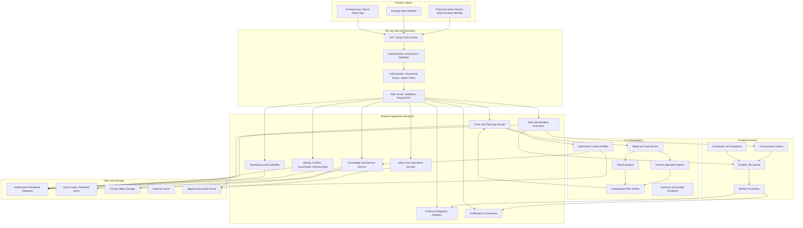
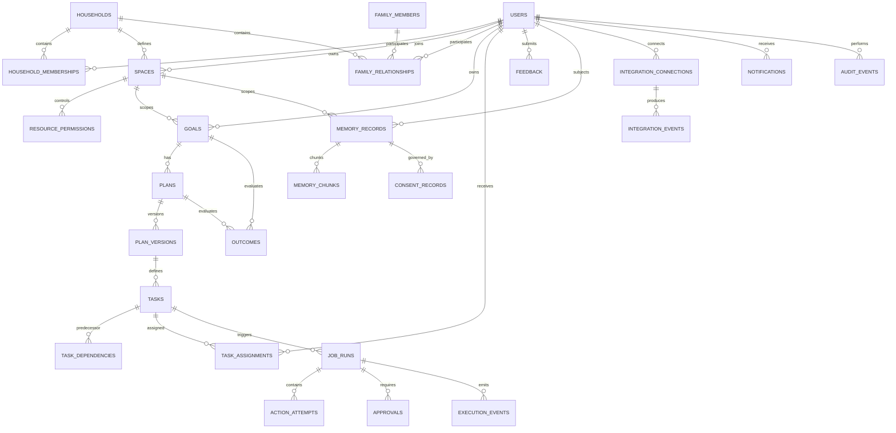
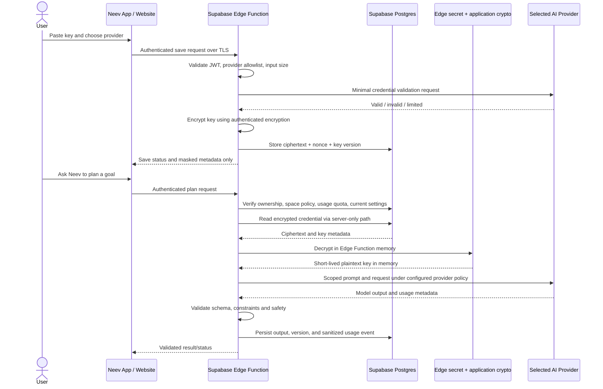
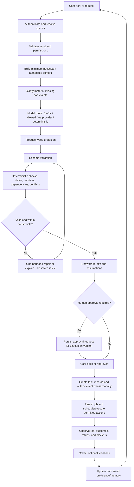
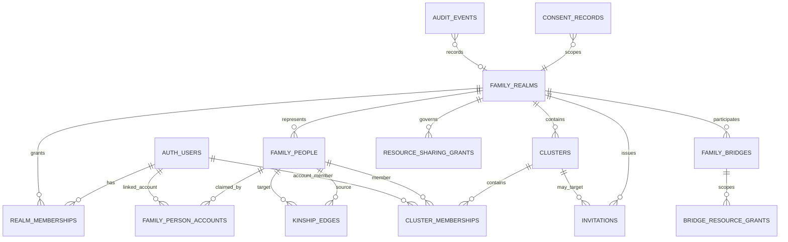

# Neev — Complete Family Operating System
## Master Architecture, Infrastructure, Data Model, AI Agents, Execution Engine, Admin Console, and Implementation Specification

**Document type:** Canonical engineering and product specification  
**Product:** Neev — Private Family AI Operating System  
**Status:** Supabase-only target architecture and repair specification; actual implementation status must be verified against the repositories  
**Primary clients:** Existing Expo / React Native mobile app and existing Neev website  
**Architecture goal:** One coherent product with secure family collaboration, personal privacy, verified planning, durable execution, and continuous improvement  
**Implementation rule:** Inspect and extend the real codebase. Do not assume a documented feature already works.

---

## 1. Product Vision

Neev is a private Family Operating System that helps individuals and multi-generational households understand what matters, make better decisions, create realistic plans, execute them, handle changes, and learn from outcomes.

Neev is not merely a calendar, task manager, chatbot, or plan generator. It connects goals to real-world execution.

The product should help with:

- Personal growth, career development, interview preparation, learning, and deep work.
- Household responsibilities, routines, shopping, meals, and shared decisions.
- Children’s learning plans, school deadlines, projects, and family coordination.
- Family events, festivals, cultural traditions, travel, holidays, and celebrations.
- Elder care coordination, appointments, reminders, and caregiver workload visibility.
- Family knowledge, oral histories, heirloom recipes, memories, and traditions.
- Personal and family goals, habit formation, progress reviews, and retrospectives.
- Scheduling around availability, travel time, effort, budgets, deadlines, dependencies, and changing circumstances.

Neev must help people act, not simply produce attractive recommendations.

### 1.1 Product outcome

For any supported goal, Neev should be able to:

1. Understand the goal and why it matters.
2. Identify the people, spaces, constraints, and resources involved.
3. Retrieve only information the requesting user is authorized to access.
4. Clarify missing or ambiguous information.
5. Build a realistic, dependency-aware plan.
6. Validate the plan against dates, availability, effort, costs, permissions, and external facts.
7. Explain assumptions, trade-offs, uncertainty, and alternatives.
8. Obtain approval for consequential actions.
9. Convert approved plans into durable tasks and scheduled actions.
10. Execute permitted actions through reliable integrations.
11. Track progress and detect failures or changed conditions.
12. Notify the right people without creating notification fatigue.
13. Collect feedback and compare planned outcomes with actual outcomes.
14. Improve future recommendations through consented, explainable learning.

### 1.2 Non-goals

Neev must not:

- Pretend that a generated plan is verified or executed.
- Fabricate availability, prices, travel durations, health measurements, or completion statuses.
- Autonomously make high-impact family, medical, financial, educational, or legal decisions.
- Expose personal information to household members by default.
- Send emails, create meetings, make bookings, spend money, or share sensitive data without the required authorization and confirmation.
- Require an LLM for deterministic calculations that can be implemented and tested with ordinary code.
- Add agents, databases, queues, microservices, or infrastructure solely for architectural appearance.
- Promise unlimited free inference, storage, uptime, or redundancy.

---

## 2. Repository Reality and Implementation Contract

This specification defines the intended destination, not a claim about the current code.

Before changing code, the implementation agent must inspect the actual repositories and determine which components already exist, which are incomplete, and which are absent.

### 2.1 Required discovery

Inspect:

- `AGENTS.md` and all applicable repository-specific instructions.
- `README.md`, `CORE.md`, architecture documents, product requirements, and existing task ledgers.
- Git status, current branch, recent commits, diffs, and uncommitted user changes.
- Mobile application routes, state stores, API clients, local persistence, notification handling, and design system.
- Website routes, server/client boundaries, session handling, API integration, existing administrative surfaces, and deployment configuration.
- Authentication providers, account models, environment variables, and callback/deep-link flows.
- Existing Firebase, Supabase, Firestore, PostgreSQL, vector-store, storage, and analytics integrations.
- Existing database schema, migrations, access policies, indexes, triggers, and seed data.
- Existing AI clients, prompts, model routing, retrieval logic, tool calling, workflows, and evaluation tests.
- Background jobs, scheduled functions, retry mechanisms, idempotency controls, and notification delivery.
- Google Calendar, Tasks, Meet, Health Connect, or other integrations that actually exist.
- Build, lint, type-check, unit-test, integration-test, and deployment commands.
- Secret management, CI/CD, observability, backups, and recovery procedures.

Do not assume that a file, route, integration, feature, dependency, schema, or environment variable exists merely because this document mentions it.

### 2.2 Change safety

- Preserve legitimate uncommitted work.
- Do not reset, clean, overwrite, or delete files blindly.
- Do not upgrade major dependencies without evidence and a specific compatibility reason.
- Reuse existing working modules when their behavior and boundaries are sound.
- Search for existing implementations before creating new ones.
- Keep mobile, website, and infrastructure changes compatible with the actual installed versions.
- Never commit credentials, private keys, access tokens, service-account files, or production data.
- Do not commit or deploy unless explicitly authorized.
- Record important verification evidence and remaining blockers in the repository’s established tracking mechanism.

### 2.3 Evidence-based status

Every feature must be classified as one of:

- **Verified:** implementation exists and relevant tests or runtime checks passed.
- **Implemented, unverified:** code exists, but sufficient tests or runtime evidence are missing.
- **Partial:** some user-visible or backend behavior exists, but the end-to-end contract is incomplete.
- **Missing:** no meaningful implementation exists.
- **Blocked:** cannot be completed because of a specific external dependency, permission, credential, or unavailable capability.
- **Not applicable:** justified by the actual product and repository.

Documentation, screenshots, and mock data are not proof of functional completion.

---

## 3. Architecture Principles

1. **Privacy by default:** private personal information remains private unless explicitly shared.
2. **One authoritative owner per data domain:** avoid conflicting sources of truth.
3. **Local resilience:** core screens and previously available data should remain useful during network interruptions where the existing product supports offline operation.
4. **Durable execution:** background work must survive process restarts and recover from transient failures.
5. **Deterministic first:** use ordinary code for scheduling arithmetic, validation, permissions, dependencies, and state transitions.
6. **AI for ambiguity:** use models for language understanding, synthesis, preference interpretation, and supported reasoning—not as the authority for facts or permissions.
7. **Explicit approval:** high-impact or externally visible actions require the correct human approval.
8. **Tenant isolation:** household membership never grants unrestricted access to every household resource.
9. **Observable operations:** every important job, agent run, integration call, and state transition must be traceable.
10. **Cost awareness:** model selection, retrieval, retries, storage, and background execution must have measurable budgets.
11. **Replaceable providers:** model, embedding, vector-store, and external-service integrations must sit behind stable interfaces.
12. **Incremental architecture:** begin with a modular backend and separate workers where necessary; adopt distributed services only when workload or isolation justifies them.
13. **No fake completion:** external side effects must be confirmed by the provider or clearly marked uncertain.
14. **Accessible design:** mobile and web flows must handle loading, errors, empty states, permission denial, offline state, and recovery.
15. **Testability:** important rules must be testable without calling a paid model or live external provider.

---

## 4. Logical System Architecture



This is a logical architecture. It does not require every box to become an independently deployed microservice.

### 4.1 Recommended initial deployment topology

Start with:

- The existing website and mobile application.
- One secured API/backend deployment, if compatible with the existing stack.
- One authoritative relational database.
- One durable job mechanism appropriate to the hosting platform.
- One worker deployment for background and AI jobs.
- One scheduler/dispatcher, using a platform scheduler or durable scheduling mechanism.
- Private object storage only for features that need file storage.
- One vector retrieval implementation, initially backed by PostgreSQL with pgvector if the database choice supports it.
- Centralized logs, error reporting, metrics, and audit records.

Separate services only when they need independent scaling, isolation, deployment cadence, or resource profiles.

### 4.2 Control plane and execution plane

**Control plane:**

- Authentication and authorization.
- Household and space policies.
- Configuration and feature flags.
- Model/provider configuration.
- Admin operations.
- Audit logs.
- Cost and rate limits.

**Execution plane:**

- Plan generation jobs.
- Verification jobs.
- Reminder dispatch.
- External integration calls.
- Recurring workflows.
- Knowledge ingestion and embedding.
- Outcome evaluation and feedback processing.

The execution plane must not bypass the control plane’s authorization decisions.

---

## 5. Technology and Provider Decisions — Supabase-Only Backend

**Binding infrastructure decision:** Neev uses Supabase as its only backend platform. This supersedes the generic provider-selection language elsewhere in this document. The application must not introduce Firebase, Firestore, a standalone API server, a second managed database, a separate vector database, Redis, a third-party queue, or a second backend platform as part of this implementation.

The existing mobile and web clients remain the product surfaces. The existing website host may continue serving the existing Next.js website; that does not make it a second application backend. Business data, identity, access control, files, AI orchestration, memory retrieval, scheduled work, and backend-facing APIs belong in Supabase unless a proven Supabase limitation is documented and explicitly approved.

### 5.1 Required Supabase service map

| Capability | Required implementation | Rules |
|---|---|---|
| Authentication | Supabase Auth | One identity provider and one account lifecycle. Use Google OAuth where desired, plus carefully configured email/password or magic-link support. |
| Structured records | Supabase Postgres | Authoritative records, constraints, transactions, migrations, relational integrity. |
| Access control | Postgres Row Level Security (RLS) | RLS on every exposed table; deny by default. Client-side checks are UX only. |
| Vector search | Postgres + `pgvector` | Vectors live with source metadata and visibility. Re-check authorization before returning context. |
| Private documents/media | Supabase Storage | Private buckets, storage policies, size/type limits, signed URLs only when appropriate. |
| API / business logic | Supabase Edge Functions | Validate JWT, validate input, enforce policy, call AI providers and external APIs. Never expose service-role credentials. |
| Small durable jobs | Postgres job/outbox tables + Supabase Cron (`pg_cron`) | Claim, lease, retry, deduplicate, monitor, and recover work in the database. |
| Invoking scheduled workers | `pg_cron` + `pg_net` -> Edge Functions | Cron secret stored securely; bounded batches and timeouts. Design for duplicate delivery. |
| Server-side secrets | Supabase Edge Function secrets; Supabase Vault where database-side secrets are needed | Never ship secrets to the app or browser. Per-user AI keys are separately encrypted at the application layer. |
| Live UI updates | Supabase Realtime, selectively | Use only for screens that benefit from live updates; do not use Realtime as a durable queue. |
| Backups and migrations | Supabase CLI/database exports + versioned SQL migrations | Free-plan recovery must include tested manual exports; do not assume managed daily backups are included. |
| Admin operations | Protected routes inside the existing Neev website + Edge Functions/Postgres | Admin is a feature area of the current website, not a separate site or backend. |

### 5.2 Client applications

- Keep the actual installed Expo / React Native architecture, routes, navigation, state management, UI tokens, and working features. Confirm versions from lockfiles and package manifests before choosing code examples or dependencies.
- Keep the current Neev website and add/repair authenticated routes within it. Do not create a second admin application.
- Use `@supabase/supabase-js` in the React Native app and `@supabase/ssr` for server-rendered Next.js integration when compatible with the actual installed Next.js version. Confirm the correct session/cookie pattern against the installed library version.
- Only the Supabase project URL and publishable key may be included in client-side configuration. A publishable key identifies the project; **RLS is what protects rows**. Never ship a Supabase secret/service-role key, provider API key, encryption key, cron secret, OAuth client secret, or database password to client code.
- The website must perform sensitive operations through authenticated server-side functions or Edge Functions. A hidden button or protected React route is not a security boundary.
- No client can directly write privileged records such as role changes, family invitations, audit records, approvals, provider secrets, job leases, billing/usage controls, or agent execution results unless the action is explicitly allowed by policy and enforced server-side.

### 5.3 Supabase database and schema strategy

- Use a single Supabase Postgres database for the initial implementation, with schemas and table boundaries organized by domain. Avoid one database per feature.
- Use versioned SQL migrations committed to the repository. Do not make untracked production-only schema edits without adding a migration that reproduces them.
- Use UUID primary keys, explicit foreign keys, check constraints, unique constraints, and indexes based on actual queries.
- Use transactions for state changes that must succeed together, such as accepting an invitation, creating a household membership, approving a plan, or creating a task batch.
- Treat Postgres as the source of truth for goals, plans, tasks, approvals, memory metadata, provider configuration metadata, job state, and audit events.
- Use JSONB for bounded, versioned metadata—not as a substitute for relational schema where constraints or query patterns are known.
- Use database time (`now()` / `timestamptz`) for persisted events. Store user IANA time zone IDs separately; never treat local wall-clock time as UTC without conversion.
- Define retention, export, deletion, and migration paths before storing sensitive family data.

### 5.4 Supabase-only vector retrieval

Neev's first vector store is Postgres `pgvector` in the same Supabase project. Do not add ChromaDB, Pinecone, Qdrant, another hosted vector service, or a separate vector server.

The vector index is a retrieval accelerator—not an authorization authority. Store each chunk's `owner_user_id` and/or `space_id`, household scope, visibility, source record, content hash, embedding model/version, and retention metadata. Query with the smallest required authorized scope, use RLS where applicable, and have the retrieval function revalidate permissions before context reaches a model. Do not make the vector table anonymously readable.

Embedding dimension must match the configured embedding model. Do not hard-code an assumption such as `vector(1536)` until a specific embedding model has been chosen and tested. Store `embedding_provider`, `embedding_model`, `embedding_dimensions`, and `embedding_version` so migration/re-embedding is explicit.

### 5.5 Supabase-only AI runtime

- Implement a small provider adapter layer within Supabase Edge Functions. Do not create a standalone AI backend service for the first production-ready implementation.
- Route each user request through: authenticated request -> input/schema validation -> authorization/context builder -> model policy -> provider adapter -> output schema validation -> deterministic verifier -> persisted result / job -> client response.
- Run short interactive operations synchronously when they reliably fit Edge Function limits. Route long-running tasks through Postgres-backed jobs and scheduled bounded batches.
- Do not build a fleet of independent autonomous agents on day one. Model each specialist as a constrained workflow step with a typed input/output contract, explicit tool allowlist, token/time budget, and verification stage. Prefer a single model call with structured output when that is sufficient.
- Use regular code for dates, dependency ordering, scheduling calculations, authorization, state transitions, and cost/usage arithmetic. Never ask the model to be the database permission system or the final arbiter of facts.

### 5.6 Free-first model strategy and honest cost boundary

Supabase supplies the backend capabilities; it does not supply unlimited AI text-generation or embedding inference. Neev must therefore support:

1. User-owned provider credentials (BYOK) as the preferred path for stronger models.
2. Optional provider free tiers only when their current terms, quotas, privacy rules, and availability are verified. Treat them as changeable capabilities, not a guarantee.
3. Deterministic non-LLM fallback for basic planning, reminders, sorting, checklists, and constraint checking.
4. A provider-disabled mode that keeps core app data, tasks, plans, reminders, profile management, and manual workflows useful without model calls.
5. Usage limits, budget controls, circuit breakers, and transparent user-facing errors when providers are unavailable.

Do not use the term “fully free AI” to imply unlimited model usage. “Free Supabase backend” and “free or BYOK model inference” are two different claims. The app must disclose when a provider charges the user directly through their own key.

### 5.7 Supabase platform limits and operational reality

Supabase's current published Free-plan usage table lists (verify again in the Supabase Dashboard before launch): 500 MB database size per project, 1 GB Storage, 5 GB egress, 50,000 monthly active users, 500,000 Edge Function invocations, 2 million Realtime messages, and 200 peak Realtime connections. The Free plan can pause projects after roughly seven days of low database activity. Free-plan projects should not be treated as high-availability production infrastructure. See the official [billing/quotas page](https://supabase.com/docs/guides/platform/billing-on-supabase) and [free-project pausing guide](https://supabase.com/docs/guides/platform/free-project-pausing); these limits can change.

For the launch design:

- Keep data and document sizes small; avoid storing large media unnecessarily.
- Track usage and warn before limits are reached.
- Export data regularly and test restores.
- Do not promise uninterrupted production availability on a free project.
- Never make spending-money provider calls silently. Enforce per-request, per-user, and per-household limits.
- Do not invent a background always-on worker. Scheduled processing must fit documented Supabase Cron / Edge Function constraints and be recoverable after pauses.

Official references:

- [Supabase React Native Auth guide](https://supabase.com/docs/guides/auth/quickstarts/react-native)
- [Supabase Expo quickstart](https://supabase.com/docs/guides/getting-started/quickstarts/expo-react-native)
- [Securing data and RLS](https://supabase.com/docs/guides/database/secure-data)
- [Google OAuth provider](https://supabase.com/docs/guides/auth/social-login/auth-google)
- [pgvector / vector columns](https://supabase.com/docs/guides/ai/vector-columns)
- [Supabase Cron](https://supabase.com/docs/guides/cron)
- [Scheduling Edge Functions](https://supabase.com/docs/guides/functions/schedule-functions)
- [Edge Function secrets](https://supabase.com/docs/guides/functions/secrets)
- [Database backups](https://supabase.com/docs/guides/platform/backups)

## 6. Identity, Households, and Sacred Spaces

Neev must distinguish an authenticated account, a profile, a family-person record, a family realm/tree, a household, a cluster, a membership, a relationship, a resource-sharing grant, and a space. They are different data and security concepts.

A household is a living arrangement or day-to-day collaboration unit, not necessarily the entire extended family and not a blanket data-sharing permission. The canonical multi-family model and migration guidance are detailed in Sections 45–63. Those sections refine this initial section and supersede any earlier assumption that one flat household must represent every relationship, cluster and privacy boundary.

### 6.1 Sacred Spaces

#### Personal Space

Private to an individual by default:

- Career plans and interviews.
- Personal learning and development.
- Deep-work blocks.
- Private goals and reflections.
- Sensitive notes.
- Personal reminders and routines.

Sharing a Personal Space resource requires an explicit permission or sharing action.

#### Nuclear Space

For an explicitly defined immediate household group:

- School activities and homework.
- Household schedules.
- Shared chores and shopping.
- Family appointments.
- Shared responsibilities.
- Relevant family logistics.

Membership alone does not automatically grant access to sensitive child or health records.

#### Family Sanctuary

For a broader family circle:

- Family events and invitations.
- Traditions and cultural knowledge.
- Shared recipes and memories.
- Family travel planning.
- Pet-care coordination.
- Explicitly shared oral histories and archives.

Each space must support resource-level visibility where required.

### 6.2 Roles

Potential roles:

- `household_owner`
- `household_admin`
- `adult_member`
- `caregiver`
- `child_member`
- `guest`
- `platform_operator`

These are proposed role names. Align them with the existing authorization system if one exists.

Roles are not enough on their own. Use explicit resource policies for sensitive information, child data, health-related information, and personal records.

### 6.3 Membership lifecycle

Support:

- Invitation creation.
- Invitation expiration and revocation.
- Acceptance and membership creation.
- Role assignment.
- Membership suspension.
- Removal from a household.
- Transfer of household ownership.
- Revocation of connected integrations.
- Review of resources that were shared with removed members.
- Audit history for privileged changes.

Do not delete historical records blindly when a membership ends. Preserve or delete records according to their ownership, retention, legal obligations, and explicit user requests.

### 6.4 Family model expansion required for Neev

The original simple household model is insufficient for the real product on its own. Neev must support multiple independent family trees, family-person records without accounts, overlapping subfamily clusters, relationship edges, limited invitations, per-resource privacy and explicit cross-family bridges. A person can exist in one tree without being an app user; an account can participate in several independent trees without those trees becoming visible to one another. See Sections 45–63 for the complete target contract, flows, data model, UX, security requirements and acceptance tests.

---

## 7. Planning and Execution Domain

Planning and execution are separate domains connected by explicit state transitions.

### 7.1 Goal

A goal captures an outcome the user or family wants to achieve.

Suggested fields:

- `id`
- `owner_user_id`
- `household_id`, nullable
- `space_id`
- `title`
- `description`
- `category`
- `priority`
- `target_date`, nullable
- `status`
- `success_criteria`
- `created_at`
- `updated_at`

### 7.2 Plan and plan versions

A plan should be versioned. A revision must not silently rewrite the history of a plan that has already been approved or executed.

Suggested fields:

- `id`
- `goal_id`
- `current_version_id`
- `status`
- `created_by`
- `created_at`
- `updated_at`

A plan version should record:

- Structured steps and dependencies.
- Assumptions.
- Constraints considered.
- Required resources.
- Estimated effort and cost ranges where supported.
- Schedule proposal.
- Risks and fallback options.
- Verification results.
- Approval records.
- Model/provider and prompt version references where useful.
- Creation timestamp.

### 7.3 Task

Tasks represent actionable work.

Suggested fields:

- `id`
- `plan_version_id`
- `space_id`
- `title`
- `description`
- `status`
- `priority`
- `assignee_user_id`, nullable
- `due_at`, nullable
- `estimated_duration_minutes`, nullable
- `effort_level`, nullable
- `requires_approval`
- `created_at`
- `updated_at`

Tasks may be manually created or generated from an approved plan. Every generated task must have a stable source reference to its originating plan step.

### 7.4 Dependencies

Represent dependencies explicitly.

Examples:

- A travel booking depends on dates and traveler availability.
- A school project depends on materials and a completion deadline.
- A family event depends on attendee availability and venue confirmation.
- A learning plan may depend on prerequisite topics.

The dependency graph must be acyclic unless a specifically supported workflow defines another safe behavior.

Detect cycles before scheduling. Report invalid dependencies rather than generating impossible plans.

### 7.5 Plan states

A proposed state model:

- `draft`
- `validating`
- `needs_information`
- `needs_revision`
- `ready_for_approval`
- `approved`
- `scheduled`
- `in_progress`
- `blocked`
- `completed`
- `cancelled`
- `expired`

Define legal transitions centrally. Do not let arbitrary clients directly set privileged states.

### 7.6 Task states

A proposed state model:

- `pending`
- `ready`
- `scheduled`
- `in_progress`
- `waiting_for_approval`
- `blocked`
- `completed`
- `skipped`
- `cancelled`
- `failed`

Every transition that affects execution should record its actor, timestamp, reason, and relevant correlation ID.

### 7.7 Execution is not generation

The system must separate:

1. Proposed action.
2. Verified action parameters.
3. User or policy approval.
4. Scheduled execution.
5. Attempted execution.
6. Provider-confirmed result.
7. Reconciliation when the result is uncertain.

A model-generated message saying “booking complete” is not evidence that a booking exists.

---

## 8. Deterministic Planning and Constraint Engine

Build a testable domain engine for rules that do not require an LLM.

### 8.1 Constraint categories

- Deadlines and date windows.
- User and household availability.
- Task dependencies.
- Travel and preparation buffers.
- Estimated duration and effort.
- Budget constraints.
- Resource availability.
- Location and time-zone differences.
- Age-appropriate task assignment.
- Caregiver workload.
- Required approvals.
- Provider booking or calendar availability.
- Existing commitments.
- User preferences and explicit exclusions.
- Minimum rest or spacing constraints when the user has configured them.

### 8.2 Scheduling algorithm

A suitable initial algorithm:

1. Normalize dates, time zones, durations, and constraints.
2. Validate input and required information.
3. Build the dependency graph.
4. Detect dependency cycles and impossible prerequisites.
5. Sort tasks by dependency readiness, deadlines, priority, and configured policy.
6. Find feasible slots within each participant’s availability.
7. Apply preparation and transit buffers when relevant and supported.
8. Calculate effort and workload by person and time window.
9. Detect overloads, conflicts, and deadline violations.
10. Generate alternatives where possible.
11. Explain unresolved constraints and trade-offs.
12. Re-run validation after any material revision.

For small schedules, use a transparent deterministic algorithm before adopting a complex optimization solver.

### 8.3 Priority calculation

Do not hide priority inside an opaque model prompt.

Use an explicit, versioned policy that considers:

- User-declared priority.
- Deadline proximity.
- Consequences of missing a deadline.
- Dependencies that unblock other work.
- Time sensitivity.
- Available capacity.
- Reversibility and cost of delay.
- User-defined values.

A weighted score may help rank candidates, but hard constraints must remain hard constraints. A low numerical score must not override a safety, permission, or legal requirement.

### 8.4 Availability integrity

Distinguish:

- User-declared availability.
- Imported calendar availability.
- Provider-confirmed availability.
- Estimated availability.
- Unknown availability.

Do not treat an empty calendar as proof that someone is available. Do not claim a booking, seat, room, appointment, or ticket is available without a sufficiently current source.

### 8.5 Feedback into scheduling

After execution, compare:

- Estimated vs actual duration.
- Planned vs actual completion.
- Missed or rescheduled deadlines.
- User-rated effort.
- Notification usefulness.
- Conflicts and causes.
- Whether the outcome met the success criteria.

Use these observations to adjust future estimates only within the user’s authorized profile and retention settings.

---

## 9. Multi-Agent AI Architecture

Neev should use a small number of focused agents with explicit input/output contracts—not a swarm of unbounded agents talking to each other.

### 9.1 Core orchestration

#### 1. Intent and Context Agent

Responsibilities:

- Classify the user’s request.
- Extract goals, participants, time constraints, preferences, and unknowns.
- Identify whether clarification is required.
- Produce structured output validated by a schema.

It must not authorize access or execute actions.

#### 2. Planning Agent

Responsibilities:

- Propose structured plan steps.
- Identify dependencies and resource needs.
- Offer reasonable alternatives.
- Explain assumptions and trade-offs.

It proposes plans; it does not mark them approved or completed.

#### 3. Domain Specialist Agents

Enable specialists only when the request needs them:

- Learning and career planning.
- Family event and holiday planning.
- Household routines and chores.
- Travel logistics.
- Family knowledge and traditions.
- Care coordination and appointment preparation.
- Personal productivity and goal tracking.

Specialists receive only the context required for their assigned task.

#### 4. Verification Agent

Responsibilities:

- Check whether the plan meets explicit requirements.
- Identify missing data and unsupported claims.
- Compare proposed dates against authoritative availability where available.
- Check consistency and dependency ordering.
- Flag high-risk assumptions.
- Request deterministic validators where applicable.

A second LLM is not sufficient verification for arithmetic, authorization, external availability, or real-world execution. Use deterministic checks and authoritative provider results.

#### 5. Execution Coordinator

Responsibilities:

- Convert approved steps into durable jobs.
- Verify action permissions immediately before execution.
- Enforce idempotency.
- Handle retries and uncertain outcomes.
- Record execution evidence.
- Request human intervention when required.

It must not obey instructions embedded in retrieved documents that conflict with system policy or user permissions.

#### 6. Reflection and Evaluation Agent

Responsibilities:

- Summarize outcome evidence.
- Compare outcomes against success criteria.
- Categorize failures and user feedback.
- Propose future preference updates.
- Generate evaluation records.

It must not automatically rewrite protected user profile fields or turn a single event into a permanent assumption.

### 9.2 Agent execution contract

Each agent run should record:

- Run ID and correlation ID.
- Requesting user and authorized scope.
- Task type.
- Input references, not unnecessary copies of sensitive content.
- Model and provider.
- Prompt/configuration version.
- Start and completion timestamps.
- Token or usage estimates when available.
- Output schema validation.
- Retry count.
- Status and error category.
- Verification results.
- Approval requirements.
- Final outcome.

Avoid retaining full prompts and responses indefinitely when references, redacted logs, and short-lived diagnostics are sufficient.

### 9.3 Tool permissions

Every tool must have:

- A typed input schema.
- A typed output schema.
- A clear authorization boundary.
- A timeout.
- A resource limit.
- An audit policy.
- An idempotency policy where it creates side effects.
- An error contract.
- A testable implementation.

Do not expose arbitrary shell execution, unrestricted SQL, unrestricted network access, or arbitrary code execution to agents.

### 9.4 Agent workflow state

Use a durable state machine for long-running workflows. Persist state between steps so a restart does not lose the workflow.

Support:

- Checkpointing.
- Cancellation.
- Deadline and timeout handling.
- Retry limits.
- Human approval pauses.
- Resume after approval.
- Failure recovery.
- Dead-letter handling.
- Workflow versioning.

---

## 10. Memory, Profiles, and Vector Retrieval

Neev requires more than one undifferentiated vector database containing every fact about every person.

### 10.1 Separate memory classes

#### A. Authoritative structured profile

Store explicit, editable fields in the primary database:

- Preferred name and language.
- Time zone.
- Explicit preferences.
- Accessibility requirements, where voluntarily provided.
- Household relationships.
- Notification settings.
- Explicitly configured planning preferences.
- Consent and sharing settings.

Structured profile fields should not be inferred silently from vector retrieval.

#### B. Episodic memory

A specific event or interaction:

- A completed family trip.
- A previously planned celebration.
- A learning session.
- A user-reported scheduling difficulty.

Store provenance, visibility, date, and retention policy.

#### C. Semantic knowledge

Reusable information:

- Family recipes.
- Oral histories.
- Shared traditions.
- Learning resources.
- User-approved reference notes.

Store the source and its access scope.

#### D. Procedural preferences

Learned patterns that may help future planning:

- A user prefers earlier preparation.
- A household prefers fewer notifications.
- A particular routine usually requires extra setup time.

Treat these as tentative, explainable preferences. Support review, correction, expiration, and deletion.

### 10.2 Memory record metadata

A memory record should include appropriate fields such as:

- `id`
- `subject_user_id`, nullable where appropriate
- `household_id`, nullable
- `space_id`, nullable
- `source_type`
- `source_id`
- `memory_type`
- `visibility`
- `consent_basis`
- `confidence`
- `created_at`
- `updated_at`
- `expires_at`, nullable
- `retention_policy`
- `embedding_model_version`, when embedded
- `deletion_status`

Do not store more personal content than the feature needs.

### 10.3 Retrieval flow

1. Authenticate the requesting user.
2. Resolve household memberships and permitted spaces.
3. Determine the purpose and minimum necessary context.
4. Apply authorization and visibility filters.
5. Run lexical and/or semantic retrieval.
6. Revalidate each result against authoritative permissions.
7. Rank results by relevance, freshness, source quality, and task fit.
8. Include provenance and uncertainty in the context supplied to the model.
9. Avoid returning unrelated sensitive records.
10. Log retrieval metadata without leaking private content into operational logs.

### 10.4 Supabase `pgvector` embedding and indexing pipeline

Supabase Postgres + `pgvector` is the only vector database in the first implementation. The embedding provider is replaceable, but the stored vectors, chunk metadata, and source-of-truth authorization remain in Supabase.

For content that is authorized to be indexed:

1. Verify source ownership and visibility before reading or extracting it.
2. Validate content type and configured maximum size.
3. Extract text using supported processing available within the chosen implementation; do not add a new paid extraction service as an unannounced dependency.
4. Avoid embedding secrets, access tokens, unnecessary health data, or unrelated family information.
5. Split into stable, overlapping chunks with source offsets and deterministic chunk IDs.
6. Request an embedding from the selected embedding adapter, applying timeout, retry and rate-limit controls.
7. Store the chunk, embedding dimensions, provider/model/version, content hash, source ID, user/space/household scope, and indexing status transactionally where possible.
8. Make re-indexing idempotent: the same source revision should not create duplicate chunks.
9. On edit, mark prior chunks stale and replace them safely; on deletion, remove chunks and derived embeddings through a durable deletion workflow.
10. Reconcile failed, partial, or stale indexing jobs.
11. Re-check access to every candidate result before prompt construction.

If no free embedding API is configured and on-platform/local inference is not part of the deployed environment, semantic indexing is unavailable. The product must keep keyword search and structured filtering usable instead of fabricating embeddings or silently pretending retrieval is active.

### 10.5 Retrieval quality

Evaluate:

- Recall and precision of authorized records.
- Cross-household and Personal Space leakage (must be zero in tests).
- Stale-memory rate and deletion correctness.
- Source freshness and provenance quality.
- Unsupported claims attributable to retrieved content.
- Latency, tokens, provider failures, and embedding costs.
- Search quality when no embedding provider is configured.

A vector similarity score is not a factual confidence score and must not be shown as one.

## 11. Database ER Model

The following is a logical model. Exact table names, column types, indexes, and constraints must be adapted to the actual database and migration framework.



This diagram is a starting point, not a complete physical schema. A `FAMILY_MEMBERS` record may represent a person who does not have a Neev account, so do not force every family member into the authentication `USERS` table. The implementation must decide how dependent/child profiles are represented and protected.

### 11.1 Suggested entities

#### Identity and access

- `users`
- `auth_identities` if not already managed by the auth provider
- `households`
- `household_memberships`
- `invitations`
- `spaces`
- `resource_permissions`
- `consent_records`
- `audit_events`

#### Family

- `family_members`
- `family_relationships`
- `pets`
- `availability_rules`
- `user_preferences`
- `notification_preferences`

#### Planning and execution

- `goals`
- `plans`
- `plan_versions`
- `tasks`
- `task_dependencies`
- `task_assignments`
- `schedule_blocks`
- `approvals`
- `job_runs`
- `action_attempts`
- `execution_events`
- `outcomes`
- `feedback`

#### Knowledge and AI

- `knowledge_sources`
- `memory_records`
- `memory_chunks`
- `embedding_jobs`
- `agent_runs`
- `agent_steps`
- `evaluation_runs`
- `model_usage_events`
- `prompt_versions`

#### Integrations and operations

- `integration_connections`
- `integration_events`
- `notifications`
- `notification_deliveries`
- `outbox_events`
- `feature_flags`
- `admin_audit_events`

Do not create every suggested table without confirming a concrete use case. Reuse existing entities when they already fulfill the same contract.

### 11.2 Required database invariants

- Every household-scoped record has a valid household or space boundary.
- Membership checks are enforced server-side and, where supported, at the database policy layer.
- Cross-tenant foreign-key relationships are rejected.
- Task dependencies cannot point to missing or unauthorized tasks.
- A completed task has a recorded actor or verified automation source and completion timestamp.
- Approved plan versions are immutable or changes create a new version.
- External side effects have idempotency keys or equivalent deduplication protection.
- Approval records identify who approved what, under which version, and when.
- Deletion and retention behavior is explicit.
- Sensitive values are not copied into broad operational logs.

---

## 12. Example Relational Schema Outline

This section is illustrative. Do not execute it directly without adapting it to the actual database, naming conventions, migration tool, auth provider, and existing schema.

```sql
-- Illustrative PostgreSQL outline only.
-- Add actual constraints, indexes, RLS policies, and migration ordering
-- after inspecting the current repository.

CREATE TABLE households (
    id UUID PRIMARY KEY,
    name TEXT NOT NULL,
    timezone TEXT NOT NULL,
    created_at TIMESTAMPTZ NOT NULL DEFAULT now(),
    updated_at TIMESTAMPTZ NOT NULL DEFAULT now()
);

CREATE TABLE household_memberships (
    id UUID PRIMARY KEY,
    household_id UUID NOT NULL REFERENCES households(id),
    user_id UUID NOT NULL,
    role TEXT NOT NULL,
    status TEXT NOT NULL,
    created_at TIMESTAMPTZ NOT NULL DEFAULT now(),
    UNIQUE (household_id, user_id)
);

CREATE TABLE spaces (
    id UUID PRIMARY KEY,
    household_id UUID REFERENCES households(id),
    owner_user_id UUID,
    name TEXT NOT NULL,
    space_type TEXT NOT NULL,
    visibility_policy JSONB NOT NULL DEFAULT '{}'::jsonb,
    created_at TIMESTAMPTZ NOT NULL DEFAULT now()
);

CREATE TABLE goals (
    id UUID PRIMARY KEY,
    household_id UUID REFERENCES households(id),
    space_id UUID NOT NULL REFERENCES spaces(id),
    owner_user_id UUID NOT NULL,
    title TEXT NOT NULL,
    description TEXT,
    category TEXT NOT NULL,
    priority TEXT NOT NULL,
    target_at TIMESTAMPTZ,
    status TEXT NOT NULL,
    success_criteria JSONB NOT NULL DEFAULT '[]'::jsonb,
    created_at TIMESTAMPTZ NOT NULL DEFAULT now(),
    updated_at TIMESTAMPTZ NOT NULL DEFAULT now()
);

CREATE TABLE plans (
    id UUID PRIMARY KEY,
    goal_id UUID NOT NULL REFERENCES goals(id),
    current_version INTEGER NOT NULL DEFAULT 1,
    status TEXT NOT NULL,
    created_by UUID NOT NULL,
    created_at TIMESTAMPTZ NOT NULL DEFAULT now()
);

CREATE TABLE plan_versions (
    id UUID PRIMARY KEY,
    plan_id UUID NOT NULL REFERENCES plans(id),
    version INTEGER NOT NULL,
    plan_document JSONB NOT NULL,
    assumptions JSONB NOT NULL DEFAULT '[]'::jsonb,
    verification_report JSONB,
    created_at TIMESTAMPTZ NOT NULL DEFAULT now(),
    UNIQUE (plan_id, version)
);

CREATE TABLE tasks (
    id UUID PRIMARY KEY,
    plan_version_id UUID REFERENCES plan_versions(id),
    space_id UUID NOT NULL REFERENCES spaces(id),
    title TEXT NOT NULL,
    description TEXT,
    status TEXT NOT NULL,
    priority TEXT NOT NULL,
    assignee_user_id UUID,
    due_at TIMESTAMPTZ,
    estimated_duration_minutes INTEGER,
    requires_approval BOOLEAN NOT NULL DEFAULT FALSE,
    completed_at TIMESTAMPTZ,
    created_at TIMESTAMPTZ NOT NULL DEFAULT now(),
    updated_at TIMESTAMPTZ NOT NULL DEFAULT now()
);

CREATE TABLE task_dependencies (
    task_id UUID NOT NULL REFERENCES tasks(id) ON DELETE CASCADE,
    depends_on_task_id UUID NOT NULL REFERENCES tasks(id),
    dependency_type TEXT NOT NULL DEFAULT 'finish_to_start',
    PRIMARY KEY (task_id, depends_on_task_id),
    CHECK (task_id <> depends_on_task_id)
);

CREATE TABLE job_runs (
    id UUID PRIMARY KEY,
    household_id UUID REFERENCES households(id),
    task_id UUID REFERENCES tasks(id),
    job_type TEXT NOT NULL,
    status TEXT NOT NULL,
    idempotency_key TEXT,
    attempts INTEGER NOT NULL DEFAULT 0,
    scheduled_at TIMESTAMPTZ,
    started_at TIMESTAMPTZ,
    finished_at TIMESTAMPTZ,
    last_error_code TEXT,
    created_at TIMESTAMPTZ NOT NULL DEFAULT now()
);

CREATE UNIQUE INDEX job_runs_idempotency_key_unique
    ON job_runs (idempotency_key)
    WHERE idempotency_key IS NOT NULL;

CREATE TABLE memory_records (
    id UUID PRIMARY KEY,
    subject_user_id UUID,
    household_id UUID REFERENCES households(id),
    space_id UUID REFERENCES spaces(id),
    source_type TEXT NOT NULL,
    source_id UUID,
    memory_type TEXT NOT NULL,
    visibility TEXT NOT NULL,
    content_reference TEXT,
    retention_policy TEXT NOT NULL,
    expires_at TIMESTAMPTZ,
    created_at TIMESTAMPTZ NOT NULL DEFAULT now(),
    updated_at TIMESTAMPTZ NOT NULL DEFAULT now()
);

CREATE TABLE feedback (
    id UUID PRIMARY KEY,
    user_id UUID NOT NULL,
    goal_id UUID REFERENCES goals(id),
    plan_id UUID REFERENCES plans(id),
    task_id UUID REFERENCES tasks(id),
    rating INTEGER,
    feedback_type TEXT NOT NULL,
    comment_reference TEXT,
    created_at TIMESTAMPTZ NOT NULL DEFAULT now()
);

CREATE TABLE audit_events (
    id UUID PRIMARY KEY,
    actor_user_id UUID,
    household_id UUID REFERENCES households(id),
    action TEXT NOT NULL,
    resource_type TEXT NOT NULL,
    resource_id UUID,
    request_id TEXT,
    metadata JSONB NOT NULL DEFAULT '{}'::jsonb,
    created_at TIMESTAMPTZ NOT NULL DEFAULT now()
);
```

### 12.1 Schema implementation requirements

Before adapting this outline:

- Confirm how the auth provider identifies users.
- Confirm UUID or other primary-key conventions.
- Define all enumerations or check constraints.
- Define foreign keys that enforce tenant consistency.
- Add indexes based on actual query patterns.
- Implement database-level policies where supported.
- Define row ownership and visibility for each table.
- Ensure plan/task mutations are transactional where necessary.
- Implement dependency-cycle validation.
- Decide whether audit events require a separate append-only storage policy.
- Ensure JSON columns do not become an excuse to avoid modeling core relationships.
- Add forward and rollback migration procedures where supported.
- Test migrations against a disposable database and a realistic existing-data snapshot.

---

## 13. API Contracts

Use the existing API conventions if the repository already has a sound standard. The following routes are logical examples, not claims about current endpoints.

### 13.1 Identity and household

- `GET /api/v1/me`
- `GET /api/v1/households`
- `POST /api/v1/households`
- `GET /api/v1/households/:householdId/members`
- `POST /api/v1/households/:householdId/invitations`
- `POST /api/v1/invitations/:invitationId/accept`
- `PATCH /api/v1/households/:householdId/members/:membershipId`
- `DELETE /api/v1/households/:householdId/members/:membershipId`

### 13.2 Goals and plans

- `POST /api/v1/goals`
- `GET /api/v1/goals`
- `GET /api/v1/goals/:goalId`
- `POST /api/v1/goals/:goalId/plan-drafts`
- `GET /api/v1/plans/:planId`
- `GET /api/v1/plans/:planId/versions`
- `POST /api/v1/plans/:planId/validate`
- `POST /api/v1/plans/:planId/approve`
- `POST /api/v1/plans/:planId/revise`
- `POST /api/v1/plans/:planId/cancel`

### 13.3 Tasks and execution

- `GET /api/v1/tasks`
- `POST /api/v1/tasks`
- `PATCH /api/v1/tasks/:taskId`
- `POST /api/v1/tasks/:taskId/complete`
- `POST /api/v1/tasks/:taskId/block`
- `POST /api/v1/tasks/:taskId/reschedule`
- `GET /api/v1/executions/:executionId`
- `POST /api/v1/executions/:executionId/cancel`
- `POST /api/v1/executions/:executionId/retry`

### 13.4 Knowledge and feedback

- `POST /api/v1/knowledge/sources`
- `GET /api/v1/knowledge/sources`
- `POST /api/v1/knowledge/sources/:sourceId/reindex`
- `DELETE /api/v1/knowledge/sources/:sourceId`
- `POST /api/v1/feedback`
- `GET /api/v1/goals/:goalId/outcomes`

### 13.5 API requirements

Every endpoint must:

- Authenticate where required.
- Validate payloads.
- Enforce resource-level authorization.
- Reject cross-household and cross-space access.
- Return consistent error codes and request IDs.
- Apply rate limits.
- Avoid exposing internal stack traces.
- Define pagination and filtering for collection endpoints.
- Use idempotency protection for retried operations that create side effects.
- Record appropriate audit events.
- Document which responses contain stale, estimated, or provider-confirmed information.

Never trust a `userId`, `householdId`, `spaceId`, or role supplied by the client without resolving and validating it on the server.

---

## 14. Workflow and Event Architecture

Use durable state transitions and events to coordinate asynchronous work.

### 14.1 Important events

Potential event types:

- `goal.created`
- `plan.draft_created`
- `plan.validation_completed`
- `plan.approval_requested`
- `plan.approved`
- `plan.revised`
- `task.created`
- `task.scheduled`
- `task.started`
- `task.blocked`
- `task.completed`
- `execution.retry_scheduled`
- `execution.failed`
- `notification.delivery_succeeded`
- `notification.delivery_failed`
- `knowledge.source_ingested`
- `knowledge.indexing_completed`
- `feedback.submitted`
- `outcome.evaluated`

Use a consistent event naming scheme and schema version.

### 14.2 Transactional outbox

When a database transaction changes important state and needs to trigger a job or event:

1. Write the state change.
2. Write an outbox record in the same transaction.
3. Commit the transaction.
4. Dispatch the outbox record asynchronously.
5. Retry delivery safely.
6. Deduplicate consumers using event IDs or idempotency keys.
7. Mark the outbox record delivered only after the defined delivery contract is met.
8. Reconcile stuck or repeatedly failing records.

Do not assume a database write and a queue publish are atomic unless the actual infrastructure guarantees it.

### 14.3 Retry policy

Use bounded exponential backoff with jitter for retryable failures.

Classify errors:

- Transient network failure.
- Rate limiting.
- Provider timeout.
- Authentication expired.
- Authorization denied.
- Invalid input.
- Permanent business-rule failure.
- Unknown outcome after a side effect.
- Non-retryable provider rejection.

Do not blindly retry a payment, booking, email, invitation, or other side effect when the first result is uncertain. Reconcile with the provider or require human review.

### 14.4 Job lifecycle

A job record should capture:

- Job ID and type.
- Scope and initiating actor.
- Correlation and idempotency IDs.
- Payload reference.
- Status.
- Scheduled, started, and completed timestamps.
- Attempt count.
- Lease or claim information where needed.
- Last error category.
- Next retry time.
- Cancellation request.
- Result reference.

Use bounded concurrency and dead-letter handling. Jobs must not remain silently stuck forever.

---

## 15. Scheduling, Calendars, and Notifications

### 15.1 Scheduling

Support:

- User and household time zones.
- Daylight-saving transitions where applicable.
- Recurrence rules.
- Exceptions to recurring events.
- Conflict detection.
- Task duration and buffers.
- Dependency-aware scheduling.
- Replanning after a changed deadline or availability.
- Explicit user confirmation for changes to external calendars.

Persist timestamps in a consistent standard, typically UTC, while preserving the relevant local time zone for calendar semantics.

### 15.2 Notification tiers

The product may support:

1. Advance reminder.
2. Preparation reminder.
3. Due-now reminder.
4. Overdue or exception notification, where appropriate.

The exact schedule must depend on the task, the user's preferences, urgency, and the risk of missing it. Avoid rigid global rules that create unnecessary alerts.

### 15.3 Notification reliability

Track:

- Intended recipient.
- Notification channel.
- Scheduled time.
- Actual provider submission.
- Provider delivery status when available.
- Retry count.
- Deduplication key.
- Read or action status where supported.
- Suppression reason.

Do not label a notification as delivered when the provider only accepted the request.

### 15.4 Notification safety

- Respect quiet hours and per-user preferences.
- Deduplicate repeated alerts.
- Limit escalation.
- Do not disclose sensitive details on a lock screen by default.
- Avoid notifying every household member about a private personal task.
- Support snoozing, dismissal, and correction of bad schedules.

---

## 16. Google and Other External Integrations

Integrations must be optional, permission-scoped, and isolated behind adapters.

### 16.1 Calendar

Before implementing, verify the current API, required scopes, authentication flow, token refresh behavior, quota limits, and event update semantics.

Support, where actually implemented:

- Reading authorized calendar availability.
- Proposing events.
- Creating events after approval.
- Updating and deleting events with proper authorization.
- Mapping provider event IDs to local records.
- Detecting stale credentials and revoked consent.
- Reconciling uncertain write results.

### 16.2 Tasks

- Create and synchronize tasks only with explicit account authorization.
- Record provider IDs.
- Handle edits and deletions.
- Define conflict resolution.
- Avoid duplicate task creation after retries.

### 16.3 Meet

Do not assume a Meet API can create every desired meeting link under all account types and permissions. Verify the currently supported Google API and the relevant account configuration. If creation is not supported, provide a clearly labeled alternative workflow.

### 16.4 Health Connect and wellness information

- Use documented platform APIs and explicit permission requests.
- Request only the data needed for a specific feature.
- Keep health-related data in a more restrictive privacy class.
- Never infer a medical diagnosis from ordinary activity data.
- Do not send health information to an LLM or external provider without explicit, informed consent and a verified data-handling basis.
- Respect platform-specific availability and permissions.

### 16.5 Integration connection model

Store connection metadata, scopes, status, provider IDs, and token references. Keep refresh tokens and secrets in an appropriate encrypted secret store or protected server-side mechanism—not in client-visible records or ordinary logs.

When a connection is revoked, stop scheduled actions and surface the consequences to the user.

---

## 17. Existing Website and Integrated Admin Panel

The admin panel must be part of the existing Neev website, using its existing framework, routing, theme, and component system wherever appropriate.

Do not create a separate admin frontend unless the actual repository makes in-app integration technically unsuitable and the reason is documented.

### 17.1 Access model

- User-facing pages and administrative pages must have separate route-level authorization.
- Hiding a menu item is not authorization.
- Every admin API must enforce permissions server-side.
- Require strong authentication for platform-operator access.
- Support session expiration and revocation.
- Record privileged changes in an audit trail.
- Prevent support staff from automatically seeing private family content.
- Use just-in-time, purpose-limited access for exceptional support workflows where needed.

### 17.2 Admin navigation

Suggested sections:

1. Overview
2. Users and households
3. Memberships and access
4. Plans and executions
5. Jobs and schedules
6. AI agent runs
7. Model and prompt versions
8. Knowledge indexing
9. Integrations
10. Notifications
11. Usage and cost
12. Audit and security
13. System health
14. Feature flags and controlled configuration

Only expose a section once its data source, authorization, and operations are genuinely implemented.

### 17.3 Operational overview

Useful metrics:

- API error rate and latency.
- Worker backlog and oldest queued job.
- Job success, failure, and retry rates.
- Scheduled-job lateness.
- Agent-run duration and schema-validation failures.
- Model usage and estimated spend.
- Embedding/indexing backlog.
- Notification delivery failures.
- Integration token expiry and error rates.
- Database health and connection pressure.

Do not display invented values or synthetic production activity as real data.

### 17.4 User and household management

Support authorized administrative operations such as:

- Search by safe identifiers.
- View account status and membership metadata.
- Suspend or restore access where policy allows.
- Review invitation and membership status.
- Revoke sessions or integrations when authorized.
- Inspect relevant audit events.
- Trigger a privacy-safe account export or deletion workflow.

Do not provide a default “view everything as this user” capability. Any exceptional support access must be narrowly scoped, approved, logged, and time-limited.

### 17.5 Execution inspection

For each execution, display:

- Triggering goal and plan version.
- Current state and state history.
- Tasks and dependencies.
- Approval status.
- Job attempts and sanitized errors.
- External integration result references.
- Retry and cancellation controls where safe.
- User-facing impact.
- Correlation IDs.

Administrative retry controls must use the same idempotency and authorization protections as ordinary execution.

### 17.6 Agent operations

Provide visibility into:

- Agent type.
- Model/provider.
- Prompt/configuration version.
- Start/end time.
- Input/output schema validation.
- Token usage or estimates.
- Retry count.
- Verification status.
- Sanitized failure categories.
- Outcome and evaluation references.

Do not expose secrets or unredacted sensitive family content by default.

### 17.7 Admin audit records

Record:

- Actor.
- Action.
- Target resource.
- Timestamp.
- Request/correlation ID.
- Authorization context.
- Reason where required.
- Before/after metadata where safe.
- Outcome.

Protect audit records from casual modification. Define retention and access policies.

---

## 18. Security, Privacy, and Threat Model

### 18.1 Authentication

- Use the existing provider if its integration is sound.
- Validate sessions and tokens server-side.
- Support revocation and expiration.
- Validate OAuth state and redirect URIs.
- Avoid trusting client-only identity claims.
- Keep provider secrets out of the mobile app and browser bundle.
- Define account recovery and provider-disconnection behavior.

### 18.2 Authorization

Use deny-by-default resource policies.

Every read, write, search, export, notification, job, and external action must be evaluated against the actor’s permissions and resource scope.

Required negative tests:

- A user cannot read another household’s records by changing an ID.
- A household member cannot read another member’s Personal Space by default.
- A removed member loses access according to the defined revocation policy.
- A child or guest cannot invoke privileged administration.
- A vector search cannot return unauthorized records.
- A queued job cannot continue with stale permissions without revalidation.
- An admin route cannot be accessed by merely changing the URL.

### 18.3 Sensitive data

Classify at least:

- Public product content.
- Ordinary personal data.
- Household-shared data.
- Confidential personal data.
- Child-related data.
- Health-related data.
- Authentication secrets.
- Integration credentials.

Define storage, encryption, access, logging, retention, and export rules per class.

### 18.4 AI-specific threats

Address:

- Prompt injection in documents, calendar descriptions, and retrieved memories.
- Unauthorized tool use.
- Cross-household context leakage.
- Model hallucination.
- Data exfiltration through model output.
- Malicious or malformed document ingestion.
- Excessive tool calls and runaway agent loops.
- Model/provider outage.
- Untrusted external content.
- Incorrect assumptions becoming permanent memory.

Retrieved text is data, not authority. It cannot override system policy, access control, or required approval.

### 18.5 Data deletion and export

Provide a defined workflow for:

- Exporting user-owned data.
- Deleting or anonymizing eligible records.
- Revoking integrations.
- Removing associated embeddings and chunks.
- Clearing caches and derived indexes.
- Marking queued jobs for cancellation or reauthorization.
- Applying backup-retention rules.
- Recording deletion progress without retaining deleted sensitive content.

Be honest about backup expiry and external-provider retention limitations.

### 18.6 Secrets

- Use environment-specific secret management.
- Validate required configuration at startup.
- Fail safely when required secrets are missing.
- Never print secrets to logs.
- Rotate exposed credentials.
- Keep development, staging, and production credentials separate.
- Use least-privilege service accounts.
- Do not commit `.env` files containing secrets or provider service-account JSON.

---

## 19. Resilience, Deployment, and Scaling

### 19.1 Environments

Maintain clear separation between:

- Local development.
- Automated test environments.
- Staging.
- Production.

Use separate credentials, databases, OAuth redirect URIs, model budgets, and external integration accounts where appropriate.

### 19.2 Infrastructure components — Supabase-only backend

Use this initial topology and do not add another hosted backend platform:

- Existing website host: keeps serving the existing Next.js frontend; no separate admin site.
- Supabase Auth: identity and sessions.
- One Supabase Postgres database: authoritative application data, RLS, `pgvector`, job ledger, audit trail, usage counters, and migration metadata.
- Supabase Storage: private file/object storage with policies.
- Supabase Edge Functions: business/API boundaries, AI provider adapters, integrations, admin operations, and bounded worker steps.
- Supabase Cron (`pg_cron`) and `pg_net`: schedules database jobs and invokes Edge Functions where needed.
- Supabase Vault and Edge Function secrets: platform-side secrets, with application-layer encryption for per-user provider credentials.
- Supabase Realtime: opt-in UI invalidation/status updates only.
- Supabase CLI + versioned SQL migrations + periodic logical exports: schema lifecycle and recovery.

There is no Redis, standalone queue, second database, dedicated vector service, ChromaDB, Firebase, Firestore, separate FastAPI/Go/NestJS API, or separate admin backend in the baseline. If a tested requirement proves one of these necessary, document the failure of the Supabase-only design, quantify cost/complexity, and require an explicit product decision before adding it.

Free plan caveat: Supabase free projects may pause after low activity; automated backups are not included like paid-plan daily backups. Keep a recurring manual export-and-restore drill. Cron/Edge execution must be bounded, retryable, idempotent, and sized for the published platform limits. See the [Cron guide](https://supabase.com/docs/guides/cron), [scheduled Edge Functions guide](https://supabase.com/docs/guides/functions/schedule-functions), and [backups guide](https://supabase.com/docs/guides/platform/backups).

### 19.3 Horizontal scaling

Design workers to scale independently from the API when workload warrants it.

Requirements:

- Idempotent handlers.
- Bounded concurrency.
- Database connection limits.
- Job leases or claims.
- Duplicate-delivery tolerance.
- Queue backlog monitoring.
- Provider rate limiting.
- Fairness between households.
- Cancellation support.
- Safe shutdown.
- Graceful handling of provider outages.

“Multi-cluster” should be a measured future capability, not a prerequisite for the first reliable release.

### 19.4 Backups and recovery

Define:

- Backup frequency.
- Retention.
- Encryption.
- Restore permissions.
- Recovery point objective (RPO).
- Recovery time objective (RTO).
- Restore drills.
- Migration recovery.
- Vector-index reconstruction.
- Object-storage recovery.
- Reconciliation after partial outages.

A backup is not verified until a restore procedure has been tested.

### 19.5 Cost controls

Track:

- Database and storage usage.
- Queue and worker usage.
- Model calls and tokens.
- Embedding generation.
- External API usage.
- Notification delivery.
- Logs and retention.
- Network transfer.

Set budgets and alerts. Apply per-user and per-household quotas where useful. Cache only data that can be safely cached under the relevant privacy policy.

---

## 20. Observability and Incident Handling

Use structured logs and correlation IDs across API requests, workflow runs, jobs, agent calls, and external integration requests.

### 20.1 Metrics

At minimum:

- API request count, latency, and errors.
- Authorization denials.
- Queue depth and queue age.
- Job retry and failure rates.
- Workflow completion rate.
- Plan validation failure categories.
- Agent schema-validation failures.
- Model timeout and rate-limit rates.
- Token usage and estimated cost.
- Embedding job failures.
- Notification delivery results.
- Integration refresh failures.
- Database connection saturation.

### 20.2 Privacy-safe logs

Never log raw authentication tokens, refresh tokens, private keys, or full sensitive documents.

Prefer resource IDs, status codes, sanitized error classes, and content-free metadata. Redact or omit personal text unless explicitly necessary for a time-limited diagnostic process with appropriate authorization.

### 20.3 Incident workflow

Document:

1. Detection.
2. Impact assessment.
3. Containment.
4. Credential/session revocation where needed.
5. Recovery.
6. User communication when required.
7. Root-cause analysis.
8. Regression tests.
9. Follow-up actions.

---

## 21. UI and Product Integration

The backend must support the real product experience without forcing users to understand the infrastructure.

### 21.1 Mobile application

Preserve the existing design system and routes where sound. Integrate:

- Goal and plan state.
- Task execution state.
- Approval requests.
- Schedule conflicts.
- Blocked tasks.
- Notifications and reminder preferences.
- Offline/error/retry states where supported.
- Household and space switching.
- Memory review, correction, and deletion controls.

Do not build a parallel client state model that conflicts with authoritative server state. Use the existing state management and API caching conventions after auditing them.

### 21.2 Website

The user-facing website should support the relevant desktop-friendly workflows:

- Plan review.
- Calendar and task coordination.
- Household administration within permissions.
- Knowledge browsing.
- Goal and outcome history.
- Integration connection management.
- Privacy and consent settings.

### 21.3 Shared UX states

For every network-backed feature, define:

- Initial loading.
- Empty state.
- Partial data.
- Offline state.
- Permission denied.
- Authentication expired.
- Validation error.
- Retryable failure.
- Permanent failure.
- Pending approval.
- Pending execution.
- Uncertain external outcome.
- Successful provider-confirmed result.

The interface must not show success merely because a request was submitted.

---

## 22. Testing Strategy

### 22.1 Unit tests

Test deterministic domain rules:

- Date arithmetic and time zones.
- Dependency graph validation.
- Scheduling constraints.
- Priority ranking.
- Workload balancing.
- State transitions.
- Approval requirements.
- Idempotency behavior.
- Retry classification.
- Memory visibility policy.
- Permission evaluation.
- Cost and usage calculations.

### 22.2 Database and integration tests

Test:

- Migrations from a clean database.
- Migrations against representative existing data.
- Foreign-key and tenant constraints.
- Authorization policies.
- Transactions and outbox behavior.
- Concurrent task updates.
- Duplicate event delivery.
- Job lease expiry.
- Retry and dead-letter handling.
- Deletion propagation.
- External provider timeout and uncertain result.
- Token refresh and revoked credentials.

### 22.3 AI evaluations

Create a repeatable, versioned evaluation suite covering:

- Ambiguous requests.
- Missing information.
- Conflicting constraints.
- Impossible deadlines.
- Unavailable resources.
- Prompt injection in retrieved content.
- Unauthorized memory requests.
- Cross-household leakage attempts.
- Fabricated external availability.
- Incorrect plan dependency ordering.
- Unsafe or consequential action requests.
- Excessive agent loops.
- Model timeout and malformed output.
- Cost and latency thresholds.

Score schema validity, constraint satisfaction, factual grounding, privacy compliance, action safety, and user usefulness separately.

### 22.4 End-to-end tests

At minimum, verify:

1. A user creates a goal.
2. Neev generates a structured draft.
3. The verifier identifies an intentionally invalid constraint.
4. The user revises or approves a valid version.
5. Tasks and dependencies are persisted.
6. Scheduled jobs survive worker restart.
7. An authorized action runs exactly once from the product’s perspective.
8. A failed action is retried safely.
9. A changed deadline triggers a consistent rescheduling workflow.
10. Feedback is recorded and linked to the relevant outcome.
11. Future recommendations use only authorized, permitted memory.
12. A different household cannot retrieve the plan or its embeddings.
13. An unauthorized admin cannot inspect the execution.
14. A deleted source no longer appears in active retrieval results after the defined deletion process.

### 22.5 Build and release checks

Use the commands and tooling actually defined by the repository.

Verify:

- Formatting.
- Linting.
- Type checking.
- Unit tests.
- Integration tests.
- Database migrations.
- Security policy tests.
- API contract tests.
- Website build.
- Mobile type checks and builds.
- Worker startup.
- Environment configuration.
- Dependency and secret scanning where available.
- Smoke tests against staging.

Record actual command output and failures. Do not claim tests passed if they were not run.

---

## 23. Implementation Workstreams and Completion Criteria

These workstreams define scope; they are not permission to stop after documenting the plan. Implement all achievable work in the actual repository and continue until the agreed scope is verified or a specific blocker remains.

### Workstream A — Repository and infrastructure audit

Deliver:

- Actual component and deployment inventory.
- Existing architecture diagram.
- Current data-flow diagram.
- Current schema and relationship map.
- Existing feature status with evidence.
- Security and reliability gaps.
- A list of files to change and files that must remain untouched.

Complete when the architecture reflects the actual implementation rather than assumptions.

### Workstream B — Data model and access control

Deliver:

- Validated ER diagram.
- Migrations.
- Foreign keys and indexes.
- Household and space authorization.
- Resource-level privacy enforcement.
- Membership lifecycle.
- Migration and policy tests.

Complete when cross-household and unauthorized Personal Space access tests fail safely.

### Workstream C — Goal, plan, and task domain

Deliver:

- Structured goals.
- Versioned plans.
- Dependency-aware tasks.
- State transitions.
- Approval workflow.
- Plan validation reports.
- API contracts and tests.

Complete when plans can be created, revised, approved, persisted, and tracked end to end.

### Workstream D — Execution infrastructure

Deliver:

- Durable job dispatch.
- Scheduler.
- Worker handlers.
- Outbox or equivalent reliable dispatch.
- Idempotency.
- Retry and reconciliation logic.
- Cancellation and recovery.
- Execution event history.

Complete when restart, duplicate-delivery, transient-failure, and uncertain-outcome tests pass.

### Workstream E — AI orchestration and verification

Deliver:

- Provider abstraction.
- Structured output schemas.
- Context authorization.
- Intent and planning workflow.
- Deterministic validation.
- Verification and approval gates.
- Usage and timeout controls.
- Evaluation suite.

Complete when model failures or invalid outputs cannot bypass validation or authorization.

### Workstream F — Knowledge and memory

Deliver:

- Memory types and visibility model.
- Ingestion and indexing pipeline.
- Vector retrieval adapter.
- Permission-aware retrieval.
- Provenance.
- Retention, correction, and deletion.
- Retrieval quality tests.

Complete when relevant authorized memories can be retrieved and privacy isolation tests pass.

### Workstream G — Calendar, integrations, and notifications

Deliver:

- Integration connection lifecycle.
- Availability and scheduling adapters.
- Approval-aware external writes.
- Notification scheduling and delivery records.
- Deduplication and retry logic.
- Revocation handling.
- Provider-specific tests.

Complete when every supported integration has a verified end-to-end path and unsupported behavior is clearly surfaced.

### Workstream H — Existing website admin integration

Deliver:

- Protected admin routes in the existing website.
- Server-side admin authorization.
- User and membership operations.
- Plan and execution inspection.
- Job and agent observability.
- Integration and notification status.
- Usage and cost reporting.
- Audit views and safe operational controls.

Complete when actual operational data is shown and unauthorized admin operations are rejected server-side.

### Workstream I — Product integration

Deliver:

- Existing mobile app integration.
- Existing website integration.
- Shared API contracts.
- Plan and task views.
- Approval UX.
- Scheduling conflict UX.
- Failure and retry states.
- Memory and privacy controls.

Complete when a user can carry a supported goal from creation through execution and outcome review using the real product interfaces.

### Workstream J — Production readiness

Deliver:

- Environment validation.
- Secrets management.
- CI checks.
- Logs, metrics, and alerts.
- Backups and tested restore.
- Migration procedures.
- Security review.
- Cost limits.
- Release checklist.
- Operational runbook.

Complete when release and recovery procedures are documented and the relevant checks have actually passed.

---

## 24. Required Documentation Deliverables

Keep documentation concise, canonical, and synchronized with implementation. Do not create multiple overlapping master documents.

The repository should contain, or update existing equivalents for:

1. `README.md` — product overview and local setup.
2. `docs/architecture.md` — current architecture and deployment topology.
3. `docs/data-model.md` — ER diagram, tables, relationships, privacy scope.
4. `docs/security-and-privacy.md` — threat model, authorization, retention, deletion.
5. `docs/ai-orchestration.md` — agent contracts, workflow state, provider policy.
6. `docs/execution-engine.md` — queue, scheduling, retries, idempotency, recovery.
7. `docs/integrations.md` — supported integrations, permissions, limitations.
8. `docs/admin-console.md` — admin routes, roles, operations, audit behavior.
9. `docs/deployment.md` — environments, configuration, migration, release, rollback.
10. `docs/operations-runbook.md` — alerts, incidents, backup restore, troubleshooting.
11. Existing project task ledger or verification record — concrete implementation and test evidence.

If equivalent documents already exist, update them instead of duplicating them.

---

## 25. Environment Configuration — Supabase-First

Use only configuration required by the actual code. The following is a target inventory, not a claim that every variable already exists. Commit `.env.example` with placeholders only; never commit real values.

### 25.1 Mobile client (`EXPO_PUBLIC_*` only)

```dotenv
EXPO_PUBLIC_SUPABASE_URL=https://YOUR_PROJECT_REF.supabase.co
EXPO_PUBLIC_SUPABASE_PUBLISHABLE_KEY=sb_publishable_REPLACE_ME
```

Only the project URL and publishable key belong in the app bundle. It is expected that users can inspect them. Their safety depends on RLS and correct grants, not obscurity.

### 25.2 Existing Next.js website

```dotenv
NEXT_PUBLIC_SUPABASE_URL=https://YOUR_PROJECT_REF.supabase.co
NEXT_PUBLIC_SUPABASE_PUBLISHABLE_KEY=sb_publishable_REPLACE_ME
```

The exact server/client naming must match the existing Next.js environment convention. Do not duplicate configuration under several names without reason. Server-side functions that use elevated permissions must use a server-only secret and must repeat authorization checks.

### 25.3 Supabase Edge Function secrets

Illustrative names only; define in Supabase's Function Secrets settings and use the actual names referenced by deployed code:

```dotenv
# Server-side-only. Never prefix these with EXPO_PUBLIC_ or NEXT_PUBLIC_.
SUPABASE_URL=https://YOUR_PROJECT_REF.supabase.co
SUPABASE_PUBLISHABLE_KEY=sb_publishable_REPLACE_ME
SUPABASE_SECRET_KEY=sb_secret_REPLACE_ME
NEEV_CRON_SECRET=REPLACE_WITH_RANDOM_SECRET
NEEV_BYOK_ENCRYPTION_KEY=REPLACE_WITH_32_BYTE_KEY_MATERIAL
NEEV_BYOK_ACTIVE_KEY_VERSION=v1
```

Do not assume all these are needed: recent Supabase Edge environments provide some platform variables automatically. Verify available environment variables in the current project and use the least-privileged mechanism possible. Never copy a real secret into this document, source control, client config, issue tracker, or logs.

`NEEV_BYOK_ENCRYPTION_KEY` is an application-layer encryption key for persistent per-user BYOK credentials. Use a supported cryptographic API, authenticated encryption such as AES-256-GCM, random unique nonces, versioned ciphertext, and a documented rotation plan. Do not use a password hash as encryption, a hard-coded default key, or a key stored beside ciphertext in an ordinary application table.

### 25.4 Provider credentials

Do not add global model API keys unless the app explicitly supports a clearly disclosed operator-funded shared quota. The default is per-user BYOK credential storage. Provider credentials are accepted by an Edge Function, validated where practical, encrypted at rest, never returned in subsequent API responses, and only decrypted for the authorized user's request.

OAuth credentials for Google or another identity/integration provider are platform secrets; they are not user BYOK model keys. Keep them separate by environment.

### 25.5 Configuration validation

- Fail deployment or function startup with a clear redacted error if a required secret is missing.
- Do not print secret values in diagnostics.
- Add an automated check that fails if a service-role/secret key or model provider API key appears in `EXPO_PUBLIC_*`, `NEXT_PUBLIC_*`, source maps, logs, or committed files.
- Keep dev/test/prod Supabase projects and OAuth redirect URIs separate when project availability permits. If free-plan project limits make three projects impractical, document the risk and keep test data clearly isolated.
- Recheck the current Supabase key formats and dashboard guidance; never assume older `anon` / `service_role` key names are the only available form.

## 26. Definition of Done

Neev is not complete merely because the application starts, the AI returns a response, or the admin page renders.

A feature is done only when:

- Its behavior is defined.
- Its implementation exists in the actual repository.
- Its authorization is enforced server-side.
- Its data model and state transitions are correct.
- Failure and retry behavior are defined.
- Sensitive data is handled under the intended privacy policy.
- Relevant automated tests pass.
- Required builds and checks pass.
- The actual UI integrates with the backend.
- Observability is sufficient to troubleshoot failures.
- Documentation reflects the implementation.
- Remaining limitations are explicit.

### Final engineering report

At completion, report:

- Repositories and branches changed.
- Actual architecture before and after.
- Files and migrations changed.
- Existing code reused.
- Features implemented.
- Tests and commands actually run.
- Build results.
- Security and tenant-isolation test results.
- Deployment changes made, if authorized.
- External credentials or approvals still required.
- Known limitations.
- Remaining blockers.
- Exact status of each workstream.

Do not claim production deployment, real external integration, model availability, or complete privacy guarantees without evidence.

---

## 27. Final Implementation Instruction

**Work in the actual Neev repositories. Do not return only a plan.**

Read the project instructions and inspect the current code, documentation, schema, deployment, and uncommitted changes before editing. Build an evidence-based map of what exists, reuse working components, repair incomplete implementations, and implement the missing pieces in the smallest coherent architecture.

Correct the architecture diagrams and ER model to match the real system. Implement the necessary schema changes, authorization boundaries, planning and execution workflow, memory retrieval, agent contracts, admin routes within the existing website, observability, and tests. Preserve existing working product behavior and user changes.

Do not invent services, files, data, APIs, or successful test results. Do not fabricate metrics, model outputs, external availability, or execution status. Do not expose one user's personal data to another household member or to an administrator without a valid, explicit, audited authorization path.

Continue beyond the first screen, migration, endpoint, or agent. Verify the full supported journey from goal creation to planning, validation, approval, execution, feedback, and future improvement. Where an external provider, secret, quota, or platform capability blocks completion, implement the legitimate local portion, document the exact blocker, and report it honestly.

**The target is a reliable, privacy-first system that helps families plan well, execute safely, and improve from real outcomes—not an elaborate architecture diagram with disconnected or simulated features.**


---

# Implementation Addendum — Make the Existing Neev App Correct, Complete, and Free-First

This addendum is mandatory and makes the intended implementation more specific than the general target architecture above. It should be read together with every prior section. Where a prior generic example conflicts with this addendum, the Supabase-only decision in this addendum wins.

## 28. The Main Problem Is Product Correctness, Not Lack of Architecture

Neev already has an app and website. Do not respond to that reality by creating a parallel replacement, another demo, a second backend, or a large collection of mock screens. The job is to discover why the existing app does not feel or behave correctly and repair the actual end-to-end journey.

### 28.1 Start with a reality map

Before implementing new features, make a tracked audit table with these columns:

| Field | Meaning |
|---|---|
| Feature / journey | A user-observable capability, not merely a component name |
| Existing mobile route | The real route and file path found in the repository |
| Existing web route | The real route and file path found in the website repository |
| Current state | Verified, implemented-unverified, partial, missing, blocked, or not applicable |
| Expected behavior | Plain-language acceptance criteria tied to user intent |
| Actual behavior | Reproduced observed behavior; do not guess |
| Root cause | Confirmed cause with logs, code, data, or a failing test |
| Required correction | Smallest complete fix with its dependencies |
| Supabase dependency | Table/function/policy/storage/provider/job involved |
| Test evidence | Command, automated test, manual steps, screenshots or sanitized logs |
| Status | Not started, in progress, blocked, or verified |

Do not mark an issue as fixed just because the code compiles. A successful fix must repair the user-visible journey and its data/auth behavior.

### 28.2 Required hands-on assessment

1. Read repository instructions, current documentation, lockfiles, package manifests, route trees, uncommitted changes, and deployment settings.
2. Run the existing app without changing dependencies. Capture the first failure and the first major UX problem on a real supported device/emulator and the existing website.
3. Test the actual entry point, onboarding, sign-in, household creation/joining, Personal Space, shared family space, goal creation, plan generation, plan editing/approval, task execution, completion, feedback, memory controls, settings, and sign-out.
4. Trace each action through UI -> Supabase SDK/Edge Function -> RLS/database/integration -> returned UI state. Identify mock data, hard-coded success, swallowed errors, optimistic state that never reconciles, stale caches, RLS failures, auth redirects, and duplicate requests.
5. Check every loading, empty, offline, permission-denied, partial-success, retry, timeout, and fatal-error state.
6. Reproduce and test a bug before editing it; add a regression test at the narrowest practical level.
7. Preserve working behavior, design tokens, and user changes. Avoid wholesale rewrites unless the audit proves the current design cannot be repaired safely.
8. Repeat the same journey after the fix and attach evidence to the feature tracker.

### 28.3 Quality bar for every screen

- It has one clear purpose and a visible next step.
- It uses the canonical design system and actual domain language, not generic AI dashboard filler.
- It has real data wiring, meaningful empty/loading/error states, and a useful retry path.
- It does not show placeholder success, generated fake family members, fake progress, fake availability, or fake model usage.
- It does not reset unsaved user input on a network failure.
- It handles keyboard/safe area, smaller screens, accessibility labels, appropriate touch targets, and Android back/navigation behavior.
- It makes private vs shared information obvious without exposing unnecessary detail.
- It stays consistent after app restart and on another signed-in device, unless an explicitly documented offline-first behavior applies.
- It never treats cached client state as proof that an action committed to Supabase.

### 28.4 Prioritize work by dependency and observed impact

Recommended order is a dependency order, not an invitation to stop after a phase:

1. Fix build, routing, crashes, auth/session handling, and configuration.
2. Fix Supabase schema, migrations, RLS, membership, and data correctness.
3. Fix the primary family/personal user journeys and their loading/error states.
4. Fix goal -> plan -> verify -> approve -> tasks -> execution -> feedback.
5. Add memory and vector retrieval only after access control and data lifecycle work correctly.
6. Add BYOK and provider routing with transparent failure/cost states.
7. Add scheduling/notifications, admin observability, exports, backup drills, and release checks.
8. Run full regression and security suites; do not leave dependent steps as a written plan.

## 29. Complete Product Feature Contract

These are product requirements to verify against the actual app. Implement missing items only after audit confirms their absence. They are not proof that the app currently contains them.

### 29.1 Identity and onboarding

- Support sign-in, sign-up where enabled, sign-out, session refresh, password reset/recovery if supported, Google OAuth if configured, and safe cancellation/back navigation.
- Create the user's profile idempotently after first authentication. An auth account and an app profile are separate records joined by `auth.users.id`.
- Ask for only minimum required profile information; do not infer identity from device MAC address or assume a phone number can be read reliably from the OS.
- Allow the user to select/create a household, accept an invitation, or continue in a private-only mode if that is part of the product contract.
- Explain how Personal Space, Nuclear Space, and Family Sanctuary differ before requesting sharing permissions.
- Handle a partially created account/profile/household safely. Retrying onboarding must not create duplicates.

### 29.2 Profiles and family spaces

- An individual profile belongs to one authenticated Supabase user.
- A user may participate in multiple independent family realms and multiple households/clusters; never assume a user has exactly one of any group.
- A family tree, residence/household, cluster, relationship edge, account link, and permission grant are separate concepts.
- Household membership, realm membership, cluster membership and resource sharing are separate access checks when permissions differ.
- Role changes, invites, relationship claims, removals, bridge acceptance and ownership transfer must be server-authorized and audited.
- People without accounts or phone numbers must remain representable without fabricated Auth users or contact details.
- No family graph, search, vector query or AI prompt may cross a tree boundary without explicit resource grants from a separately approved bridge.
- Removing a member immediately affects future reads and job authorization. Define a policy for already exported/cached data and already-sent notifications.
- Personal Space is private to its owner. Family membership alone is not access.
- Shared spaces must define who can read, create, edit, invite, approve, and delete—not merely one `is_admin` boolean.

### 29.3 Goals, plans, and actionable execution

- A goal describes the desired outcome, motivation, deadline or timeframe, owners/participants, relevant space, constraints, and success criteria.
- A plan is versioned. Each plan version records input context references, planning assumptions, model/provider identifier, prompt/workflow version, validation results, human edits, and approval state. Avoid retaining unnecessary raw model prompts containing sensitive context.
- A generated plan remains a draft until the deterministic verifier runs and the user approves it when required.
- Each actionable step becomes a task with an owner, due date/time if known, duration estimate, priority, dependencies, status, and source plan version.
- Dependencies must be cycle-checked. Completion of a prerequisite may update dependent task readiness, but it must not silently reschedule an entire household without the configured policy.
- Every task update is persisted transactionally; UI updates reconcile with server truth.
- Distinguish `scheduled`, `in_progress`, `blocked`, `completed`, `skipped`, `cancelled`, and `failed` where appropriate. A deadline passing does not mean a task is failed automatically unless that business rule is defined.
- Replanning creates a new version or a clear change record. It must not silently erase completed work, historical decisions, or user-edited tasks.
- Before execution, show assumptions, unresolved inputs, realistic effort, conflicts, and the user choices that materially change the outcome.

### 29.4 Household and personal planning domains

Support these only to the depth that reliable product flows can be built and tested:

- Career and job-search goals, learning roadmaps, interview prep and portfolio milestones.
- Family schedules, recurring routines, household responsibilities, shopping, meal planning and shared events.
- School/learning projects, deadlines and age-appropriate review controls.
- Trips, holidays, festivals, family visits and event preparation.
- Elder-care coordination and appointment reminders, with stricter privacy and human review for health-related details.
- Personal habits, focused work, retrospectives and progress reviews.
- Family knowledge: consented recipes, traditions, memories, and oral history.

Do not make one generic “AI plan” template handle every domain identically. Use domain schemas and validators, but keep a consistent cross-domain goal/plan/task framework.

### 29.5 Feedback and learning loop

After a task or goal reaches an outcome, ask a short, relevant feedback question rather than a long survey every time. Record planned vs actual effort, outcome, blocker, user satisfaction when voluntarily supplied, and whether the information may be used as a future preference. Distinguish:

- A fact the user explicitly stated.
- A system-calculated metric.
- A model-generated inference.
- A tentative learned preference.

Let a user inspect, correct, opt out of, expire, and delete learned preferences. Do not train cross-user/family behavior profiles from one household's private data.

## 30. Complete Supabase Setup from a Blank Project

This is the intended out-of-the-box setup for the Supabase backend. Adapt identifiers and commands to the actual repository instead of creating a second app. Check the latest official guides because dashboard labels and CLI behavior can change.

### 30.1 Create the Supabase project

1. Create one Supabase project in a region suitable for the users and available free plan; select a strong database password and store it in an approved password manager.
2. Keep the project on the Free plan initially, but note that this is a development/early-launch posture and not an uptime guarantee.
3. Record the project URL and publishable key. Do not put a secret/service-role key into the app.
4. Enable the `vector` extension from Database -> Extensions. Enable `pg_cron` and `pg_net` only when using scheduled job invocation; confirm their availability in the project's Postgres version and dashboard.
5. Commit a baseline migration and apply schema changes via the Supabase CLI. Do not make all future changes only through the SQL Editor.
6. Configure site URL, allowed redirect URLs, deep-link redirects for the Android app, and local development callback URLs. Use exact allowlisted URLs, not wildcard production redirects.
7. Configure Authentication policies: allowed providers, sign-up behavior, email confirmation rules, password policies/rate limits as available, and session expiry/refresh behavior.
8. Configure Google OAuth only if used: create the Google OAuth client with correct web application credentials, set the Supabase callback URL in the provider console, configure allowed app/site redirects, and test the full Expo-to-provider-to-Supabase round trip on the real Android build. Do not copy a web-only OAuth flow blindly into native Android.
9. Configure private Storage buckets only for real features needing files. Do not create a public bucket for user or family documents.
10. Deploy and verify Edge Functions; use separate development configuration for local tests.
11. Configure required secrets in Supabase's supported secret settings. Use Vault for database-scheduled requests where appropriate.
12. Add monitoring for database size, storage, egress, function invocations, authentication delivery limits, Cron failures, and model-provider errors.
13. Run the security tests below before putting real family data into the project.

### 30.2 Supabase CLI and migration workflow

Use the version of the Supabase CLI supported by the repository. The commands below are a workflow reference; verify exact flags against the installed CLI version:

```bash
supabase login
supabase link --project-ref YOUR_PROJECT_REF
supabase migration new neev_initial_schema
# Edit the generated migration under supabase/migrations/
supabase db push
supabase functions list
supabase functions deploy YOUR_FUNCTION_NAME
```

For local development, run the project's documented Supabase local stack if Docker and resources are available. Do not make Docker or a local service a mandatory end-user runtime dependency; it is a development and test option. In CI, apply migrations to an isolated test project/database before any production migration.

Rules:

- Never run destructive reset commands against production.
- Review generated diffs before applying migrations.
- Use expand -> migrate -> contract when renaming/removing important columns.
- Create backups/exports before risky migrations, especially on the Free plan.
- Test rollback or forward-fix strategy explicitly; SQL migrations are not automatically reversible.
- Seed only synthetic test data; never copy private household production data into CI.

## 31. Canonical Data Model and First-Migration Requirements

The prior ER model remains the domain overview. The following table groups are mandatory in the Supabase implementation where corresponding features are in scope.

### 31.1 Identity and family

- `profiles`: app profile keyed by `auth.users.id`.
- `households`: household record and lifecycle.
- `household_members`: role, status, inviter, accepted/removed timestamps, and membership lifecycle.
- `spaces`: Personal Space, Nuclear Space, Family Sanctuary, and any approved scope within a household; include owner/household, type, state and display metadata.
- `space_members`: explicit membership/role where the space is shared; Personal Space owner access must remain isolated.
- `invitations`: hashed, one-time invitation token, expiry, target household/space, permitted role, inviter, and lifecycle state. Store token hashes, not raw invitation tokens.

### 31.2 Planning and execution

- `goals`: creator, owner/participants, space, outcome, constraints, deadline/time zone, priority, status and archive/deletion state.
- `plans`: goal, status, current version pointer, requested-by, verification/approval state.
- `plan_versions`: immutable version number, structured content, assumptions, validator results, model metadata, and created-by.
- `tasks`: plan/version origin, owner, space, title, description, priority, status, estimated effort, due/scheduled timestamps, timezone, recurrence metadata if supported, and completion data.
- `task_dependencies`: directed edges with cycle validation.
- `approvals`: actor, resource, action summary, request hash/version, decision, expiry, and audit reference. Approval is for a specific version/payload; material changes invalidate prior approval.
- `execution_jobs`: durable job type, payload reference, status, attempts, `run_after`, lease fields, idempotency key, correlation ID, error category, and timestamps.
- `outbox_events`: committed state-change event awaiting dispatch, attempts, dispatch status and timestamps.

### 31.3 Memory and AI

- `memory_records`: source, owner/space scope, memory type, visibility, provenance, consent, confidence/epistemic class, expiration and deletion status.
- `memory_chunks`: chunk text or protected reference, source revision, chunk index, hash, visibility scope, embedding version, and embedding vector in `pgvector`.
- `ai_provider_configs`: safe metadata only: owner, provider identifier, selected/default model, enabled state, capability flags, and timestamps.
- `encrypted_provider_credentials`: encrypted provider key material and rotation version. No direct user read access. Edge Functions must authenticate and authorize before retrieving it.
- `ai_usage_events`: user, household/space scope, provider/model, task type, token estimates or returned usage, latency, result category, configured cost estimate, and request correlation ID. Never log raw keys or sensitive prompts.
- `prompt_versions` / `workflow_versions`: version-controlled identifiers and metadata, with source control as the canonical source for prompt content where appropriate.
- `feedback_events`: explicit user feedback, outcome link, consent to reuse, classification, and deletion state.

### 31.4 Integration and operations

- `integration_connections`: provider, owner/scope, scopes granted, status, external subject, token reference/secret reference, last sync and revocation timestamps. Never store long-lived OAuth token plaintext in a client-readable row.
- `integration_sync_state`: cursor/last sync, failure class and retry state.
- `audit_events`: actor, action, subject resource, request ID, timestamp, safe metadata and outcome.
- `user_preferences`: structured values with provenance and visibility rules.
- `notification_preferences` and `notification_events`: consented channel, quiet hours/time zone, delivery status and deduplication key.

Do not create all tables without reviewing the actual product journey. Do create a migration and explain a deliberate exclusion when a domain is genuinely out of scope.

## 32. Illustrative Supabase SQL Baseline

**Important:** This is an engineering starting point and must be adapted to the actual schema, installed Supabase/Postgres version, role model, and feature scope. Apply as a versioned migration; do not paste blindly into production. Test all policies using separate authenticated users and households.

### 32.1 Enable vector and create profiles / households / spaces

```sql
create extension if not exists vector with schema extensions;

create table if not exists public.profiles (
  id uuid primary key references auth.users(id) on delete cascade,
  display_name text,
  locale text not null default 'en',
  time_zone text not null default 'Asia/Kolkata',
  onboarding_state text not null default 'not_started'
    check (onboarding_state in ('not_started','in_progress','complete')),
  created_at timestamptz not null default now(),
  updated_at timestamptz not null default now()
);

create table if not exists public.households (
  id uuid primary key default gen_random_uuid(),
  name text not null check (length(trim(name)) between 1 and 100),
  created_by uuid not null references auth.users(id) on delete restrict,
  status text not null default 'active'
    check (status in ('active','archived','deletion_pending','deleted')),
  created_at timestamptz not null default now(),
  updated_at timestamptz not null default now()
);

create table if not exists public.household_members (
  household_id uuid not null references public.households(id) on delete cascade,
  user_id uuid not null references auth.users(id) on delete cascade,
  role text not null check (role in ('owner','adult','caregiver','child','guest')),
  status text not null default 'active'
    check (status in ('invited','active','suspended','removed')),
  invited_by uuid references auth.users(id) on delete set null,
  joined_at timestamptz,
  removed_at timestamptz,
  created_at timestamptz not null default now(),
  primary key (household_id, user_id)
);

create table if not exists public.spaces (
  id uuid primary key default gen_random_uuid(),
  household_id uuid references public.households(id) on delete cascade,
  owner_user_id uuid references auth.users(id) on delete cascade,
  space_type text not null check (space_type in ('personal','nuclear','sanctuary')),
  name text not null check (length(trim(name)) between 1 and 100),
  status text not null default 'active' check (status in ('active','archived')),
  created_at timestamptz not null default now(),
  updated_at timestamptz not null default now(),
  check (
    (space_type = 'personal' and owner_user_id is not null)
    or (space_type in ('nuclear','sanctuary') and household_id is not null)
  )
);

create table if not exists public.space_members (
  space_id uuid not null references public.spaces(id) on delete cascade,
  user_id uuid not null references auth.users(id) on delete cascade,
  role text not null check (role in ('owner','manager','member','viewer')),
  created_at timestamptz not null default now(),
  primary key (space_id, user_id)
);

create index if not exists household_members_user_status_idx
  on public.household_members(user_id, status);
create index if not exists spaces_household_idx on public.spaces(household_id);
create index if not exists spaces_owner_idx on public.spaces(owner_user_id);
```

### 32.2 Enable RLS immediately

Every table reachable by the client must have RLS turned on before the app is allowed to query it. The following are initial simple policies, not the complete production policy set for every operation:

```sql
alter table public.profiles enable row level security;
alter table public.households enable row level security;
alter table public.household_members enable row level security;
alter table public.spaces enable row level security;
alter table public.space_members enable row level security;

create policy "profile owner can read own profile"
  on public.profiles for select to authenticated
  using (id = (select auth.uid()));

create policy "profile owner can update own profile"
  on public.profiles for update to authenticated
  using (id = (select auth.uid()))
  with check (id = (select auth.uid()));

-- SECURITY DEFINER helper avoids recursive RLS when household_members policies
-- need to verify membership. It derives identity from auth.uid(); callers cannot
-- supply an arbitrary actor ID. Keep the function narrowly scoped and audited.
create or replace function public.is_active_household_member(p_household_id uuid)
returns boolean
language sql
stable
security definer
set search_path = ''
as $$
  select exists (
    select 1
    from public.household_members hm
    where hm.household_id = p_household_id
      and hm.user_id = (select auth.uid())
      and hm.status = 'active'
  );
$$;
revoke all on function public.is_active_household_member(uuid) from public;
grant execute on function public.is_active_household_member(uuid) to authenticated;

create policy "active household members can read household"
  on public.households for select to authenticated
  using (public.is_active_household_member(id));

create policy "active members can read member roster"
  on public.household_members for select to authenticated
  using (public.is_active_household_member(household_id));

create policy "users can read personal spaces they own"
  on public.spaces for select to authenticated
  using (
    (space_type = 'personal' and owner_user_id = (select auth.uid()))
    or exists (
      select 1 from public.space_members sm
      where sm.space_id = spaces.id and sm.user_id = (select auth.uid())
    )
  );

create policy "users can read own space memberships"
  on public.space_members for select to authenticated
  using (user_id = (select auth.uid()));
```

Before using these policies in a production app:

- Add narrowly scoped write policies or RPC/Edge Function flows for household creation, member invites, acceptance, removal, and role changes.
- Do not allow a user to self-assign `owner` or `manager` by updating a membership row.
- Verify that a Personal Space cannot be exposed by an accidental `space_members` row or broad household policy; Personal Space ownership must remain an explicit invariant.
- Decide whether members may see a member roster, names, or profiles and expose only those fields. A `profiles` row policy should not be broadened casually to all household members.
- Test policies with user A, user B in the same household, user C in another household, a removed member, and an unauthenticated client.
- Do not use `service_role` in a user-facing client to “fix” an RLS error. Investigate the exact failing policy and caller identity.

### 32.3 Secure helper functions

Complex multi-tenant policy logic may use narrowly scoped SQL functions only when needed. If using `SECURITY DEFINER`:

- Set a safe, explicit `search_path` (prefer `pg_catalog` and fully qualified object names).
- Restrict `EXECUTE` privileges to the intended database roles.
- Keep functions in a non-exposed/private schema where feasible.
- Avoid dynamic SQL and never accept an arbitrary user ID as proof of authorization.
- Derive the actor from `auth.uid()` and verify current membership/status within the function.
- Test whether the function owner bypasses RLS, and ensure the function itself performs the intended checks.

Do not create a generic “admin RPC” that accepts a role, arbitrary table, SQL string, or unrestricted resource ID.

### 32.4 Planning and task tables

```sql
create table if not exists public.goals (
  id uuid primary key default gen_random_uuid(),
  space_id uuid not null references public.spaces(id) on delete cascade,
  created_by uuid not null references auth.users(id) on delete restrict,
  owner_user_id uuid references auth.users(id) on delete set null,
  title text not null check (length(trim(title)) between 1 and 180),
  description text,
  domain text not null,
  priority smallint not null default 3 check (priority between 1 and 5),
  status text not null default 'active'
    check (status in ('draft','active','paused','completed','cancelled','archived')),
  target_date date,
  time_zone text not null default 'Asia/Kolkata',
  constraints jsonb not null default '{}'::jsonb,
  success_criteria jsonb not null default '[]'::jsonb,
  created_at timestamptz not null default now(),
  updated_at timestamptz not null default now()
);

create table if not exists public.plans (
  id uuid primary key default gen_random_uuid(),
  goal_id uuid not null references public.goals(id) on delete cascade,
  created_by uuid not null references auth.users(id) on delete restrict,
  status text not null default 'draft'
    check (status in ('draft','verifying','awaiting_approval','approved','active','completed','rejected','superseded','failed')),
  current_version integer not null default 1 check (current_version > 0),
  created_at timestamptz not null default now(),
  updated_at timestamptz not null default now()
);

create table if not exists public.plan_versions (
  plan_id uuid not null references public.plans(id) on delete cascade,
  version integer not null check (version > 0),
  content jsonb not null,
  assumptions jsonb not null default '[]'::jsonb,
  validation jsonb not null default '{}'::jsonb,
  model_metadata jsonb not null default '{}'::jsonb,
  created_by uuid not null references auth.users(id) on delete restrict,
  created_at timestamptz not null default now(),
  primary key (plan_id, version)
);

create table if not exists public.tasks (
  id uuid primary key default gen_random_uuid(),
  space_id uuid not null references public.spaces(id) on delete cascade,
  goal_id uuid references public.goals(id) on delete set null,
  plan_id uuid references public.plans(id) on delete set null,
  plan_version integer,
  title text not null check (length(trim(title)) between 1 and 180),
  description text,
  owner_user_id uuid references auth.users(id) on delete set null,
  created_by uuid not null references auth.users(id) on delete restrict,
  status text not null default 'todo'
    check (status in ('todo','scheduled','in_progress','blocked','completed','skipped','cancelled','failed')),
  priority smallint not null default 3 check (priority between 1 and 5),
  estimated_minutes integer check (estimated_minutes is null or estimated_minutes between 1 and 10080),
  due_at timestamptz,
  scheduled_start_at timestamptz,
  scheduled_end_at timestamptz,
  completed_at timestamptz,
  time_zone text not null default 'Asia/Kolkata',
  metadata jsonb not null default '{}'::jsonb,
  created_at timestamptz not null default now(),
  updated_at timestamptz not null default now(),
  check (scheduled_end_at is null or scheduled_start_at is null or scheduled_end_at > scheduled_start_at)
);

create table if not exists public.task_dependencies (
  task_id uuid not null references public.tasks(id) on delete cascade,
  depends_on_task_id uuid not null references public.tasks(id) on delete cascade,
  created_at timestamptz not null default now(),
  primary key (task_id, depends_on_task_id),
  check (task_id <> depends_on_task_id)
);

create index if not exists goals_space_status_idx on public.goals(space_id, status, updated_at desc);
create index if not exists plans_goal_status_idx on public.plans(goal_id, status);
create index if not exists tasks_space_status_due_idx on public.tasks(space_id, status, due_at);
create index if not exists tasks_owner_status_due_idx on public.tasks(owner_user_id, status, due_at);
create index if not exists task_dependencies_prerequisite_idx on public.task_dependencies(depends_on_task_id);

alter table public.goals enable row level security;
alter table public.plans enable row level security;
alter table public.plan_versions enable row level security;
alter table public.tasks enable row level security;
alter table public.task_dependencies enable row level security;
```

The following starter helpers/policies provide a more complete scope boundary for planning records. Review policy granularity against the actual role contract before production. `can_access_space` uses the space owner or explicit `space_members` membership; shared-space membership must be provisioned through an authorized household/invitation flow.

```sql
create or replace function public.can_access_space(p_space_id uuid)
returns boolean
language sql stable security definer
set search_path = ''
as $$
  select exists (
    select 1 from public.spaces s
    where s.id = p_space_id
      and (
        (s.space_type = 'personal' and s.owner_user_id = (select auth.uid()))
        or exists (
          select 1 from public.space_members sm
          where sm.space_id = s.id and sm.user_id = (select auth.uid())
        )
      )
  );
$$;

create or replace function public.can_edit_space(p_space_id uuid)
returns boolean
language sql stable security definer
set search_path = ''
as $$
  select exists (
    select 1 from public.spaces s
    where s.id = p_space_id
      and (
        (s.space_type = 'personal' and s.owner_user_id = (select auth.uid()))
        or exists (
          select 1 from public.space_members sm
          where sm.space_id = s.id
            and sm.user_id = (select auth.uid())
            and sm.role in ('owner','manager','member')
        )
      )
  );
$$;
revoke all on function public.can_access_space(uuid) from public;
revoke all on function public.can_edit_space(uuid) from public;
grant execute on function public.can_access_space(uuid) to authenticated;
grant execute on function public.can_edit_space(uuid) to authenticated;

create policy "goals visible in authorized spaces"
  on public.goals for select to authenticated
  using (public.can_access_space(space_id));
create policy "goals can be created in editable spaces"
  on public.goals for insert to authenticated
  with check (created_by = (select auth.uid()) and public.can_edit_space(space_id));
create policy "goals can be updated in editable spaces"
  on public.goals for update to authenticated
  using (public.can_edit_space(space_id))
  with check (public.can_edit_space(space_id));
create policy "goals can be deleted in editable spaces"
  on public.goals for delete to authenticated
  using (public.can_edit_space(space_id));

create policy "tasks visible in authorized spaces"
  on public.tasks for select to authenticated
  using (public.can_access_space(space_id));
create policy "tasks can be created in editable spaces"
  on public.tasks for insert to authenticated
  with check (created_by = (select auth.uid()) and public.can_edit_space(space_id));
create policy "tasks can be updated in editable spaces"
  on public.tasks for update to authenticated
  using (public.can_edit_space(space_id))
  with check (public.can_edit_space(space_id));
create policy "tasks can be deleted in editable spaces"
  on public.tasks for delete to authenticated
  using (public.can_edit_space(space_id));

create policy "plans visible through authorized goal"
  on public.plans for select to authenticated
  using (exists (
    select 1 from public.goals g
    where g.id = plans.goal_id and public.can_access_space(g.space_id)
  ));
create policy "plan versions visible through authorized plan"
  on public.plan_versions for select to authenticated
  using (exists (
    select 1 from public.plans p join public.goals g on g.id = p.goal_id
    where p.id = plan_versions.plan_id and public.can_access_space(g.space_id)
  ));

-- Keep plan creation/versioning and dependency writes behind narrowly authorized
-- Edge Functions/RPCs until the exact version/approval contract is implemented.
-- Do not give clients blanket INSERT/UPDATE/DELETE policies on plans or plan_versions.
-- Job/outbox/credential tables intentionally remain unavailable to normal clients.
```

These examples are starter policies, not a substitute for a full security review. The final migration must include appropriate policies for memory records/chunks, storage objects, approvals, invitations, integrations, and notifications. Do not leave a table RLS-enabled but unusable without tests, and do not solve usability by granting broad access. A task-dependency write must verify that both tasks belong to compatible authorized scopes and reject cycles. The helper functions are `SECURITY DEFINER`; audit their owner, grants, search path, and direct table checks before production.

### 32.5 Durable jobs and outbox tables

```sql
create table if not exists public.execution_jobs (
  id uuid primary key default gen_random_uuid(),
  job_type text not null,
  scope_user_id uuid references auth.users(id) on delete set null,
  scope_space_id uuid references public.spaces(id) on delete cascade,
  payload jsonb not null default '{}'::jsonb,
  status text not null default 'queued'
    check (status in ('queued','running','retry_wait','succeeded','failed','cancelled','dead_letter')),
  attempts integer not null default 0 check (attempts >= 0),
  max_attempts integer not null default 5 check (max_attempts between 1 and 20),
  run_after timestamptz not null default now(),
  lease_owner text,
  lease_expires_at timestamptz,
  idempotency_key text not null unique,
  correlation_id uuid not null default gen_random_uuid(),
  error_code text,
  safe_error_message text,
  created_at timestamptz not null default now(),
  updated_at timestamptz not null default now(),
  completed_at timestamptz
);

create index if not exists execution_jobs_ready_idx
  on public.execution_jobs(status, run_after, created_at)
  where status in ('queued','retry_wait');

create table if not exists public.outbox_events (
  id uuid primary key default gen_random_uuid(),
  event_type text not null,
  aggregate_type text not null,
  aggregate_id uuid not null,
  payload jsonb not null default '{}'::jsonb,
  status text not null default 'pending'
    check (status in ('pending','dispatching','dispatched','failed')),
  attempts integer not null default 0,
  available_at timestamptz not null default now(),
  created_at timestamptz not null default now(),
  dispatched_at timestamptz
);

create index if not exists outbox_pending_idx
  on public.outbox_events(available_at, created_at)
  where status in ('pending','failed');

alter table public.execution_jobs enable row level security;
alter table public.outbox_events enable row level security;
-- Do not create broad user policies for worker internals. Access them through narrowly
-- authorized Edge Functions/RPCs; normal authenticated clients should not select these tables.
```

Job implementation requirements:

- Claim a bounded batch atomically (for example, with row locks and `SKIP LOCKED` inside a database function).
- Set a lease and expiry before processing; reclaim stale leases safely.
- Use an idempotency key for each logical action and provider request where supported.
- Increase attempt count exactly once per claimed attempt and apply bounded exponential backoff with jitter.
- Persist sanitized failure categories and dead-letter after the configured attempt budget.
- Re-check actor/space authorization immediately before a sensitive action; membership may have changed since enqueue time.
- Mark external operations `unknown`/needs reconciliation when the network fails after the request might have succeeded. Do not blindly resend non-idempotent actions.
- Do not run a heavy agent loop within a single Cron invocation. Work in bounded batches.

## 33. Memory Tables and pgvector Contract

The exact vector dimension depends on the chosen embedding model. This example uses a placeholder dimension and must be edited before applying:

```sql
-- Replace 1536 with the exact dimension of the configured embedding model.
create table if not exists public.memory_records (
  id uuid primary key default gen_random_uuid(),
  owner_user_id uuid references auth.users(id) on delete cascade,
  space_id uuid references public.spaces(id) on delete cascade,
  source_type text not null,
  source_id uuid,
  memory_type text not null check (memory_type in ('explicit_fact','episodic','semantic','procedural_preference')),
  visibility text not null check (visibility in ('private','space','household')),
  epistemic_type text not null check (epistemic_type in ('user_stated','system_calculated','model_inference','learned_preference')),
  content text not null,
  provenance jsonb not null default '{}'::jsonb,
  consent_state text not null default 'allowed'
    check (consent_state in ('allowed','restricted','withdrawn')),
  confidence numeric(4,3) check (confidence is null or confidence between 0 and 1),
  expires_at timestamptz,
  deleted_at timestamptz,
  created_at timestamptz not null default now(),
  updated_at timestamptz not null default now()
);

create table if not exists public.memory_chunks (
  id uuid primary key default gen_random_uuid(),
  memory_id uuid not null references public.memory_records(id) on delete cascade,
  chunk_index integer not null check (chunk_index >= 0),
  chunk_text text not null,
  content_hash text not null,
  embedding extensions.vector(1536),
  embedding_provider text,
  embedding_model text,
  embedding_version text,
  source_revision text not null,
  created_at timestamptz not null default now(),
  unique (memory_id, source_revision, chunk_index)
);

create index if not exists memory_records_owner_idx
  on public.memory_records(owner_user_id, created_at desc)
  where deleted_at is null;
create index if not exists memory_records_space_idx
  on public.memory_records(space_id, created_at desc)
  where deleted_at is null;

alter table public.memory_records enable row level security;
alter table public.memory_chunks enable row level security;
```

Do not copy these exact 1536 dimensions into production unless it matches the actual provider. For small datasets, exact vector similarity scans may be simpler than an ANN index. Add an HNSW/IVFFlat index only after checking pgvector support in the installed Supabase Postgres version, table size, recall requirements, write patterns, and memory budget. Test query plans.

For every retrieval request:

1. Derive identity from the verified Supabase session.
2. Resolve authorized space IDs from current membership records.
3. Query only visible memories and use scoped SQL filters.
4. Rank lexical and vector candidates (hybrid search is preferable when implemented correctly).
5. Enforce a maximum result count and token budget.
6. Revalidate source-record access before content enters a prompt.
7. Include provenance and epistemic type in the internal context.
8. Prevent retrieved document text from acting as instructions for tools or authorization.
9. Apply retention/expiry and deletion rules to chunks as well as source records.
10. Log record IDs and quality metrics when useful, not raw private memory content.

## 34. Bring Your Own Key (BYOK) — Complete Functional Specification

### 34.1 Objective

Neev must let a user connect their own supported AI-provider key to improve output quality and control provider choice. BYOK is an explicit account feature, not a free-text setting or a key pasted into a prompt. It must coexist with a no-key deterministic mode and optional free provider quotas.

BYOK can improve model capability and selection. It does **not** automatically improve factual accuracy, validate a plan, remove provider limits, make inference free, or make a provider compliant with the user's privacy expectations. Neev still validates all structured outputs and uses deterministic checks.

### 34.2 User-facing configuration

Within an existing protected settings/AI settings area, implement:

- Provider catalogue containing only adapters actually implemented and tested.
- Provider selection and supported model list. Do not show models unsupported by the selected key/account.
- Add key flow with label, provider, masked input, optional default model, and clear statement about provider billing/data handling.
- “Test connection” action that sends a minimal validation request and does not run a large prompt.
- Connection status: not configured, validating, active, invalid/expired, rate-limited, provider unavailable, or disabled.
- Per-task routing preferences such as planning, summarization, memory extraction, and embeddings, but only where the configured provider supports the relevant capability.
- Default/fallback order with opt-in rules. Never switch to a provider that will bill the user unexpectedly without an explicit, understandable selection.
- Basic usage summary: requests, date range, reported or estimated tokens, latency, failures, and estimated cost where price data is reliable. Label estimates as estimates.
- Disable, replace, rotate, and permanently delete actions.
- Last successful test time and safe error category. Never show full key material again after submission.

### 34.3 Supported provider model

Implement providers through an adapter interface. Start with one high-value provider, prove the security and usage path, then add providers as tested adapters instead of showing a giant unimplemented catalogue.

```ts
export type AiTaskType =
  | 'intent_parse'
  | 'plan_generate'
  | 'plan_critique'
  | 'summarize'
  | 'memory_extract'
  | 'embed'
  | 'feedback_reflect';

export type ProviderCredential = {
  credentialId: string;
  ownerUserId: string;
  providerId: string;
  keyVersion: number;
};

export interface AiProviderAdapter {
  readonly providerId: string;
  listSupportedModels(input: { credential: SecretMaterial }): Promise<Array<{
    id: string;
    capabilities: AiTaskType[];
    contextWindow?: number;
  }>>;
  validateCredential(input: { credential: SecretMaterial }): Promise<{
    ok: boolean;
    safeErrorCode?: string;
  }>;
  generate(input: {
    credential: SecretMaterial;
    modelId: string;
    taskType: AiTaskType;
    systemInstruction: string;
    input: unknown;
    timeoutMs: number;
    maxOutputTokens: number;
  }): Promise<{
    output: unknown;
    usage?: { inputTokens?: number; outputTokens?: number };
    providerRequestId?: string;
  }>;
}
```

`SecretMaterial` above is conceptual server-only material and must never be imported into a client package, serialized to logs, or returned from an Edge Function. Use the language/runtime conventions of the actual codebase; do not create an unsafe client-side type export containing key values.

### 34.4 Safe end-to-end request flow



### 34.5 Persistent BYOK credential storage

**Never store provider keys in `profiles`, local mobile storage as the only protection, plain JSON settings, browser localStorage, AsyncStorage, crash reports, analytics events, prompts, or ordinary logs.** A key entered once should not be returned in a later API response.

Recommended persistent design:

- Frontend sends key only to a dedicated authenticated Edge Function over TLS.
- Edge Function verifies user identity from the Supabase JWT; never trusts a caller-supplied `user_id` as identity.
- Provider IDs and model IDs are validated against a server-side allowlist/catalogue. Avoid making arbitrary user-provided URLs the default provider endpoint (SSRF and data-exfiltration risk).
- Validate the key with a minimal request where the provider supports it; do not spend money on a large test call.
- Encrypt with authenticated encryption such as AES-256-GCM using a unique cryptographically random nonce per encryption and a server-side key stored in Supabase Edge Function secrets. Use authenticated additional data binding the ciphertext to owner ID, provider ID and credential ID, so ciphertext cannot be transplanted between accounts/providers.
- Store ciphertext, nonce, algorithm identifier, key version, owner ID, provider ID, key label, masked suffix if safe, and timestamps. Never store plaintext key.
- Restrict the credential table: enable RLS, create no authenticated-user select policy, revoke unnecessary client grants, and access it only from a trusted Edge Function/server-side path after authorization.
- Decrypt only just before the provider request, in memory; do not persist decrypted key, send it to the model, or include it in an error.
- Sanitize upstream request/response errors before logging or returning them to the client.
- Key deletion removes the encrypted credential immediately and marks related provider settings disabled. State explicitly that this does not revoke the key at the external provider; direct the user to revoke/rotate there if exposed.
- Support key rotation with active key version, old-version decrypt-only support during migration, re-encryption jobs, completion metrics, and retirement only after verification.

This design protects stored key material from casual table access, but it is **not end-to-end encryption against the operator of the Supabase project or a compromised authorized Edge Function**, because the server must decrypt the key to call the provider. Disclose this accurately. For maximum privacy, offer a session-only mode that uses a key transiently and does not persist it, with the limitation that the user may need to re-enter it.

### 34.6 Proposed credential table (server-only)

```sql
create table if not exists public.encrypted_provider_credentials (
  id uuid primary key default gen_random_uuid(),
  owner_user_id uuid not null references auth.users(id) on delete cascade,
  provider_id text not null,
  display_label text not null default 'Personal API key',
  key_ciphertext text not null,
  key_nonce text not null,
  encryption_algorithm text not null default 'AES-256-GCM',
  encryption_key_version text not null,
  masked_suffix text,
  status text not null default 'active'
    check (status in ('validating','active','invalid','rate_limited','disabled','revocation_pending')),
  last_validated_at timestamptz,
  last_used_at timestamptz,
  created_at timestamptz not null default now(),
  updated_at timestamptz not null default now(),
  unique (owner_user_id, provider_id, display_label)
);

alter table public.encrypted_provider_credentials enable row level security;
-- Intentionally create NO SELECT/INSERT/UPDATE/DELETE policy for authenticated users.
-- An authorized Edge Function performs credential CRUD after verifying auth.uid().
```

Confirm actual role grants after migration; RLS alone is not the entire privileges model. Test the Data API from an authenticated client and verify that no credential row or ciphertext can be retrieved. The UI may query a separate safe view/function that returns only `id`, provider ID, label, masked suffix, status and timestamps—never ciphertext or nonce.

### 34.7 Provider routing and failover

For each request:

1. Identify the task type and required capability.
2. Read the user's explicit routing preference and active credential metadata.
3. Verify model compatibility, privacy setting, allowed context categories, request budget, and provider policy.
4. Estimate request size and potential cost before calling the provider when supported.
5. Choose the user's selected provider/model. Use fallback only if the user enabled the exact fallback behavior and any billing implication is clear.
6. Build minimal, authorized context. Do not send entire memory/household history by default.
7. Invoke the provider with timeout, max output tokens, and an idempotency/correlation identifier where the provider supports it.
8. Validate the response schema; reject malformed results rather than pretending success.
9. Run deterministic domain validation and user-approval gates.
10. Record usage and safe status metadata.
11. Return a helpful, actionable error when quota, authentication, region, content, or network limitations prevent completion.

### 34.8 BYOK privacy and consent UX

Before first use, show which categories of data may be sent to the selected provider. Provide a setting to minimize/redact personal and household context, and make clear that a user-supplied key does not change the provider's retention/training policy. Never send private-space memory into a shared-space task unless the user has permission and the request purpose justifies it. Avoid passing secrets, access tokens, medical specifics, minors' sensitive details, or unrelated family content unless strictly necessary and explicitly authorized.

### 34.9 BYOK testing checklist

- User A cannot create, list, update, use, or delete User B's credential.
- A client cannot retrieve ciphertext, nonce or secret metadata beyond the safe response.
- Invalid credentials return a safe status without logging the key.
- Provider errors containing authorization headers or key fragments are redacted.
- Malicious provider/model names or arbitrary URLs are rejected.
- Key replacement does not leave the previous key active in routing metadata.
- Deletion disables routing immediately and removes ciphertext from the active table.
- Encryption nonce uniqueness and decryption integrity are tested.
- Key-version rotation can decrypt and re-encrypt old records without data loss.
- Quota exhaustion fails cleanly and does not loop/retry indefinitely.
- Usage estimates are visibly labeled as estimated when provider pricing/usage data is incomplete.
- No-key mode remains functional for deterministic core flows.

## 35. AI and Planning Workflow — Useful, Verifiable, and Affordable

### 35.1 The pipeline



### 35.2 Agent roles are workflow steps, not unrestricted autonomous bots

- **Intent/context step:** classifies the request, resolves ambiguity, and identifies which data is necessary.
- **Planning step:** produces a structured candidate plan and marks unknown inputs as unknown.
- **Domain validators:** apply domain-specific rules and ordinary functions.
- **Independent critique step:** checks feasibility, missing dependencies, overcommitment, conflicting deadlines, and unsupported assumptions. It must not be allowed to override the deterministic verifier.
- **Execution coordinator:** writes durable jobs/tasks only after policy and approval requirements pass.
- **Outcome reflection step:** summarizes actual progress and user feedback, proposes—but does not silently persist—learned preferences when consent/configuration requires review.

Each step needs a versioned input/output schema, maximum retries, timeout, token budget, tool allowlist, cancellation semantics and sanitized failure categories. A bounded workflow with one primary model can deliver most of the value. Do not multiply model calls just to claim that Neev has many agents.

### 35.3 Planning quality controls

Before a plan can be labelled “verified,” check:

- Dates are valid and interpreted in the user's selected time zone.
- The user's working hours, commitments, declared rest periods and buffers are respected.
- Estimated effort fits available time; the plan is not overloaded.
- Prerequisites precede dependent tasks and no dependency cycle exists.
- A task has an owner or is explicitly unassigned.
- Cost/budget limits are not assumed; unknown cost stays unknown.
- External availability is sourced from the relevant integration and timestamped, or is labelled unverified.
- Sensitive actions remain pending until explicit approval.
- The user can inspect and edit assumptions before activating the plan.
- If required facts are missing, the system asks a focused question or provides alternatives rather than fabricating values.

### 35.4 Adaptive re-planning

When an event changes (missed task, new deadline, calendar conflict, illness reported, changed priority, unavailable integration):

1. Detect a real event or explicit user statement; do not infer a crisis from low engagement.
2. Determine affected tasks and dependencies deterministically.
3. Explain the minimal affected portion before rewriting the full plan.
4. Generate a candidate adjustment and list trade-offs.
5. Preserve completed task history and user edits.
6. Ask for approval when owners, external commitments, sensitive data, costs, or large schedule changes are affected.
7. Persist a new plan version and a reasoned change record.
8. Measure whether the adjustment improved the outcome; do not claim that one observed pattern proves a permanent preference.

## 36. Supabase Edge Functions and API Contracts

### 36.1 Function boundaries

Use a small, intentional set of functions. The final names must match repository conventions; example functional groups:

- `create-household` / `accept-invitation`: validated membership transactions.
- `create-goal`: input validation and space permission.
- `generate-plan`: authorized context, provider routing, typed output, plan draft persistence.
- `verify-plan`: deterministic validation, plus optional bounded model critique.
- `approve-plan`: approval tied to exact plan/version hash.
- `execute-job-batch`: claims a bounded batch and runs authorized worker steps.
- `manage-provider-credential`: BYOK save/test/list-safe-metadata/disable/delete.
- `ai-request`: short interactive AI call after quota and permission checks, if separate from planning is warranted.
- `search-memory`: scoped lexical/vector retrieval.
- `delete-user-data`: staged, audited privacy workflow.
- `admin-operations`: privileged operations; require server-derived admin role and audit event.

Do not create a function per tiny UI click. Prefer cohesive functions with explicit request schemas, narrow permissions and independent tests.

### 36.2 Standard request contract

Every client-facing Edge Function should:

1. Validate HTTP method and content type.
2. Enforce request body size and schema limits.
3. Validate the Supabase JWT using the approved Supabase mechanism and derive actor identity from verified claims.
4. Apply per-user/household rate limits or quotas for expensive operations.
5. Check space/resource permissions using current database state.
6. Reject unknown fields that could influence privilege or routing; never accept client-supplied roles as authority.
7. Apply request/correlation IDs and safe logging.
8. Use timeouts and abort signals for upstream calls.
9. Return a consistent error envelope with a stable code, readable message, retryability flag, and correlation ID—never raw secret-bearing provider responses.
10. Store any durable side effect transactionally or through an outbox/job mechanism.

Example error envelope:

```json
{
  "error": {
    "code": "AI_PROVIDER_RATE_LIMITED",
    "message": "Your selected provider is temporarily rate-limited. Try again later or choose another configured provider.",
    "retryable": true,
    "correlationId": "00000000-0000-0000-0000-000000000000"
  }
}
```

The example ID is illustrative only.

### 36.3 Client authorization rules

- Use the user's normal authenticated Supabase client for user-scoped direct reads/writes allowed by RLS.
- Use Edge Functions or narrowly designed RPCs for multi-step privileged actions.
- Never use the secret/service-role key in an Expo bundle, `NEXT_PUBLIC_*`, browser JavaScript, mobile storage, or client API request.
- Never work around an RLS denial by switching all calls to an admin client. Find and correct the specific authorization design.
- If an Edge Function uses an elevated server-only key for a necessary operation, explicitly verify the caller's access before doing so and log a safe audit event.

## 37. Free-First Scheduling, Notifications, and Background Processing

### 37.1 Free Supabase primitives

Use Postgres tables, constraints, SQL functions, `pg_cron`, `pg_net`, and Edge Functions before considering external background systems. Confirm each extension and feature is enabled in the actual project.

Suitable tasks include:

- Discover jobs whose `run_after` time has arrived.
- Expire invitations and stale approvals.
- Identify due reminders/notifications.
- Process deletion/indexing tasks in bounded batches.
- Dispatch outbox events to the correct Edge Function.
- Reconcile expired worker leases.

Do not perform long AI loops or large data transformations inside a database Cron SQL statement. A Cron job should trigger a bounded dispatcher/worker step, not become the application server.

### 37.2 Cron safety

- Use a narrow schedule, not a second-by-second polling loop without a measured need.
- Keep batch sizes and concurrent work bounded; Supabase's Cron guide recommends no more than eight concurrent jobs and each job under ten minutes for performance.
- Store the invocation secret in Supabase Vault when the database-side HTTP request needs it; keep a corresponding Edge Function secret only where the function validates it.
- Make the HTTP endpoint resistant to unauthenticated public invocations; verify a strong secret or approved service identity when a scheduled request bypasses end-user JWT authentication.
- Never assume delivery is exactly once. Deduplicate with a job/event key.
- Record Cron status and failed invocations, and alert the admin view when repeated failures occur.

### 37.3 Notifications

- Make user consent, quiet hours, time zone, channel preference, and deduplication first-class.
- In-app notifications can use a Supabase table and selective Realtime updates.
- For push notifications, inspect the existing Expo push setup before changing it. Supabase is the backend of record for notification intent and receipts; the mobile delivery service may remain a transport dependency that the existing app requires. Do not claim Supabase itself delivers native push to a device without the corresponding transport.
- Store a notification intent before sending. Record delivery status, attempt count and provider response category.
- Do not repeat a notification indefinitely after an error.
- Avoid exposing health, child-related, or personal-space details in lock-screen text unless the user explicitly enables it.

### 37.4 Free-plan auth email limitation

Supabase's built-in Auth email provider has published default email rate limits (currently two emails per hour unless configured with another SMTP provider or the Send Email hook; confirm current project settings). This can be restrictive for onboarding, email OTP, magic-link and recovery testing. Do not treat the default email transport as a high-volume production mailing system. For a strictly Supabase-only free setup, prefer a verified social login path where appropriate, keep email flows within the current limit during testing, and document the trade-off instead of quietly adding an external paid mail service. See [Supabase Auth rate limits](https://supabase.com/docs/guides/auth/rate-limits).

## 38. Google and External Integrations Without a Second Backend

- Google integrations run through Supabase Edge Functions and store connection metadata in Postgres.
- OAuth tokens are encrypted and treated as secrets; never store refresh/access tokens in client-visible settings rows.
- Keep OAuth scopes minimal. Calendar read access does not imply permission to create or delete events.
- Before creating/deleting a calendar event, task, or meeting, show the proposed operation and require the product-defined approval.
- Persist a sync cursor/last-sync time and idempotency metadata.
- Respect provider rate limits and API errors; use bounded retry/backoff.
- Distinguish “connected” from “last sync succeeded.”
- If the integration is disconnected/revoked, disable new calls and clean up stored tokens according to the provider flow.
- Health Connect data is accessed through the Android app and native permission APIs; a Supabase backend does not grant those permissions. Send only the data needed for a feature and apply explicit sensitive-data consent.
- If an integration cannot be completed because credentials or user consent are missing, make it a clear blocked state and keep the rest of the app functional.

## 39. Existing Website: Integrated Admin and Family Operations

The admin panel must live within the existing Neev website, use its existing layout, navigation, design tokens, authenticated session and routing conventions, and call the same Supabase project. Do not introduce another domain or another backend.

### 39.1 Access design

- Keep ordinary user settings separate from platform/operator administration.
- Define a server-verified admin role in a trusted table/claims mechanism; a profile column editable by the user is not an admin system.
- Protect every server route and mutation, not only the rendered page.
- Keep a full audit record for privileged actions.
- Admin visibility must not automatically grant access to private personal memory, private family content, provider keys, or sensitive records. Operational support should prefer metadata and safe diagnostics.
- Support role revocation and require the current server-side role check on every privileged request.

### 39.2 Minimum admin sections

- **System health:** Supabase connectivity, key configuration presence (never key value), function error rate, Cron/job failures, storage/db usage, auth failures and current feature flags.
- **Households:** synthetic/support-safe operational metadata, membership lifecycle, and documented support actions.
- **Plans and tasks:** status, validation result, safe error category, overdue counts and failed job links.
- **AI operations:** selected provider/model IDs, usage counts, latency, quota errors, schema-validation rate, fallback usage and redacted failure details.
- **Memory operations:** indexing failures, stale chunks, deletion progress and counts; no indiscriminate browsing of family content.
- **Integrations:** connection status, granted scopes, last sync and sanitized failures—never raw OAuth tokens.
- **Audit:** actor, action, target, timestamp, request/correlation ID, outcome and safe reason.
- **Configuration:** feature flags, supported provider catalogue, model allowlist and system-level budgets where applicable. Changes require validation, audit and rollback path.

### 39.3 Support and operational actions

Support actions must be typed and scoped (for example, retry a failed idempotent job, disable a broken provider adapter, or resend a safe invitation). Avoid generic SQL consoles or arbitrary prompt-editing UIs in production. Do not expose “impersonate user” unless the product has a formal, audited, time-limited policy and legal/privacy review; it is not required for the first release.

## 40. Free Plan, Resource Budgets, and Quota Design

### 40.1 Strictly free initial stack

| Need | Free-first choice | Limit / rule |
|---|---|---|
| Authentication | Supabase Auth | Provider setup and email rates must be tested; user account count is not an unlimited-throughput guarantee. |
| Database | Supabase Postgres Free project | Published limit currently 500 MB per project; track growth and avoid bloated JSON/chunks. |
| Vector DB | `pgvector` in the same Postgres project | Shares database capacity and compute with app records. There is no separate vector quota or free inference included. |
| File storage | Supabase Storage | Published Free plan includes 1 GB; use private buckets and enforce per-file limits. |
| Backend functions | Supabase Edge Functions | Published Free plan includes 500,000 invocations; batch/coalesce requests and handle limits. |
| Scheduler | `pg_cron` + `pg_net` | Use modest schedules and bounded worker batches; verify extension availability. |
| Realtime | Supabase Realtime selectively | Published free quota currently includes 2 million messages and 200 peak connections; avoid subscribing every screen to every table. |
| Auth emails | Supabase built-in delivery during limited early testing | Current default rate is restrictive; disclose limitation. Do not promise reliable bulk email at zero cost. |
| AI text generation | BYOK or optional verified free provider quota | Not included in Supabase; the key owner may incur provider charges. Deterministic fallback must exist. |
| Embeddings | BYOK/allowed free embedding provider or disabled | If unavailable, keep lexical search; don't simulate semantic search. |
| Backups | Scheduled CLI logical exports retained outside the live project | Automated daily backups are documented for paid plans; test restore from exports. |
| Website | Existing hosting | Keep the current site host; do not migrate hosting as part of this backend decision without cause. |

These are published quotas observed during preparation, not a contractual promise. Confirm the current [Supabase billing page](https://supabase.com/docs/guides/platform/billing-on-supabase) at implementation time. Supabase Free can pause inactive projects; see [project pausing](https://supabase.com/docs/guides/platform/free-project-pausing). Do not build product promises around permanent free-tier limits.

### 40.2 App-level quotas

Implement app-specific controls independent of upstream quotas:

- Max prompt/input size, attachment size and context tokens.
- Max model attempts and repairs per user request.
- Max concurrent jobs per user/household.
- Max repeated retries after provider failure.
- Max indexed chunks and retention window per user/household where needed.
- Max realtime subscriptions per screen and unsubscribe on unmount.
- Request rate limits for unauthenticated onboarding and authenticated AI calls.
- Per-user provider call budget and daily budget alerts; for BYOK, indicate whether the provider's own dashboard is authoritative for cost.

Do not represent an estimated provider cost as an exact invoice. Prices and free quotas change; keep rate cards versioned and timestamped if calculating cost.

### 40.3 Degrade gracefully when quotas are reached

When a limit is reached:

1. Preserve already committed goals, plans, tasks and memories.
2. Stop new expensive work before exhausting the whole project.
3. Show which capability is constrained and what remains available.
4. Offer retry time, smaller input, disabled embeddings, keyword search, manual task management or user's own provider configuration as appropriate.
5. Do not invite a user to spend money without a clear explanation.
6. Avoid retry storms that increase usage.
7. Write safe usage metadata and give the admin view a warning.

## 41. Security, Privacy, and Recovery Acceptance Tests

These must be automated where practical and run before release:

### Identity and RLS

- Signed-out client reads no private data.
- User can be active in multiple family realms without their records being implicitly merged.
- Kinship links and clusters cannot cross realm boundaries, even through direct API calls.
- A no-phone/no-account relative can exist as a family-person node without a fake Auth account.
- Cluster-only invitations cannot grant whole-tree access.
- Revoked or expired invitations cannot be replayed, and invitation recipients can decline without repeated spam.
- Cross-family bridge access is bilateral, resource-scoped and revocable.
- User A cannot read or mutate User B's profile, goals, plans, tasks, provider config or memories by changing UUIDs.
- User A and User B in the same household cannot access each other's Personal Space.
- A user in household X cannot access household Y's records, storage objects, vector matches, notifications, jobs or integration credentials.
- Removed/suspended membership immediately blocks new requests.
- Role and invitation token cannot be changed by tampering with client payload fields.
- Admin endpoint denies a normal member even when called directly without the UI.

### Storage and secrets

- Private Storage object is inaccessible without authorized policy/signed path.
- BYOK credentials are never visible to a frontend query.
- Service/secret key scanning passes for source, client build, source maps and committed files.
- Logs do not include OAuth tokens, provider keys, full prompt content or sensitive family records.
- Credential deletion and key rotation pass the defined lifecycle.

### AI and tools

- Prompt injection inside a recipe/document/calendar item cannot elevate privileges or trigger an unauthorized tool.
- Model output cannot create an unapproved external action.
- Invalid JSON or schema output is rejected and handled safely.
- Model timeout/rate limit/outage leaves goal/task data consistent.
- Retrieved context cannot cross space/household boundaries.
- Sensitive requests use the selected privacy mode and provider setting.
- The deterministic planner remains useful when all model providers are disabled.

### Execution and recovery

- Duplicate job dispatch does not duplicate a task batch or external action.
- Worker process/function restart does not lose a claimed job permanently.
- Expired leases are recoverable.
- Retry limit moves an operation to an inspectable failure state.
- A network timeout after a potentially successful external action triggers reconciliation rather than blind duplicate execution.
- Plan approval becomes invalid when the material plan version changes.
- Export and restore of a synthetic dataset works in a clean test environment.
- Deletion reaches source records, chunks, indexed vectors, files, scheduled jobs, and related metadata under the documented policy.

## 42. Release Readiness and Real Completion Criteria

The app is “ready” only when a real user can execute this complete journey without developers manually editing database rows:

1. Install/open the existing app.
2. Sign in through a configured Supabase Auth flow.
3. Create or join a household, or stay private if supported.
4. See and understand Personal Space and shared spaces.
5. Create a goal with useful dates, constraints and success criteria.
6. Generate a plan via configured BYOK/allowed free provider or deterministic fallback.
7. See assumptions and validation results; correct missing information.
8. Approve the exact plan version where required.
9. See tasks created in Supabase and reflected in mobile/web after restart.
10. Complete a task; see the state change persisted and dependent tasks recalculated safely.
11. Handle an error/timeout and recover without duplicate records.
12. Give feedback and control whether that feedback becomes future memory.
13. Inspect and delete personal memories and provider keys through actual product controls.
14. Sign out and confirm no private screen/content remains exposed.
15. Sign in as another household member and verify the intended shared/private split.
16. Inspect safe operational information in the admin panel integrated into the existing website.
17. Restore a test export and demonstrate that a free-project pause/quota failure does not silently corrupt the state.

The final report must name the exact journeys tested, device/browser, commit/branch, migrations applied, commands run, test counts, failures still open, configuration/secret prerequisites, and what was not possible to verify. A screenshot is evidence of appearance, not evidence of correct authorization or persistence.

## 43. Implementation Agent's Non-Negotiable Final Prompt

> Continue working in the existing Neev repositories. The product already exists; the problem is that its behavior and user experience are not correct enough. Inspect the actual code and runtime before editing. Read all repository instructions and relevant Markdown documentation, inspect uncommitted work, and map the real mobile and website journeys. Repair the actual product rather than creating a parallel demo or returning only an architecture plan.
>
> Use Supabase as the only backend platform: Supabase Auth, Postgres, RLS, pgvector, private Storage, Edge Functions, Vault/secrets, Cron/pg_net where needed, and Realtime only where it provides genuine UX value. Do not add Firebase/Firestore, ChromaDB, Pinecone, Redis, a separate managed database, a standalone API server, an external job queue, or a second admin website. Preserve the existing mobile and website stacks and the current website host unless the repository audit proves a specific change is required.
>
> Implement the product as a coherent end-to-end system. Fix sign-in/session recovery, profile creation, independent family realms, family-person records, no-account relatives, overlapping clusters, relationship management, secure joining/invitations, resource-level privacy, explicit cross-family bridges, space privacy, goal and plan creation, deterministic validation, approvals, task dependencies, durable execution, feedback and consented memory. Integrate the admin panel into the existing Neev website. Use migrations, RLS, typed Edge Functions, tests, safe logs, and operational runbooks. Do not use service-role privileges to bypass an RLS bug. Follow the complete family architecture in Sections 45–63.
>
> Add a complete BYOK system: protected key entry, server-side validation, application-layer authenticated encryption for persistent credentials, no direct client access to ciphertext, model allowlists, explicit provider/billing/privacy disclosures, usage limits, safe errors, rotation and deletion. Never return or log keys. BYOK improves provider choice, not the trustworthiness of generated output; run schema validation and deterministic planning verification on every plan. Keep the app useful without an AI key.
>
> Treat the word “free” honestly. Use Supabase Free plan and Supabase-native backend features first, but document the quotas, inactivity pause, backup limitations, auth email rate limits, and the fact that model inference and embeddings are not included in Supabase. Use verified provider free quotas or the user's key; never claim unlimited free model calls. Keep lexical search and deterministic workflows functional without embeddings or LLMs.
>
> Test the full journey from a real authenticated user goal through a verified and approved plan, persisted tasks, execution, feedback, memory controls and sign-out. Run RLS cross-user/cross-household negative tests, failure/retry/recovery tests, provider outage tests, build/type/lint/test commands, and a Supabase export/restore drill. Preserve legitimate uncommitted changes. Never fabricate successful tests, data, external availability, cost values or deployment status. If blocked by credentials or a platform quota, complete everything locally possible and report the exact blocker and evidence.
>
> Do not stop when one route renders, one query succeeds, or one AI response looks convincing. The definition of done is the verified product journey, secure data isolation, recoverable execution, accessible/error-resilient UI, and documentation aligned with the actual code.

## 44. Official Documentation Reference List

Re-check these official Supabase references at the time of implementation; limits, dashboard labels, SDKs, key formats and platform capabilities can change.

- [React Native authentication](https://supabase.com/docs/guides/auth/quickstarts/react-native)
- [Expo + React Native quickstart](https://supabase.com/docs/guides/getting-started/quickstarts/expo-react-native)
- [Google OAuth](https://supabase.com/docs/guides/auth/social-login/auth-google)
- [Authentication rate limits](https://supabase.com/docs/guides/auth/rate-limits)
- [Securing data / RLS](https://supabase.com/docs/guides/database/secure-data)
- [Edge Function secrets](https://supabase.com/docs/guides/functions/secrets)
- [pgvector vector columns](https://supabase.com/docs/guides/ai/vector-columns)
- [Supabase Cron](https://supabase.com/docs/guides/cron)
- [Schedule Edge Functions](https://supabase.com/docs/guides/functions/schedule-functions)
- [Free-plan quotas and billing](https://supabase.com/docs/guides/platform/billing-on-supabase)
- [Free project pausing](https://supabase.com/docs/guides/platform/free-project-pausing)
- [Database backups](https://supabase.com/docs/guides/platform/backups)
---

# Family Network Architecture Addendum — Canonical Requirements

**This addendum extends and, where necessary, takes precedence over the earlier household-only examples in this document.** The product must not model every kind of family as a single flat household. Before implementation, reconcile this target model with the actual schema and existing components; do not create duplicate tables or parallel flows without first auditing what exists.

## 45. The Core Mental Model: Person, Account, Family Realm, Tree, Household, Cluster, and Permission

Neev needs a model that matches real family life rather than forcing real people into one group. These concepts are related but are not interchangeable.

| Concept | Meaning | Example | What it does **not** mean |
|---|---|---|---|
| **Authenticated account** | A person who can sign in to Neev | An adult using the mobile app | Does not mean they belong to every family tree that contains a relative |
| **Profile** | The account holder's own account preferences and product settings | Language, time zone, app settings | Is not the family's shared person record |
| **Family person** | A person represented in one specific family realm, even if they never sign in | Grandmother without a phone; a child profile managed by a guardian | Does not require email, phone, or an account |
| **Family realm** | A hard privacy boundary and owner of one independent family network/tree | The Chakraborty family tree; a spouse's family tree; another independent branch | Is not automatically shared just because members know one another |
| **Family tree / graph** | The relationship graph inside one realm | Parents, siblings, cousins, spouses, in-laws and grandparents | Is not always a literal tree; real relationships can be many-to-many and historically complex |
| **Household** | A residence or day-to-day living unit, where useful | User + partner + children; elder-care household | Is not necessarily the entire extended family |
| **Cluster** | An explicitly created subgroup or collaboration circle inside a realm, with its own membership and access rules | Siblings, nuclear family, joint family, cousins, marriage planning, festival planning | Does not grant access to all other clusters or the whole tree |
| **Kinship relationship** | A typed edge between two family-person nodes | sibling, parent, child, spouse/partner, in-law, guardian, adoptive or chosen-family relationship | Is not an access grant |
| **Sharing grant** | A specific permission for a person, cluster or realm to access a particular resource | Share a trip itinerary with three cousins until a date | Does not expose the owner's whole profile or other family records |
| **Family bridge** | A limited, consented connection between two different family realms | Share wedding-event logistics between two families | Does not merge trees, reveal all relatives, or make either tree searchable from the other |

### 45.1 Non-negotiable identity boundary

The design must separate three identities: the globally authenticated Supabase account; a realm-scoped family-person record; and a realm-scoped membership/access grant. A real adult may have one Neev account but be represented in several independent family realms. Each realm must retain its own relationship graph, local display preferences, membership, consent and data permissions. No global endpoint or vector query may return all occurrences of that person across realms.

A person without an account can still be represented in the family tree. When that person later creates an account, they may claim or link the relevant realm-scoped record using an explicit verification and acceptance flow. Never merge records based only on a matching name, phone number, email, birth date, contact-book match or model guess.

### 45.2 Treat the graph as a graph, not a strict tree

A family graph can contain multiple parent/guardian relationships, remarriage, adoption, step-relations, in-law links, caregiving relationships, chosen family, unknown parentage, disputed facts and relationships that change over time. Do not force one biological-parent interpretation or one cultural vocabulary on every family. Use typed relationship edges, provenance, state and optional validity dates. Relationship labels shown to a viewer may be calculated from the graph, but those derived labels must not disclose edges the viewer cannot access.

A family graph is an **information structure**, not an invitation to infer intimate facts. The system must not infer secret marriages, parentage, religion, caste, health, relationship disputes, or family status from names, photographs, message patterns, or graph gaps. Suggested relationships remain proposals until a properly authorized person confirms them.

## 46. Multi-Family Architecture and Isolation Rules

### 46.1 Family realms are independent security tenants

The family realm is the top-level privacy boundary for the family tree. The final physical schema may evolve the existing `households` model or add an explicit `family_realms` entity depending on the repository audit. The engineering team must not blindly create two competing root entities. Regardless of the chosen table names, the semantics are mandatory:

- Every family-person node, relationship edge, cluster, family memory, family event, family task, family-owned file and family-sharing grant belongs to exactly one realm unless it is an expressly designed account-owned record.
- A family-tree query starts with one selected realm and proves current access before traversing any edges.
- Every edge must connect two people inside the same realm. Enforce this with composite foreign keys or equivalent database constraints, not only client validation.
- Every cluster belongs to exactly one realm. A cluster cannot quietly contain a node from a different realm.
- A user's membership in Realm A grants nothing in Realm B. Being a spouse, sibling, parent, adult child, in-law, emergency contact or administrator in one realm does not grant access to another.
- A realm owner cannot inspect another realm simply because they created it or have a platform-admin role.
- Deleting or leaving one realm must not delete a user's profile, account or memberships in other realms.
- Search, analytics, vector search, notifications, exports, backups and AI context must retain realm scope.

### 46.2 How one person can participate in multiple family trees

Example: a user participates in their birth-family tree and their spouse's family tree. The app displays two separately selected trees. Each tree has its own family-person representation, relationship edges and privacy grants. The user may see both because they independently accepted authorized access to each tree—not because Neev globally connected the records.

By default, do not expose a visible “find this person in other family trees” feature. Do not expose existence, names, avatars, count of records or membership state in another realm. If a cross-realm link is necessary, it must be a separate, explicit consent process using a family bridge (Section 51).

### 46.3 Migration from a household-only schema

During the repository audit:

1. Identify the current owner/tenant identifier used by every relevant table, policy, Storage path, vector row, job and notification.
2. Determine whether the current `households` table means “extended-family privacy realm,” “residential unit,” or inconsistently both.
3. Choose one canonical mapping and document it. If a distinct `family_realms` table is introduced, migrate existing records transactionally and maintain stable IDs or a clear mapping table.
4. Backfill realm identifiers before enforcing `NOT NULL`; detect orphaned, cross-household and ambiguous records instead of silently assigning them.
5. Add cross-realm foreign-key constraints and RLS tests before migrating production writes.
6. Keep existing IDs, working app components and route contracts compatible where reasonable; supply adapters during migration rather than duplicating every feature.
7. Re-index memories only after their realm and visibility metadata has been validated.
8. Prove that the previous household's authorized members still see the expected data and that an unrelated realm cannot access it.

## 47. Family Clusters: Many Types, Overlapping Membership, Separate Permissions

A **cluster** is a subgroup, not just a UI tag. Cluster membership may enable access to explicitly shared records and may power relevant plans, conversations, events, memories or workflows. Each cluster needs its own description, purpose, administrators, join policy, members, role assignments, sharing policy, visibility, invitation controls and lifecycle.

### 47.1 Required cluster families

Support built-in starting categories, while keeping the list extensible and letting a family create custom clusters:

- **Personal / selected-person circle:** private or small group sharing for a specific resource. Personal Space remains owner-private unless explicitly shared.
- **Nuclear / immediate family:** the group the family itself identifies as its immediate household/family unit.
- **Siblings:** full, half, step, adoptive, chosen or otherwise user-defined sibling circles; do not infer the type or relationship.
- **Parent / guardian / child care circle:** permitted child-related responsibilities with age-appropriate access boundaries.
- **Joint family:** extended multi-generation household or a user-defined joint-family unit.
- **Extended family:** a wider group of relatives within the realm.
- **Distant relatives / cousins / branches:** smaller, curated access without requiring the whole tree to be exposed.
- **Marriage / wedding / engagement cluster:** temporary or ongoing planning involving one or more family branches. This is a planning group, not a relationship-status announcement.
- **In-law / spouse-family coordination:** limited interaction where independently authorized members from two realms may share selected event or caregiving data through a bridge.
- **Tradition / festival / language / cultural-practice cluster:** family-defined knowledge and event coordination, without assigning beliefs based on identity or ancestry.
- **Care circle:** selected caregivers and contacts for elder care or support, with stricter data categories and consent.
- **Trip / event / project / celebration cluster:** time-bounded collaboration with an archive/expiry policy.
- **Custom cluster:** user-named groups that may represent family branches, geography, interests, responsibilities or other culturally meaningful structure.

These are templates, not a forced taxonomy. A user can belong to several clusters at once. Cluster names such as “joint family,” “nuclear family,” or local kinship terms must be editable because households and traditions vary. A family may use a cluster for inclusion and coordination while denying it access to unrelated resources.

### 47.2 Membership and permissions are separate

A person can appear in the family graph without having a Neev login, and can be a member of a cluster without access to the whole tree. Define the following separately:

1. **Graph presence:** a family-person record exists in this realm.
2. **Account linking:** the represented person has verified a relationship to a Neev account.
3. **Realm membership:** the account has a defined level of tree access, if any.
4. **Cluster membership:** the account/person has permission for a particular cluster.
5. **Resource sharing:** a specific item is shared with a person, cluster or realm.
6. **Action authority:** the person may read, comment, edit, manage members, invite, approve, export or delete the resource.

Do not grant broad realm membership solely to share a single event. Do not grant access to all Personal Space records because a person is in the nuclear-family cluster. A cluster-only external guest may see only shared cluster resources and may not browse unrelated family people. Membership in a cluster never confers realm ownership.

### 47.3 Cluster lifecycle

Required states: `draft`, `active`, `archived`, `deletion_pending`, `deleted`. Support create, rename, change description, nominate/remove cluster managers, invite, request membership, approve/decline, suspend, remove member, archive, restore where safe, export authorized resources and delete according to policy. Every membership and manager change is audited. Removing a person revokes future access immediately, including Storage download authorization, vector retrieval and queued jobs; it cannot retract data already viewed, copied or downloaded, which should be explained in the UI.

A cluster can expire automatically after an event, but expiry must not silently delete records that are the canonical family archive. At creation time, ask whether the cluster is ongoing, temporary, or an event workspace and what happens to its resources after expiry.

## 48. Privacy Model: “Family Member” Never Means “Can See Everything”

Privacy must be a combination of access control, scope, sensitivity, user consent and context. A single `is_private` boolean or one family role cannot implement the required behavior.

### 48.1 Visibility scopes

Every shareable resource must have an explicit owner and access rule. Provide user-readable choices, mapped to database permissions:

1. **Only me:** owner-only, including the owner's private memories and reflections.
2. **Selected people:** explicit person/account grants.
3. **Selected cluster:** members who have the required action permission in one specific cluster.
4. **Selected family members:** explicit recipient list, not everyone in the realm.
5. **This family tree:** only realm members whose role and resource grants allow access.
6. **Restricted care circle:** a specifically named set of caregivers for permitted data; never a generic “all family” grant.
7. **Shared cross-family bridge:** only named bridge resources and approved participants.
8. **Public / external link:** disabled by default for family records. If added, it must be an explicit separate flow with expiration, revocation, preview and a clear warning.

A visibility label is not itself a security boundary. Database RLS, Storage policies, Edge Function authorization and vector-search filters must enforce the selected scope. UI hiding alone is a security failure.

### 48.2 Permissions should be action-specific

Define permissions independently, for example:

- `read`
- `comment`
- `create_child_resource`
- `edit`
- `manage_members`
- `invite`
- `approve`
- `share`
- `export`
- `delete`
- `view_sensitive_fields`
- `include_in_ai_context`
- `receive_notifications`

A grant should specify principal (user, person, cluster or realm role), resource, actions, grantor, start/end, whether the grant is inherited, and revocation timestamp. Avoid unlimited inheritance. Resource owners must be able to see and change the effective recipients before sharing.

### 48.3 Privacy precedence and conflict handling

Use least privilege. A broader group membership cannot override a stricter owner restriction. An explicit owner-only setting must not be overridden by a cluster or realm-level sharing default. A denied, revoked or expired grant always wins. Where two access routes disagree, fail closed and request a clear owner decision rather than making access broader.

Do not silently expose private fields through a derived object. For example, a cluster member may be allowed to see that “Grandmother has an appointment at 3 PM” but not the diagnosis, private note, medication list or appointment file. Create deliberately reduced projections for shared views instead of returning the whole record and hiding fields in the client.

### 48.4 Consent-aware AI access

A query such as “tell me everything about my family” means “summarize what I am entitled to see in the currently selected family realm,” not “ignore everyone's settings.” AI retrieval must apply authorization filters before semantic ranking and generation. Excluded records must not become observable through citations, counts, result timing, summaries or error messages.

The requesting user's access does not automatically permit the system to upload every visible record to every external model provider. The BYOK/model settings must explain which provider receives prompt content. Allow sensitive-context controls and a no-external-AI/local-deterministic mode. For health, child, financial, relationship and other sensitive content, apply stricter defaults and explicit permission. Never put one family member's private notes into another person's generated answer simply because both belong to a family.

### 48.5 Privacy changes, offboarding and revocation

When someone leaves a realm or cluster:

- Revoke future queries at the database/policy layer immediately.
- Remove access to private Storage and issue no new signed URLs.
- Ensure vector matches, cached summaries, full-text search, AI context assembly and background jobs use current permissions.
- Cancel or re-authorize jobs queued under their prior access; a job must not retain a permanent authorization snapshot.
- Stop future notifications and scheduled exports to that person.
- Preserve an audit record of the access change without retaining unnecessary sensitive data.
- Define what happens to authored family records: transfer, retain with attribution, anonymize, export or delete according to product policy, local law and the person's rights.
- Explain the limits of revocation for data already downloaded or copied.

## 49. Create a Family, Add People, Join, and Claim — End-to-End Workflows

This section is the canonical user journey contract. The implementation must reuse existing screens, navigation, forms, modal patterns, design tokens, Supabase client setup and shared components wherever those are sound. Add or refactor only after locating the real implementation.

### 49.1 Flow A — Create a new family tree

1. **Start with a clear choice:** “Create a family tree,” “Join with an invitation,” or “Continue in Personal Space.” Do not force every account into a family.
2. **Create realm:** ask for a family/tree display name, optional description, language and privacy defaults. Do not require family surname, caste, religion, exact address or phone numbers.
3. **Show the privacy contract:** explain that this tree is private and separate from other family trees, membership will not reveal Personal Space, and each resource can have its own sharing scope.
4. **Create owner membership transactionally:** create the realm, owner membership, initial settings and audit event in one reliable server-side operation or recoverable workflow. Retrying must not create duplicate trees.
5. **Create the first family person:** allow the owner to add themselves as a person in the graph, with a verified link to their account. If person creation is postponed, the tree still works.
6. **Offer optional starting clusters:** nuclear family, siblings, joint family, extended family, traditions, care circle or custom. Allow skip; never create every cluster automatically.
7. **Add people at any time:** allow known names and relationships without requiring contact data or account creation.
8. **Invite selectively:** invitation audience and access preview must be clear. Do not invite the entire contact book by default.
9. **Set no-phone defaults:** an unclaimed person stays a family-person node, not a fake account or fake phone identity.
10. **Finish with a useful tree:** show what is configured and what's optional; do not force the user to enter an exhaustive lineage before the app becomes usable.

### 49.2 Flow B — Join an existing tree by invitation

1. Receive an invitation through an explicitly selected channel or a link/QR/code handed to the person.
2. Resolve the token server-side using a cryptographically random token whose digest—not plaintext—is stored. Tokens must be single-purpose, expiring, revocable and rate-limited.
3. Before acceptance, show only safe preview metadata: inviter display name, family/tree label, purpose of the invitation, intended membership scope and categories of information that may become visible. Do not reveal the tree, member list, relationships or private data before authorization.
4. Require the recipient to sign in or create an account, then explicitly accept the invitation and privacy terms.
5. Explain the effective role and cluster/resource scope before the final confirmation. “Join family” must not hide a grant of edit, export, invite or full-tree permissions.
6. Check invitation expiry/revocation, recipient constraint if present, capacity, inviter authority, family status, duplicate membership and any required guardian approval.
7. Create only the access grant encoded by the invitation. A cluster invitation must not produce full-realm access.
8. If a matching family-person record appears to exist, offer a safe claim/link flow. Do not automatically merge by name or contact details.
9. Record acceptance, inviter, recipient, granted scope, timestamp and token ID in an audit event without storing the raw token.
10. Display a clear success state and explain how to leave, change notifications or review access later.

### 49.3 Flow C — Add a relative who does not use a phone or the app

A family tree must not exclude grandparents, children, relatives without smartphones, relatives who do not want accounts, or family members whose contact details are unknown.

- Create a family-person record with a display name or family-approved label and only the minimum known information.
- Mark account status distinctly as `unclaimed` or `not_applicable`; do not fabricate login credentials, email addresses or phone numbers.
- Let the creator record a relationship and a source/confirmation state. Mark uncertain relationships as uncertain, not verified facts.
- Do not attempt to message, call or contact the person without an actual channel and explicit user choice.
- Allow later invitation through QR, one-time code, a manually shared link, an email address or phone number that the inviter is permitted to use. Never assume contact-book permission is granted.
- Allow a trusted adult to manage limited dependent information where appropriate, while maintaining an explicit guardian relationship and audit history.
- Provide a claim review so a newly registered user can confirm or dispute the representation. The current manager cannot impersonate the claimant.
- Support multiple accounts claiming to help manage a non-account family person only through clear roles and safeguards; never create a shared family login.

### 49.4 Flow D — A user joins several family trees

Show a **family switcher**, not one merged global tree. Each item shows only trees where the account has active access. Switching changes the active realm context in every data query, route, search result, AI request and notification action. Use a visible tree label/color/icon as a UX aid, never as a security control.

When the user switches realms:

- Clear or replace realm-scoped cached state and query caches.
- Cancel in-flight requests from the previous realm or reject their late results.
- Recompute authorization server-side; don't reuse a prior tree's access token/grant as proof for the new tree.
- Reset active cluster selection and AI conversation scope when necessary.
- Avoid accidental posting, event creation or file upload into the previously selected tree.
- Show realm context on sensitive confirmation screens, especially invites, sharing, deletion, exports and AI-generated responses.

### 49.5 Flow E — Invite an entire cluster without spamming people

Cluster owners may select individuals already represented in the tree, but only eligible recipients and only for a declared purpose. Sending an invitation is a sensitive action. Before it runs, show recipient count, channel, message preview, granted scope, expiry and reminder behavior. Never send automatically to every person on the graph or to all device contacts.

Prefer in-app invitations and manually copied links where possible. Batch invitations require a final confirmation and rate limit. Every recipient gets at most the configured reminder count, only while the invitation is active, and can decline or block future invites. The inviter may see the invitation state needed for workflow—such as pending/accepted/declined—but not sensitive account activity or reasons the recipient did not respond.

## 50. Invitation, Membership, and Person-Link State Machines

### 50.1 Invitation lifecycle

Use explicit states such as:

`draft → issued → opened (optional event) → accepted | declined | expired | revoked | blocked`

`delivery_attempted`, `delivery_confirmed` and `opened` are evidence events, not interchangeable with acceptance. An email/phone provider success means only that the provider accepted the send request; it does not prove the human received or read the invitation. A copied link cannot be considered delivered.

Invite types must be explicit:

- `realm_join`
- `cluster_join`
- `resource_share`
- `family_person_claim`
- `guardian_or_caregiver_assignment`
- `family_bridge_request`
- `ownership_transfer`

Each type has a different authorization and acceptance workflow. Do not use one overly powerful generic invitation token for every action.

### 50.2 Required invitation security

- Use high-entropy random tokens; store only a cryptographic digest.
- Enforce expiry, revocation, single use, replay prevention and rate limits in server-side logic.
- Bind to an intended account or destination when appropriate, without leaking whether a family member has an account.
- Do not include private family/person details in URLs, analytics, email subjects or lock-screen notifications.
- Do not allow the inviter to choose a stronger role than they themselves are authorized to grant.
- Require separate confirmation for elevated permissions such as realm administration, exports, ownership transfer or guardian rights.
- Review pending invitations when the inviter loses authority, leaves the realm, or their membership is suspended.
- Make resend/revoke actions idempotent and audit them.
- Do not allow an invitation to silently cross a family-realm boundary.

### 50.3 Membership lifecycle

Membership state and resource permissions must be separate. Suggested membership states: `pending`, `active`, `suspended`, `removed`, `left`, `expired`. Suggested role capability profiles: `realm_owner`, `realm_admin`, `adult_member`, `caregiver`, `child_member`, `cluster_manager`, `cluster_member`, `limited_guest`, `read_only`. A role is only a role template; effective access is the intersection of role capabilities, realm membership, cluster membership, resource grants, sensitivity policy and current consent.

Support join requests where invitations are not desired. A join request may reveal only the minimum data to an authorized reviewer. Approval cannot grant more than the requested/approved scope. Declining a request should not expose the full tree. Provide safeguards for disputed membership and impersonation claims.

## 51. Marriage Clusters, In-Law Relationships, and Cross-Family Bridges

Marriage and partner relationships often connect people in multiple family networks. That social connection must not merge the underlying data stores or privacy boundaries.

### 51.1 Marriage / event clusters

A marriage planning cluster may bring selected participants from two separate trees together to coordinate dates, venue tasks, travel, guest lists and shared responsibilities. Keep three separate concepts:

1. The relationship record(s), controlled within the relevant realm(s).
2. The temporary or ongoing event/working cluster.
3. The resources explicitly shared with the other family.

Creating a wedding cluster must not publish or infer relationship status to either whole family tree. A relationship can be private or not yet publicly announced. Invitations and previews must reveal only the purpose authorized by the organizer.

### 51.2 Family bridge workflow

A bridge is a separate, bilateral trust object between Realm A and Realm B. It is not a foreign-key join between their private family tables. A bridge requires:

- An initiating authorized person in Realm A.
- An accepting authorized person in Realm B.
- A clearly described purpose and expiration/review date.
- The minimal data categories/resources being shared.
- Exact participant identities and roles on both sides.
- Independent permission checks in each realm.
- Separate ability to revoke the bridge and individual shared resources.
- An audit log in each realm, with safe event references that do not reveal the other realm's private contents.

The bridge table may reference two opaque realm IDs within the privileged backend, but regular users must not be able to enumerate the other realm or discover unrelated membership. Use a bridge ID and resource-sharing grants; do not create an unfiltered database view across both realms.

### 51.3 Revoking a bridge

When either authorized side revokes the bridge, block future reads and writes through the bridge, invalidate cached data, cancel bridge-dependent pending invitations/jobs, stop notifications, and expire signed URLs. Preserve each realm's own original records. If an approved event requires coordination to continue, owners can choose a new explicit resource grant rather than restoring broad bridge access.

## 52. Family Relationship Ontology and Safe Relationship Editing

### 52.1 Relationship records

A kinship edge should include at minimum:

- Realm ID.
- Source person ID and target person ID.
- Relationship type from a versioned, extensible vocabulary.
- Directionality/symmetry semantics.
- Status such as `proposed`, `confirmed`, `disputed`, `inactive` or `retracted`.
- Who asserted it and when.
- Optional verifying party/event and its consent.
- Provenance category: self-declared, guardian-entered, family-admin-entered, imported with consent, or inferred proposal awaiting confirmation.
- Optional `valid_from` and `valid_to` if the relationship is time-bound or historically relevant.
- Sensitivity/visibility and who may edit or confirm it.
- Audit revision and reason where appropriate.

Use reference data or a controlled vocabulary to keep code stable while allowing custom labels, local scripts, translated display terms and family-defined terms. Do not hardcode one culture's hierarchy into database logic.

### 52.2 Relation types and presentation

Support configurable categories for parent/child, sibling variants, spouse/partner, former partner where appropriate, guardian/ward, adoptive, step, in-law, grandparent/grandchild, aunt/uncle/niece/nephew, cousin and family-defined or chosen relationships. The exact list must be validated with product requirements and community feedback. Where exact kinship is unknown, “relative,” “family friend,” “caregiver” or “relationship not specified” may be safer than forcing a guess.

The user interface may calculate terms such as “my aunt” or local equivalents relative to the current viewer, language and family conventions. This should be a presentation layer over verified graph paths. Do not store a single universal relation label as truth for everyone, and never reveal a path that includes hidden nodes/edges.

### 52.3 Disputes, corrections and life changes

Users must be able to request correction of a record about themselves. For disputed relationships, retain the minimal necessary status and avoid public alerts or humiliating annotations. Privileged correction workflows must record changes but not make the entire audit history broadly readable. Relationship removal should not automatically delete shared memories/events whose retention has independent consent; each resource follows its owner and retention rules.

A marriage, separation, divorce, guardianship change, death or other major life event must not automatically decide access to every related resource. Require a defined policy and explicit review. In particular, custody and guardian changes require careful validation and may need legal review; don't let one family admin silently override another guardian's permissions.

## 53. Children, Elders, Dependents, and People with Limited Digital Access

### 53.1 Child-safety baseline

- Child profiles are private by default and not publicly discoverable.
- No ads, sale of family profiles, behavioral ad targeting or unnecessary tracking.
- No open search of child names, birthdays, relationships, photos or school details.
- No direct messaging between unknown users and children as a default feature.
- Guardian/dependent relationships are explicit and audited, not inferred from surname, household, phone contacts or relationship labels alone.
- Sharing of child photos, school schedules, location, health information and recordings is a separate sensitive decision. Avoid showing precise details on lock-screen notifications.
- Do not place child data into model-provider requests by default. When AI processing is enabled, use age-appropriate explanations, guardian controls where lawful/appropriate, strict minimization and clear provider disclosure.
- A guardian's authority to manage a child's account does not justify unlimited access to every private journal, conversation or future adult record. Design an age-aware transition and privacy-review process.
- Provide a way to correct or remove mistaken profiles and to report an unsafe or unauthorized guardian relationship.

### 53.2 Compliance must be verified for deployment

The engineering team must map real processing, notices, consent, guardian verification, retention, access/deletion requests, breach handling and processor/provider sharing to applicable law in every launch jurisdiction. For an India launch, review the Digital Personal Data Protection Act and the notified Digital Personal Data Protection Rules 2025, including the current commencement/enforcement timeline and exceptions relevant to child data. This specification is not legal advice and must not hardcode a legal conclusion or age threshold without qualified review. Official starting references: [MeitY DPDP Rules 2025](https://www.meity.gov.in/documents/act-and-policies/digital-personal-data-protection-rules-2025-gDOxUjMtQWa?pageTitle=Digit) and [MeitY information on implementation](https://www.meity.gov.in/static/uploads/2026/04/46face7d48c8f6a97030f713ad5fdab4.pdf).

### 53.3 Elder and care-circle privacy

A care circle is a separately permissioned circle, not a reason to open an elder's full personal profile to every relative. A shared reminder may reveal the minimum needed to coordinate help while medical notes and documents remain restricted. The person receiving care must retain meaningful choice where possible. For people who need assistance, record the authority/scope/duration of a representative or caregiver and provide review, revocation and audit flows.

### 53.4 No-phone/no-email and low-digital-literacy support

- All basic person creation, relationship linking and family-tree viewing permissions must work without contact details.
- Joining may use in-person QR or one-time code sharing, but code possession alone must not grant powerful access without explicit acceptance and any required identity/guardian checks.
- Keep instructions readable, localized and non-technical. Explain that a relative can be represented in a tree without creating an app account.
- Do not force older relatives to install the app just to exist in the tree or be included in a manually curated family event.
- Avoid default reminders that reveal private names or details on shared phones.
- Consider delegated help for setup without giving the helper permanent access to private content.

## 54. Family Knowledge, Tradition, History, and AI Queries

### 54.1 Family knowledge domains

Support opt-in archives such as family recipes, stories, biographies, names and meanings, oral histories, photos with captions, family events, languages, traditions, seasonal observances, travel recollections and practical household knowledge. Each item needs an owner/curator, source/provenance, contributor consent, visibility scope, editing policy, retention/deletion behavior and media rights metadata where relevant.

The family must be able to keep cultural diversity and disagreement. Do not assume everyone shares the same religion, language, caste, political view, tradition or level of observance because they belong to a tree. Traditions clusters are selected by people; they are not inferred from names or ancestry. Family knowledge can contain disputed versions. Mark “according to this contributor” rather than fabricating a single authoritative story.

### 54.2 Single-query family understanding

The intended experience is a natural-language query such as “What should I know before planning grandmother's birthday?”, “Which relatives have agreed to attend?”, or “Summarize the family traditions we have saved for this festival.” To answer correctly:

1. Resolve the active family realm and allowed clusters.
2. Authenticate the requesting account.
3. Fetch only records that survive RLS/resource authorization and consent checks.
4. Apply sensitivity and AI-processing restrictions before building context.
5. Retrieve structured records first for facts such as dates, roles, invitations and task state.
6. Use full-text/vector retrieval only within the already-authorized candidate set.
7. Distinguish confirmed fact, user-contributed story, uncertain data and model inference.
8. Cite or link the relevant internal records when allowed; do not expose hidden source titles or counts.
9. Ask a targeted clarifying question if the query could refer to several people or trees.
10. Present only the information the requester may see and suggest narrow follow-up actions.

“Tell me all about this family tree” cannot override an individual member's private-resource settings. If the answer has insufficient visible data, say so plainly rather than speculating.

### 54.3 Vector retrieval must not become an access bypass

Store `realm_id`, `owner_user_id` where applicable, `space_id`, visibility/scope, source resource ID, sensitivity, AI-processing consent state, source revision, embedding model/version and deletion state alongside every chunk. Filter the candidate set using current authorized scope **before** semantic similarity results are returned. Do not run global top-k search first and then filter only the final text; hidden chunks can crowd out authorized results and may leak through timing/count side channels.

Prefer a security-definer or server-side retrieval function with an explicit caller identity and scope validation, audited SQL grants, and tightly controlled execution. Do not allow clients to query all vectors or submit arbitrary realm IDs. Every memory chunk must retain its source authorization pointer. Revocation/deletion must make it ineligible immediately and purge/rebuild embeddings as appropriate. If RLS cannot be correctly enforced for a particular vector path, do not expose that path to clients.

## 55. Canonical Family Data Model and Relationships

The table names below describe target semantics. Preserve existing tables when they already implement the contract; rename, extend or map them only through migration. Do not ship duplicate sources of truth.

### 55.1 Identity and realm entities

- `profiles`: account-level settings tied to `auth.users.id`. Keep it minimal and private.
- `family_realms` (or the audited equivalent): one independent family-tree privacy boundary, owner reference, display name, lifecycle state, privacy defaults, region/language settings and timestamps.
- `realm_memberships`: authenticated account, realm, status, role template, access mode and lifecycle timestamps. Membership may be full-tree, limited or administrator, but still does not automatically reveal every resource.
- `family_people`: one person representation within exactly one realm; names, optional dates/notes, unclaimed status, sensitivity and provenance. No mandatory phone/email.
- `family_person_accounts`: explicit, realm-scoped link from an authenticated account to a family-person node, with claim state and verification metadata. Restrict direct visibility; do not use one global user-to-person map as the authorization source.
- `households`: one co-resident or operational unit within a realm, only if the product needs this separate concept. Do not use it to imply whole-tree access.
- `clusters`: realm-scoped subgroup with type, label, purpose, status, lifetime and policy settings.
- `cluster_memberships`: family-person/account principal, cluster, membership role/status, granted by, timestamps and optional expiry.
- `kinship_edges`: realm-scoped graph edge between two family-person records with type, direction semantics, status, provenance, validity and visibility metadata.

### 55.2 Invitations, grants and cross-realm objects

- `invitations`: invite type, realm ID, optional cluster/resource ID, token digest, inviter, intended recipient constraint, proposed capabilities, expiry, use limit, status and acceptance metadata.
- `resource_sharing_grants`: resource/principal/action scope, granting actor, expiry, revocation and audit pointer. Use typed foreign keys or dedicated share tables for sensitive domains where a polymorphic resource ID would weaken referential integrity.
- `family_bridges`: separate bilateral approval record, two realm IDs, purpose, lifecycle, participating actors and audit metadata. It should not expose either side's graph to ordinary direct queries.
- `bridge_resource_grants`: exact resources/actions exposed by an active bridge. Enforce approvals from the owning realm(s).
- `consent_records`: purpose, data categories, actor/subject, policy version, scope, status and timestamps. Consent is specific; a generic terms acceptance is not consent to every AI provider or every sensitive data use.
- `audit_events`: actor, realm, action, subject, request ID, time and minimal safe metadata.

### 55.3 Core relational invariants

1. Unique `(realm_id, person_id)` identity for person records and unique composite ownership throughout realm-scoped tables.
2. Composite foreign keys ensure an edge's source and target belong to the same realm.
3. Composite foreign keys ensure a cluster's members, resources and relationships belong to the same realm unless a separate bridge contract applies.
4. A realm membership cannot be inferred from a kinship edge.
5. A cluster membership cannot be inferred from a realm membership except where a user has explicitly chosen a default membership rule that is visible and revocable.
6. A family-person account link cannot be created without an authorized claim/verification flow.
7. Cross-realm data can be read only through explicit active bridge/resource grants that pass both realm policies.
8. Deleted/revoked grant states are checked at request time and are not only copied into long-lived JWT claims.
9. A private resource cannot become visible by changing the cluster label or moving a task to a different group.
10. Any schema change to tenant IDs or ACLs requires a migration test, RLS test and negative cross-realm test.

### 55.4 Canonical graph diagram



The ER diagram is conceptual. A physical schema may use differently named tables, but it must preserve every security distinction. If one table has multiple possible principal types, enforce a valid single-principal constraint and avoid nullable-column ambiguity.

## 56. Authorization Decision Procedure

Implement one reusable server-side authorization contract and database policies that enforce the same boundary. UI capability checks improve UX but are not security controls.

For a request to access a resource, the policy path should be:

1. Validate authenticated caller and session.
2. Resolve the requested resource from its server-side ID; do not trust a client-supplied tenant/owner field.
3. Resolve its canonical realm and resource sensitivity.
4. Confirm that the resource is active and not deleted, revoked or held under an access restriction.
5. If this is a realm-owned resource, verify active membership or an explicit allowed cluster/resource grant.
6. Resolve the action permission (read/edit/share/export/etc.), checking explicit deny, expiry and revocation.
7. Enforce any dependent-specific, health, child, consent and AI-provider restrictions.
8. For cross-realm access, require an active bridge and resource-level grant authorized by the owning realm. No fallback to kinship or shared account identity.
9. Apply row-level authorization to the source rows, related rows, Storage object, vectors, cached projections and asynchronous jobs.
10. Return a deliberately limited projection and record a safe audit event for sensitive/admin actions.
11. If any step fails or the policy cannot be resolved, deny by default.

### 56.1 Never trust client-side scope

A `realm_id`, `household_id`, `cluster_id`, `person_id`, `owner_id`, role, visibility or `can_view` flag supplied by the client is an object reference, not proof of access. Resolve it against the database and the authenticated principal. Do not accept a hidden form field or locally stored role as authority. Avoid putting rapidly changing membership/consent values into long-lived custom JWT claims unless immediate revocation is still guaranteed by a fresh database check.

### 56.2 Supabase-specific requirements

- Enable RLS on all API-exposed tables and on all storage/database paths reachable through client credentials.
- Pair RLS with correct Postgres grants; enabling policies alone does not remove broader table privileges.
- Keep `service_role` and secret API keys server-side only. They bypass RLS and must never appear in the mobile bundle, public website environment or logs.
- Prefer `auth.uid()`-bound policy checks and carefully audited helper functions. If using `SECURITY DEFINER`, pin `search_path`, qualify objects, revoke unnecessary execute privileges and test privilege escalation.
- Treat Edge Functions as trusted entry points only after they validate the caller and call authorized queries/functions. An Edge Function does not magically make a request authorized.
- Use non-exposed schemas for sensitive internal tables where appropriate, but do not use schema hiding as a replacement for grants and policies.
- Test SELECT, INSERT, UPDATE and DELETE separately for anonymous users, each member role, limited guests, suspended members, removed members, unrelated realms and service roles.
- Test the same policy through direct PostgREST calls, not only through UI components.

## 57. Family-Specific UI, Navigation, and Existing Component Reuse

### 57.1 Audit before building

Build a component inventory from the actual code. Find and reuse existing:

- Auth/session provider, Supabase client, protected route and deep-link handlers.
- Navigation stack, tabs, shared layout and route guards.
- Design tokens, typography, spacing, surface, modal, sheet, avatar, list, card, empty-state, skeleton and toast components.
- Form fields, schema validation, date pickers, confirmation dialogs, accessibility helpers and localization utilities.
- Query/cache layer, mutation wrappers, optimistic updates, error mapping and offline persistence where present.
- Existing family/person/profile/household UI, contact picker and invitation screens.
- Shared app types, API client, error handling, analytics redaction and test utilities.

Do not create a second profile editor, second modal system, a new tree screen that bypasses the shared navigation, or a custom invite implementation that bypasses existing auth/session state unless the audit proves the present component is unsuitable. Where an existing component is visually or functionally broken, repair its contract and add tests rather than preserving it blindly.

### 57.2 Suggested family navigation model

Fit this to the app's current information architecture rather than enforcing a redesign. User-facing capabilities should be easy to discover:

- **Family switcher:** select one of the user's authorized family realms.
- **Family overview:** the selected realm name, currently accessible clusters, important shared events and safe summaries.
- **Tree:** graph/list view with search restricted to the current realm and current visibility.
- **People:** people represented in this realm, relationship status and account-claim state as authorized.
- **Clusters:** sibling, immediate family, joint family, traditions, care, event and custom clusters.
- **Invitations:** sent/received, scope preview, pending/expired/revoked state, resend/revoke/decline controls.
- **Sharing & privacy:** current grants by resource, person or cluster; access preview; revoke controls.
- **Family knowledge:** consented memories, recipes, stories, traditions and archives.
- **Settings:** realm owners/managers, roles, consent, exports, membership review and deletion workflows.

A person should always know which family tree they are viewing and who can see the current item. Use confirmation context for high-impact actions. Add empty states for a single-person new tree, no clusters, no invitations, no known dates and no family members with accounts; these are valid states, not errors.

### 57.3 Cross-client behavior (mobile + existing website)

Mobile and web share one Supabase authority and common authorization semantics. They may use different presentation components, but they must not diverge on who can see or edit data. Prefer shared TypeScript domain types, validation schemas and permission capability types when the current repository architecture supports a shared package. Keep platform UI components platform-appropriate.

- Invitation links must deep-link into the existing app where installed and provide a safe web acceptance fallback if the product supports it.
- Deep links must never grant access by token presence without server-side token resolution and explicit acceptance.
- Website routes must identify the active realm and enforce the same server/data policies.
- Use a privacy-safe loading/empty state while resolving realm access; do not briefly render the last family's cached data on another realm's screen.
- Handle session expiry during invite acceptance without losing the invitation or accidentally accepting it into another signed-in account.
- Test mobile-to-web invitations, web-to-mobile invitations, expired links, account switches, and multiple trees on a single device.

## 58. Family Notifications, Discovery, and Anti-Spam Rules

Family applications can unintentionally expose sensitive information through notifications and invitations. Treat notifications as a separate sharing channel.

- No automatic invitation to phone contacts, imported address books, social accounts or every person node.
- No public family directory or global family/person search by default.
- No “people you may be related to” feature based on phone/email lookup unless separately designed with strict anti-enumeration, lawful basis and informed opt-in.
- No phone/email account-existence oracle. Responses should not reveal whether a target is already a Neev user.
- Invite quota by inviter, target, realm, cluster and time window; rate-limit repeated sends and abuse reports.
- A recipient can decline, mute or block invitation attempts; respect the preference across repeated invitation routes without exposing the reason to the inviter.
- Keep invitation reminders opt-in or clearly configurable, limited in count and stopped after accept/decline/revoke/expiry.
- Notifications should say e.g. “You have a new family invitation” rather than showing a private person's details, relationship dispute, sensitive event name or data payload on a lock screen.
- Respect quiet hours and notification categories. Default sensitive categories to generic copy.
- Do not use open tracking pixels or invasive tracking for family invites. If delivery/open receipts are supported, explain them and retain the minimum necessary data.
- Report abuse and suspicious invitation attempts; protect recipients without enabling a realm admin to monitor personal communications.

## 59. Family Data Lifecycle, Export, Deletion, and Recovery

### 59.1 Data ownership and stewardship

Every record type needs a documented owner/steward and deletion rule. A family tree is collaboratively maintained, but the realm owner must not automatically own another person's independent Personal Space. An authored recipe or family story may be shared with the tree while private source notes remain personal. Separate shared content from private drafts.

### 59.2 Export

Allow authorized exports by scope: personal, selected cluster, selected family realm, or a specifically authorized cross-realm shared event. Preview the exact included categories and exclude restricted data. Exports should contain stable IDs and relationship semantics sufficient to reconstruct the permitted graph, plus provenance and timestamps where appropriate. The export mechanism must not use an unrestricted database dump for ordinary users. Audit high-sensitivity exports, and do not email huge private archives automatically.

### 59.3 Deletion and account departure

Support separate operations with clear consequences:

- Remove the account from one realm.
- Leave or remove a cluster.
- Unlink an account from a family-person record.
- Delete or anonymize a personal account profile.
- Request deletion of a family-person record, subject to other contributors' rights and necessary integrity constraints.
- Delete a whole realm after owner confirmation, member notification where appropriate, retention/legal review and final export opportunity.
- Revoke/delete a bridge without deleting the two original family trees.

Do not cascade-delete records in other realms because a user leaves one realm. Do not orphan relationship edges; archive or remove affected edges according to explicit policy. Apply deletion to structured rows, Storage objects, vector embeddings, search indexes, cached generated summaries, scheduled jobs, pending invitations, backups as far as the documented retention model permits, and external provider data where supported. Explain backup retention and deletion timing honestly.

## 60. Additional APIs Required by the Family Model

Adapt route naming to the existing API/client style; these are contracts, not a directive to create a new server framework.

### Realm and family people

- `GET /api/v1/family-realms`
- `POST /api/v1/family-realms`
- `GET /api/v1/family-realms/:realmId/overview`
- `GET /api/v1/family-realms/:realmId/people`
- `POST /api/v1/family-realms/:realmId/people`
- `PATCH /api/v1/family-realms/:realmId/people/:personId`
- `POST /api/v1/family-realms/:realmId/people/:personId/claim-request`
- `POST /api/v1/family-realms/:realmId/people/:personId/relationship-proposals`
- `POST /api/v1/relationship-proposals/:proposalId/confirm`
- `POST /api/v1/relationship-proposals/:proposalId/dispute`

### Clusters and membership

- `GET /api/v1/family-realms/:realmId/clusters`
- `POST /api/v1/family-realms/:realmId/clusters`
- `PATCH /api/v1/clusters/:clusterId`
- `POST /api/v1/clusters/:clusterId/members`
- `DELETE /api/v1/clusters/:clusterId/members/:membershipId`
- `POST /api/v1/clusters/:clusterId/join-requests`
- `POST /api/v1/join-requests/:requestId/approve`
- `POST /api/v1/join-requests/:requestId/decline`

### Invitations and sharing

- `POST /api/v1/family-realms/:realmId/invitations`
- `POST /api/v1/clusters/:clusterId/invitations`
- `GET /api/v1/invitations/received`
- `GET /api/v1/invitations/:invitationId/preview`
- `POST /api/v1/invitations/:invitationId/accept`
- `POST /api/v1/invitations/:invitationId/decline`
- `POST /api/v1/invitations/:invitationId/revoke`
- `GET /api/v1/resources/:resourceId/sharing`
- `POST /api/v1/resources/:resourceId/sharing-grants`
- `DELETE /api/v1/sharing-grants/:grantId`

### Family bridges

- `POST /api/v1/family-bridges`
- `POST /api/v1/family-bridges/:bridgeId/accept`
- `GET /api/v1/family-bridges`
- `POST /api/v1/family-bridges/:bridgeId/resource-grants`
- `POST /api/v1/family-bridges/:bridgeId/revoke`

Every route must use the same authorization contract and idempotency semantics as the rest of Neev. Do not allow client-supplied IDs or roles to bypass realm isolation. Use Edge Functions for cross-table workflows when atomicity or privileged provider operations require it, and keep ordinary access under RLS.

## 61. Family Model Acceptance Tests — Release Blocking

The following are mandatory, not optional polish. Implement as automated RLS/integration/e2e tests to the extent possible.

### Tree and realm isolation

- User A in Realm A cannot select, update, delete, export or search data from Realm B by substituting any UUID.
- User who belongs independently to Realm A and Realm B sees only the realm they selected in each query; no cross-tree union appears by default.
- A kinship edge cannot connect people from different realms.
- A cluster cannot include a person/resource from another realm through normal SQL or API calls.
- A relationship or shared surname does not grant access to a second realm.
- A platform operator/admin cannot casually browse family content and has only explicit, audited break-glass access if such a support capability is needed.

### Cluster isolation

- Sibling cluster member cannot read the nuclear-family cluster's private resource without a grant.
- Joint-family member cannot read another cluster's personal diary/notes.
- Cluster-only guest cannot enumerate realm members or query the full graph.
- Removing a cluster member immediately blocks future DB and vector queries even with a stale client cache or old queued job.
- Cluster archive or expiry does not grant access nor accidentally delete canonical family records.

### Account-free and claim flows

- Create a grandparent/relative with no phone, email or account.
- Do not create a fake Auth user for that person.
- Add a family relationship without exposing it outside the realm.
- Later claim through a valid invitation, reject expired/replayed tokens and reject an unauthorized claim attempt.
- Same name or phone number cannot silently merge two distinct people.
- Claiming a node in one realm does not link or reveal similarly named nodes in other realms.

### Invitation / spam controls

- Invitation preview does not reveal family tree details before acceptance.
- Recipient can decline/revoke/block according to product rules, and repeated invites stop.
- Resending an invitation does not create unbounded duplicate invitations or notification spam.
- Expired, revoked and accepted tokens cannot be replayed.
- Cluster invite grants cluster-only access, not realm administration or broad resource sharing.
- An inviter who loses authorization cannot continue issuing/approving invitations with stale permissions.

### Cross-family marriage / bridge

- A bridge is rejected unless each side has authorized acceptance.
- Accepted bridge reveals only named shared resources; neither side can read the other's tree graph.
- Revoking either side's bridge blocks later reads, vector retrieval, new signed URLs and queued processing.
- Creating a wedding cluster does not automatically publish relationship status or guest data.

### Child and sensitive information

- A child record is not publicly searchable and cannot be invited into public groups by default.
- Unverified account is not allowed to claim a child/dependent record by name only.
- Guardian change, removal or transfer requires the configured checks and produces an audit event.
- Notification preview does not leak child health/school/location or sensitive relationship information.
- AI context excludes child/sensitive data if the requester's authority, consent or provider configuration doesn't permit it.

### Single-query and vector privacy

- Ask “summarize my family” while logged in as a limited cluster member: response contains only visible resources.
- Repeat the query in another realm: no names, vector matches, counts, citations or hidden data from the previous realm appear.
- Search for a hidden person by exact name and by semantic paraphrase; neither reveals their existence or private details.
- Revoke sharing, repeat the same query, and verify old vectors/caches/jobs no longer expose that record.
- Disable all models and embeddings; safe structured family navigation and deterministic queries still work.

## 62. Updated Implementation Directive — Family Is a Privacy Graph, Not a Group Chat

> Continue in the existing Neev app and website repositories. Do not replace working components, generate a disconnected prototype, or add a second application. Audit the real code, current schema, existing navigation, UI primitives, auth/session setup, state/query layer, existing family/household screens, invite/deep-link handlers and tests before coding. Make the product correct, not merely bigger.
>
> Implement family identity as distinct concepts: authenticated account, profile, realm-scoped family person, family realm/tree, residence/household if needed, cluster, relationship edge, membership, resource grant and consent. Support one user in multiple independent family trees without merging them. Support multiple overlapping clusters inside each tree—nuclear family, siblings, joint/extended family, distant relatives, marriage/wedding, in-laws via a bilateral bridge, care, tradition/festival and custom clusters. Keep cluster taxonomy extensible and culturally configurable.
>
> A family person may have no phone, email or account. Do not fabricate identities or require contact data. Provide secure unclaimed profiles and explicit later claim/link flows. Support no-spam invitation options via manually shared links/QR/code and configured channels, with token hashes, expiry, revocation, recipient preview, rate limits, declines, reminder caps and audit events. Account existence must not be discoverable by arbitrary email/phone lookup.
>
> Enforce privacy at every layer. One complete family tree must never access another tree by default. Being related, sharing a name, joining a cluster, sharing a residence or having an account in a different tree is not authorization. Every family query, relation traversal, file, notification, plan, task, memory, vector result, export and job must resolve the current realm and a current explicit permission. Apply Supabase RLS and correct grants, private Storage policies, Edge Function authorization, realm-filtered vector retrieval and cross-realm negative tests. Fail closed. A broader family role must not override an owner-only resource setting.
>
> Provide owner-controlled scopes such as only me, selected people, selected cluster, selected family members, whole authorized tree, restricted care circle and a separately approved cross-family bridge. Separate read, edit, invite, share, approve, export, delete, sensitive-field access and AI-context permissions. Use reduced projections to protect private fields. A natural-language query can summarize only the requester's authorized and consented context.
>
> Include complete create-tree, add-person, join-tree, claim-person, cluster invitation, relationship correction, account removal and family-bridge flows. Preview scope before acceptance; never display the entire tree to a prospective member. Preserve one person's account and other realm memberships when they leave a family. Build child/dependent safeguards, age-appropriate access transitions, elder-care circles, no-phone support and family-specific privacy controls. Validate legal requirements for each launch region with qualified review.
>
> Reuse the existing app design system, routes, forms, API client, session provider, cache/state layer, and website components wherever they correctly implement the contract. Share domain types and validation between mobile and web when supported by the existing repository. A single backend does not excuse inconsistent client-side behavior. Never briefly show stale data from the previous tree after switching contexts.
>
> Before completion, run the full matrix in Section 61, plus existing product regressions, migration tests, type/lint/build checks and cross-client join/share tests. Report exact evidence, missing credentials and remaining defects. Do not claim that family privacy is complete because the UI hides a button. The release bar is database-level isolation, correct invitation and relationship lifecycle, current revocation, useful no-account profiles, single-query correctness, accessible UX, and real end-to-end verification.

## 63. Additional Official References for Implementation

- [Supabase Auth](https://supabase.com/docs/guides/auth): identity and session concepts.
- [Supabase Row Level Security](https://supabase.com/docs/guides/database/postgres/row-level-security): RLS must be paired with correct table grants and tested per operation.
- [Supabase Edge Functions](https://supabase.com/docs/guides/functions): server-side request handling, authentication, secrets and short-lived execution constraints.
- [Supabase pgvector](https://supabase.com/docs/guides/database/extensions/pgvector): vector storage and similarity search; family-level authorization remains the application's responsibility.
- [Supabase Database Webhooks](https://supabase.com/docs/guides/database/webhooks): asynchronous database event delivery; use a transactional outbox and idempotent consumers for essential workflows.
- [MeitY DPDP Rules 2025](https://www.meity.gov.in/documents/act-and-policies/digital-personal-data-protection-rules-2025-gDOxUjMtQWa?pageTitle=Digit): official Indian data protection rule reference; check the latest legal effective-date details before release.

