# Neev Architecture: Private Family AI Operating System

## 1. Executive Summary

**Neev** is a production-grade, privacy-first **Family Operating System** engineered for multi-generational Indian households. Unlike generic productivity apps or cloud-leaking AI assistants, Neev operates under a strict **Zero-Data-Sharing Enclave**: your family’s oral histories, child school curriculum, medical records, and career aspirations remain encrypted and confidential to your household circle.

---

## 2. Core Architectural Principles

```mermaid
graph TD
    UI[Neev React Native / Expo UI] --> Slices[Unified Root Store: useRootStore]
    Slices --> SpacesSlice[Spaces Slice: Personal, Nuclear, Family]
    Slices --> FamilySlice[Family & Pets Slice]
    Slices --> ScheduleSlice[Schedule & Functions Slice]
    Slices --> KnowledgeSlice[Heirloom Knowledge Vault]
    Slices --> RoutineSlice[Daily Family Rhythms]
    
    UI --> Heuristic[Deterministic Heuristic Engine: 0 AI Tokens]
    Heuristic --> TimeMath[Time Math & Transit Buffers]
    Heuristic --> LoadBalance[Chore & Effort Balancing]
    
    UI --> Notif[Proactive Escalating Notifications Engine]
    Notif --> LocalNotif[expo-notifications / System Tray]
    
    UI --> Google[Google Services Client]
    Google --> GCal[Google Calendar API]
    Google --> GTasks[Google Tasks API]
    Google --> GMeet[Google Meet Auto-Conferencing]
    Google --> GFit[Google Fit / Health Connect Telemetry]
    
    UI --> Cloud[Firebase Cloud Sync Engine]
    Cloud --> Firestore[Firestore Real-Time Data Enclave]
```

### 2.1 Single Store, Separate Slices
Neev enforces a **single source of truth** architecture via Zustand and Immer middleware:
- **`useRootStore`**: Consolidates all state into a single MMKV-persisted store with zero cross-store desynchronization.
- **Dedicated Slices**:
  - `createSpacesSlice`: Partitions life into Personal, Nuclear, and Family Sanctuary.
  - `createFamilySlice`: Multigenerational family members, elders, and beloved pets with superpowers & treats.
  - `createScheduleSlice`: Functions, RSVP tracking, and preparation delegations.
  - `createKnowledgeSlice`: Oral histories, heirloom recipes, traditions, and projects.
  - `createRoutineSlice`: Daily circadian rhythms and screen-free dinner habits.
  - `createIntentionsSlice`: Shared Sankalpas and pet projects with cheering.

### 2.2 Token-Saving Deterministic Cognitive Engine
To save battery and prevent wasteful LLM token costs, Neev features `neevHeuristicEngine`:
- **0 AI Tokens Consumed**: Common life preparation flows (child school exams, doctor clinic visits, tech interviews, family pujas) are computed via deterministic time arithmetic and domain heuristics.
- **Transit Buffer Math**: Automatically calculates travel and parking buffers (e.g. clinic visit: -35m departure; school bus: -20m; Google Meet: -15m audio/video check).
- **Chore Load Balancing**: Mathematically balances family tasks across members to prevent caregiver burnout.

### 2.3 Proactive Escalating Notifications Engine
Handles persistent reminders across the family lifecycle:
- **Tier 1 (Gentle Notice)**: Scheduled in advance.
- **Tier 2 (Preparation Checklist)**: 30 minutes prior with actionable items (e.g. vaccination booklet, science fair project).
- **Tier 3 (Immediate Action)**: Due right now with 1-tap Google Meet / Calendar links.

---

## 3. Google Services Ecosystem

| Service | Protocol / API | Purpose in Neev |
| :--- | :--- | :--- |
| **Google Calendar** | REST API v3 / RFC3339 | Exports family functions, school showcases, and festival muhurats. |
| **Google Tasks** | Tasks REST API | Syncs preparation delegations across parent Google accounts. |
| **Google Meet** | Google Meet API | Auto-generates instant 1-tap meeting links for remote interviews and overseas family calls. |
| **Google Fit / Health Connect** | Health Connect SDK | Synchronizes gentle daily movement (steps, sleep hours, resting heart rate). |

---

## 4. Security & Privacy Guarantees

1. **Zero Data Selling**: No advertising IDs, telemetry beacons, or behavioral tracking SDKs.
2. **Encrypted Enclave**: Cloud sync is partitioned by household ID (`NEEV-xxxx-SANC`) with Firestore Security Rules enforcing authenticated family member access only.
3. **Personal Space Confidentiality**: Personal tasks, mock interview reviews, and career switch notes are strictly bound to the authenticated user ID and never broadcast to family group channels.
